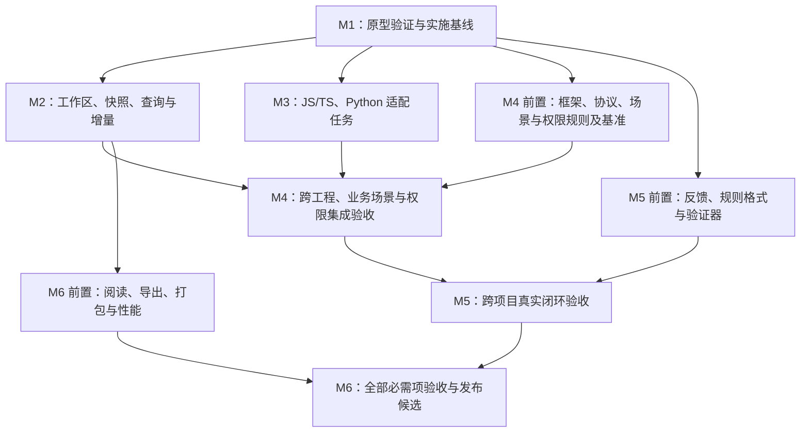

# CodeCartia（源图）完整推进方案

> 方案版本：0.4｜日期：2026-11-09｜依据：设计方案 v0.6、设计审查报告
>
> 进度同步：2026-11-10。M1-01 文档已交付；M1-02/03 当前为 0.2-draft，补入 R11 精确引用与 R12 最新请求发布世代。局部语义、业务发现、参考模型及独立评估已有实际执行入口，结果与未覆盖项见复审修复记录。产品应用及完整 M1 验收尚未完成，G1 未通过；继续以里程碑和依赖安排工作，不承诺发布日期。
>
> 范围修订：2026-11-12。按用户确认的 [D13](decisions/D13-初版语言验证范围.md)，初版只验证 JS/TS（含原生 JS、Vue、React、Node、Next、JSX/TSX、HTML 与配置）和 Python。Java、C#、C、C++ 及其专属框架/工具链实测延后，不阻塞初版 M1/G1、M3/G3、M6/G6，也不计为通过。既有 C# 局部实验保留为历史结果。范围入口为[设计方案 §5](CodeCartia-设计方案.md)。

## 1. 下一步建议与当前起点

2026-11-12 执行补充：静态完整工程加载、独立预期/拒错、受控真实 worker 与 SQLite 恢复已有首批交付，见 [G1 验证记录](progress/G1-工程加载与进程恢复验证.md)。当前任务应接续真实框架、外部独立项目、传播/业务授权及完整协议/语言接入，不重复已运行子集；本方案的完整阶段要求保持不变。

**当前处于 M1「契约与验证原型」。** M1-01 文档已完成；M1-02/03 的首次 0.1 文档交付保留在历史复核，当前 0.2 修订与局部验证见[复审修复记录](progress/M1-设计复审修复记录.md)。目标仍是形成可实现、可测量、可复现的实施基线。实际状态见[M1 任务清单](progress/M1-任务清单.md)，契约见[契约入口](contracts/README.md)。M1 还需完整协议/恢复、JS/TS 与 Python 的真实框架/项目加载、模式预算及独立准入冻结；局部实验通过不足以结束阶段。

当前仓库已经具备设计方案 v0.6、R01–R10 的设计修订、S01 的交付约束，以及用户确认的自动静态核心验收口径。业务场景与角色权限属于已确认的首版目标；本轮明确以“场景 → 步骤/动作 → 对象与业务规则”为语义和阅读主线，在每步关联参与者、角色映射、授权条件、数据范围及入口检查点。角色视图用于反查同一业务图中的场景步骤。继续保留 R08 不可信内容渲染、R09 HTTP 分发与可达处理链、R10 策略顺序与跨服务身份的确定结果对照。首版支持边界、授权模式与独立准入在 M1 冻结，不预设所有授权引擎及版本都受支持。尚未具备产品应用源码、真实分析 worker、产品包配置与运行命令、传播与业务/授权模式细表、冻结基准和任何实现验收成绩。

实施准备已有 M1-01 追踪、M1-02/03 草案、局部语义与业务发现实验、契约参考模型及独立检查。下文列出的完整应用、协议实现、初版范围内的模式细表和完整基准仍为后续要求；按[局部实验与独立评估](acceptance/M1-局部实验与独立评估.md)区分已执行子集与未完成条件，不能用局部或文档交付代替产品通过。

本方案承接以下文件，不替代已确认的产品需求：

- [设计方案 v0.6](CodeCartia-设计方案.md)：产品范围、业务主线及逐步骤授权绑定、架构与约束的依据。
- [设计审查报告](CodeCartia-设计审查报告.md)：问题来源、反例与验证要求的依据。
- [业务场景与权限验收样例](CodeCartia-业务场景与权限验收样例.md)：BS01–BS05、AP01–AP07 的后续实现规格，尚未执行。
- [工程导航](../AGENTS.md)：本工程的用途、实际状态、关键目录、必要边界及阅读入口。

## 2. 推进中保持的范围与原则

### 2.1 首版必须交付的内容

| 范围 | 首版要求 |
|---|---|
| 产品形态 | CLI＋本地 Web，多工程工作区、分析、查询、源码依据、图与文字阅读、导出 |
| 前端与全栈 | 原生 JS/TS、Vue、React、Node.js、Next.js；包含适用的 JSX、TSX、HTML 与配置分析 |
| 其他语言 | Python，独立满足深度分析要求 |
| 分析深度 | 项目/语法、语义、有限数据流、框架、跨工程关联与可复核阅读；适用能力分别验收 |
| 业务场景理解 | 沿“场景 → 步骤/动作 → 对象与业务规则”组织目标、触发、分支、异常及状态变化；每步关联参与者与适用授权，场景与实现双向定位，代码行为、业务意图及运行事实分别表达 |
| 步骤授权与角色反查 | 每步按入口上下文关联参与者、角色映射、权限/策略、动作/资源范围及实际检查点；角色视图反查同一业务图的场景步骤，原始未关联声明作为待核实诊断保留，不编造场景；支持模式和判定边界在 M1 冻结 |
| 跨工程 | JS/TS、Python 范围内的 HTTP、WebSocket、进程、文件及常见 FFI 调用边界；消息资源身份和关联契约须验证，具体消息/RPC 客户端与协议在 M1 覆盖清单中落实；延后语言内部及专属跨语言实现链路另行验证 |
| 质量 | 核心成绩来自自动静态分析；调用候选、必需关系、协议、完整链路及业务场景/角色权限分项分别准入，不将代码关系分数当作业务理解成绩 |
| AI 与持续改进 | AI 可选；首版完成反馈、AI 候选规则、独立项目验证、回归、固化与回退的实际闭环 |
| 兼容性 | 按设计验证 Windows、macOS、Linux；具体系统版本、架构、工具链及分发组合在 M1 冻结 |

本文后续的“各目标”“各语言”“各语义栈”和“全部必需项”，均限定为 D13 确认的初版 JS/TS、Python 及适用框架/组合；表中明确标为延后的条目仅保留后续设计。初版发布仍要求范围内各项分别通过深度验收，一条链路或局部适配器不能替代该范围的完整验收。Java、C#、C、C++、Spring、ASP.NET 及 JDT/Roslyn/Clang 专属验证不进入当前阶段阻塞项，未验证能力不得宣称支持。

本轮不为延后语言安装 SDK、编译器或镜像。Ubuntu/Docker 多语言环境作为后续可选准备，已有预览记录保留；JS/TS、Python 先复用现有环境，具体框架依赖按实验需要准备。公共 worker、快照、读取/渲染安全、业务授权及质量要求继续验证，范围调整不代表 G1 已通过。

### 2.2 实施中的约束

1. 先固定事实、证据、来源和验收契约，再让模块独立扩展；公共协议变更要进行影响检查。
2. 分析结果由真实源码、配置与语义输入产生；演示数据只验证展示和协议，不能计为识别能力。
3. 关系状态、来源和完整性分别保留。未知、冲突、截断和缺失输入均不得伪装成完整确认结果。
4. 98%／90% 仍是待基准验证的建议。M1 形成测量依据与冻结建议，不能直接把数字写成已批准门槛。
5. 已确认范围遇到困难时，记录阻塞并向用户提出问题；不得通过删除难例、缩小承诺或混入人工修正提高分数。
6. 前端项目和 JS/TS 工作区使用 pnpm；各原生 worker 保留对应生态的构建方式。依赖版本与实现栈以原型证据和决策记录冻结。
7. 目标工程分析遵守只读边界，不自动运行其应用、构建、生成器或安装脚本；本项目自身的开发构建与测试单独管理。
8. 每次工程改动同步维护根 AGENTS.md 和相关 README；提交、推送及对外发布按用户明确指令执行。

业务主线约束语义和阅读组织，不规定解析器必须先发现场景：允许先索引角色、策略与检查点，再按证据关联场景步骤。场景、对象、角色和策略保持可复用的独立实体及多对多关系；原始未关联声明保留来源、诊断和待核实状态，不删除事实，也不据此虚构业务。角色筛选和反查返回同一业务图中有依据的场景步骤与各自条件，不能形成脱离业务的授权清单；无场景归属的原始事实可在诊断中查看。

业务与权限实现还须遵守以下边界：业务参与者不自动等于系统角色；前端菜单或按钮可见不证明后端授权；身份认证不等于动作授权。角色继承、策略组合和允许/拒绝优先级必须来自实际源码、配置或已验证框架语义，不能使用统一假设。未找到校验点不等于匿名允许，未解析结果不能授予权限。租户、所有者、数据范围、多个入口和跨服务身份变化分别保留条件；同名角色、权限或业务动作不能据此跨上下文合并。没有角色系统但存在属性或资源关系策略时，在对应步骤直接展示主体条件及实际策略，不编造角色节点。业务前置条件与授权条件分别表达，通过授权不证明业务校验或操作成功。

业务意图可来源于用户说明、文档或 AI 辅助，但必须标注依据与核实状态；代码中识别的规则和异常不自动证明需求本意，静态可行步骤也不证明某次运行已经执行。自动提取、AI 归纳、人工整理及其派生结果沿用完整来源隔离。98%／90% 不自动成为新增业务或权限指标的门槛，各项另建真值、匹配定义及冻结决策。

## 3. 总体路线、依赖与阶段出口

沿用设计 v0.6 的六个里程碑。业务主线、逐步骤授权绑定与角色反查贯穿各阶段的首版交付；里程碑表示交付与验收边界，实际任务可以按稳定接口交叠推进。

| 阶段 | 主要目的 | 核心交付 | 阶段出口 |
|---|---|---|---|
| M1 契约与验证原型 | 证明方案可落地且质量可测 | 版本化契约、传播细表、业务/授权模式清单、独立准入矩阵、基准、各语义栈及布局/分发原型、决策记录 | G1：含业务与权限边界的深度分析实施基线冻结 |
| M2 核心工作区闭环 | 建立真实分析结果的公共承载能力 | 工作区、worker 编排、快照、存储、查询、增量、诊断、最小 Web；业务对象与权限关联纳入同一来源和失效体系 | G2：公共闭环可复现，失败与过期状态可信 |
| M3 首版语言并行适配 | 实现 JS/TS、Python 及适用框架的语义和传播能力 | 适配器、源码映射、语言/框架事实、业务对象/规则与角色/权限/校验点提取、逐项能力报告 | G3：初版范围内所有目标完成本阶段的分项验收 |
| M4 框架与跨工程集成 | 将局部事实组合为可信的完整链路与业务场景 | 首版框架覆盖、协议/资源关联、业务步骤/分支/异常/状态、角色权限条件判定、场景与实现双向映射 | G4：框架、协议、完整链路、场景和权限分项分别通过 |
| M5 跨项目改进闭环 | 将可核实反馈转成可回退的识别能力 | 反馈、候选规则、隔离验证、实际规则组合回归、规则版本与回退 | G5：至少一条真实闭环及另一独立项目复测通过 |
| M6 产品与发布验收 | 形成可安装、可理解、可维护的首版 | 代码及业务阅读、场景详情、角色权限矩阵、查询导出、兼容性/性能及独立质量报告、文档和发布候选包 | G6：首版所有必需项通过，形成可审阅发布候选 |

依赖判断落实到单个工作包：例如 HTTP 集成可以在所需前后端适配器具备事实后开始，不必等待初版范围内所有适配器实现完毕；G4 的整体通过仍要求初版全部承诺覆盖。M5 的规则格式与执行器可以提前开发，其效果证明必须使用真实分析结果。Web、打包和性能验证贯穿各阶段，最终在 M6 汇总。

业务场景组织依赖真实的业务对象、动作、条件与链路事实；逐步骤授权绑定还依赖校验点、策略组合及入口身份上下文。角色事实可提前索引，并在取得场景证据后增补绑定。主线、角色反查及导出使用同一语义结果；其展示可先用参考数据试验，但 G4/G6 必须使用真实分析产物，并与代码关系质量分别验收。

**主要完成路径是：M1 基线 → 公共核心与最慢必需适配器就绪 → 必需框架/跨工程链路及业务/权限集成 → 独立项目规则闭环 → 全部发布验收。** 排期时按实际依赖和可用负责人计算，不能把并行任务耗时简单相加，也不能假定增加子代理会等比例缩短工期。

## 4. M1：契约、基准与验证原型

### 4.1 M1 工作包

| ID | 工作包 | 具体产出 | 依赖与完成条件 |
|---|---|---|---|
| M1-01 | 需求追踪与覆盖清单 | 需求 ID、适配器/框架版本、关系类型、协议、输入条件、目标系统/架构、业务场景类型与授权引擎/模式清单；每项标记已确认或待决策 | 依据 v0.6；已完成的文档交付随业务主线修订同步维护，所有承诺有落点，不把授权模式默认推广到所有版本 |
| M1-02 | 统一契约草案 | 实体/关系/证据、源码坐标、调用上下文、来源、资源身份、业务场景/步骤/规则/状态；步骤到参与者、角色映射、策略、数据范围、入口检查点的绑定，以及快照与失效契约 | 依赖 M1-01；以 R01/R02/R03/R05/R06 及业务/权限样例校验；明确多对多复用、角色反查与原始未关联事实的诊断状态 |
| M1-03 | worker 与扩展协议 | 能力握手、协议版本、任务/快照/配置 ID、分批事实、诊断、取消、超时及完整性；日志独立 | 与 M1-02 协调；明确错误、部分结果和版本不兼容的行为 |
| M1-04 | 首版语义栈可行性原型 | JS/TS、Python 分别取得真实语义事实；前端/全栈验证模板、原始位置和环境边界；适用模式提取业务对象/规则及授权校验事实 | 使用草案协议，可反馈修改；不能仅凭 JS 样例推断 Python 可行，授权声明、校验绑定和策略判定分别验证；Java/C#/C/C++ 整体延后 |
| M1-05 | 有限数据流细表与预算 | 每个目标语言及适用框架的模式、前提、字段/别名、上下文、递归、计算预算、支持状态和正反例 | 原型先测量再冻结；落实 S01，未明确的模式不能声称支持 |
| M1-06 | 基准与评估器 | 标注规范、项目家族分区、冻结输入清单、候选/链路真值；另建场景组织、业务规则/异常/状态、双向映射、权限关联与条件结论真值和准入矩阵 | 与 M1-01/05/10 对齐；原型与发布成绩、代码与业务/权限成绩、自动与 AI/人工成绩分别报告 |
| M1-07 | 关键契约验证原型 | 上下文链路、失败查询失效、资源身份、来源隔离、规则合并/冲突，以及共享业务代码、步骤授权绑定与角色反查、先索引后关联、孤立声明诊断、HTTP 分发、策略顺序与跨服务身份的确定结果对照 | 使用人工可复核小工程；保留 R01–R10 与 BS01–BS05、AP01–AP07，追加 R11/R12 精确引用及发布反例；转换为可执行契约验证和产品回归，不改既有 BS/AP 组号；渲染原型与 M1-08 协作 |
| M1-08 | 工程化风险验证 | 只读语义输入、路径与编码、SQLite/worker 分发候选、布局引擎集成、业务步骤授权及同图角色反查的阅读原型、性能测量方式；不可信内容在 Web、HTML/SVG 导出及嵌入数据中的渲染契约和反例 | 核对设计 v0.6 候选方案及其第 9.1 节；报告实际环境、操作、结果与限制，CSP 不能替代输出转义与受限渲染 |
| M1-10 | 业务与授权模式边界 | 按语言/适配器及授权引擎版本列出场景组织、业务规则/异常/状态、逐步骤授权绑定、角色反查、原始未关联诊断、角色声明/继承、策略组合/默认行为、数据范围及身份传播模式；每项有前提、来源、预算、正反例与支持状态 | 依赖 M1-01/02，结合 M1-04/07 原型；不限制角色与场景的解析先后，具体引擎语义有依据，缺少外部策略、动态绑定或身份变换证据时保留未知 |
| M1-09 | 决策与基线冻结 | 选型记录、传播与业务/授权模式细表、预算、独立分项阈值和样本要求、版本/兼容清单、剩余风险及实施任务依赖 | 汇总前述证据及 M1-10，提交必要决策；通过 G1 后冻结 |

M1-10 延续 v0.2 新增工作包的编号以稳定追踪；它必须在 M1-09 的基线冻结前完成。R08 由 M1-08 定义渲染边界并与 M1-07 验证；R09 进入 M1-02/04/07 的路由事实与分发契约；R10 由 M1-06/07/10 冻结 AP02/AP04 的确定结果对照及 AP06 变更序列。

### 4.2 必须回答的契约问题

- **图与证据：** 实体和关系如何稳定识别；逻辑端点与精确版本事实引用如何区分；同 ID 多 revision、独立推导及合并版本如何唯一引用；原始位置、虚拟文件、宏展开和生成代码如何映射。
- **调用上下文：** 同一包装器的不同调用点如何实例化摘要；实参与形参、返回值如何对应；条件冲突与无法判定如何区别。
- **HTTP 分发：** 地址匹配候选与可达处理链如何区分；如何按框架版本保留注册/挂载顺序、继续、跳过、响应终止和错误分支；未知分发如何限制链路与权限结论。
- **快照与失效：** 输入如何冻结；成功/失败查询和候选集合如何登记；配置、依赖、生成输入及规则变化如何传递失效；完整结果如何原子替换。同发布范围按最后登记请求的持久化世代决定 current，旧请求完成只存历史；最新请求取消/失败不得恢复旧请求发布资格，见 [D12](decisions/D12-并发分析当前快照.md)。
- **资源身份：** 服务、进程和资源如何区分；工作目录、文件空间、共享挂载、broker 与命名空间如何参与解析。
- **来源隔离：** 自动事实、分析时 AI 辅助、人工覆盖及后续推导如何分层；人工标注真值如何与分析输入隔离。
- **规则执行：** 规则在哪个阶段读取哪些事实；兼容结论如何合并；冲突和显式覆盖如何保留依据；迭代预算和确定性如何保证。
- **读取边界：** 业务根、只读语义输入根、Web 可访问证据如何分别登记，符号链接解析和越界行为如何验证。
- **渲染边界：** 源码、文档、AI 文本、图标签及 URL 如何作为不可信输入处理；Web、HTML/SVG 与嵌入数据如何安全输出，如何验证恶意内容不能执行脚本或触发未授权请求；CSP 只作为补充防护。
- **业务场景：** 如何沿场景、步骤/动作、对象与业务规则组织目标、触发、分支、异常/补偿及状态变化，并逐步绑定参与者与授权；对象同一性、值版本、内存赋值、持久写入与事务提交如何分别确认；共享实现如何归属多个场景；名称、文档意图、静态行为和运行观察如何分别留证。
- **步骤授权与角色反查：** 角色、权限/策略、动作/资源和检查点如何独立建模并按入口上下文绑定步骤；角色反查如何回到同一业务图；先索引角色后取得场景时如何增补关联；未关联声明如何保留诊断而不编造场景。角色继承、多角色组合、允许/拒绝及默认行为依据实际语义判定，租户/所有者/数据范围和跨服务身份保留条件。
- **业务与权限失效：** 场景归并/拆分、步骤/入口解绑、角色声明、策略、校验位置和状态字段变化后，哪些绑定、反查、解释及矩阵单元重算或过期；如何保留其他场景仍独立支持的共享事实。

契约首先写出最小正反例，再形成结构定义与接口。所有阶段共用同一契约版本；适配器有扩展信息时保留其来源，不通过私有字段绕过公共验收。

### 4.3 语义原型与工程化实验

首版执行 JS/TS、Python、业务与授权及公共工程化实验。下表延后语言的内容作为未来恢复验证的依据；其专属环境、框架和项目加载不列入当前 M1 完成条件，已有 C# 局部报告仅保留历史事实。

| 原型线 | 至少验证的内容 | 需要记录的失败边界 |
|---|---|---|
| JS/TS、Vue、React、Node、Next | 跨文件符号与调用、请求包装器、模板/脚本映射、组件与路由事实、服务端/客户端边界 | 别名和 exports 缺失、不同编译器/框架版本、动态目标、源码映射失败 |
| Java（延后） | classpath 下的类型绑定、重载/调用候选、已有生成源码、Spring 注册事实样例 | 缺依赖/profile、绑定不完整、项目读取是否会触发脚本；不阻塞初版 |
| C#（整体延后） | 项目/程序集上下文、泛型/接口/委托候选、目标框架、ASP.NET Core 路由样例 | 引用或生成输入缺失、多目标配置、项目加载边界；既有 Roslyn 局部实验不计首版 |
| C/C++（延后） | 翻译单元编译参数、宏/头文件映射、函数指针/多态候选、已有生成头文件 | 系统头文件、目标平台、参数中的执行能力、模板与宏的定位限制；不阻塞初版 |
| Python | 作用域、导入/再导出、类型辅助/存根、装饰器/回调候选、路由注册样例 | 动态导入/猴子补丁、环境和搜索路径缺失；读取过程不能导入执行用户模块 |
| 业务与授权 | 业务对象与规则、成功/异常/状态分支；角色/权限声明、继承/组合、策略绑定和校验点；不同主体/租户/所有者/入口的条件关联 | 误导名称和过期文档、共享实现、菜单可见但服务端拒绝、未认证/已认证的授权差异、外部策略未知、跨服务身份缺失，不用名称或缺失检查填补结论 |
| 公共工程化 | worker 生命周期、存储读写/恢复、布局与标签、路径/Unicode/换行、目标平台打包试验 | 不支持组合、进程失败、内存/取消行为和具体兼容性限制 |

原型报告统一记录：输入及指纹、工具链与候选依赖版本、操作步骤、期望与实际输出、耗时/内存、失败样例、结论和替代方案。业务与权限原型另记场景/步骤绑定、主体/角色、数据范围、入口与环境、适用策略语义及未关联/未知原因。这里列出的技术路线沿用 v0.6 的候选方案；本推进文档不把候选版本或跨平台可用性视为已经验证。

探索原型采用隔离且明确标注的临时模块；未来若保留，可放入 `examples/prototypes/` 并说明用途。原型代码进入产品前需适配冻结契约并通过相应验证，不能直接将原型状态算作功能完成。

本次复审将[局部实验与独立评估](acceptance/M1-局部实验与独立评估.md)作为 M1-04/06/07/08/10 的共同入口：先由独立预期及评估器草案确定拒错行为，再运行语义实验，反馈模式与预算后按版本复测。业务发现使用不同领域/代码组织的输入，实际提取入口、跨函数步骤和检查绑定；不能用模拟 UI 或直接配置场景答案证明识别。JS/TS、Python 的真实项目加载另测脚本/生成器/插件和读取边界，内存语义 API 不替代项目加载验证。初版语言范围已由 D13 确认，具体版本、质量门槛和工具选型仍须证据后冻结。

### 4.4 G1：M1 完成判据

以下条件在 D13 确认的初版范围内必须同时满足；延后语言及其专属工具链/框架实测不阻塞 G1，也不得计作通过：

1. JS/TS、Python 与适用框架有明确覆盖条目、必要输入、责任角色及传播规则细表；业务场景类型和初版各适配器授权模式/版本/判定边界明确，不能把范围内未完成能力藏入“不适用”。
2. 图、worker、上下文、资源、业务场景、角色权限、来源、失效及规则组合契约有版本和正反例；JS/TS、Python 语义栈原型提供真实事实输出并经过复核。
3. R01–R12、S01、BS01–BS05、AP01–AP07 已落实为具备预期结果的基准；关键最小原型及评估器反例已执行，产品级全量验证明确分配到后续阶段。R08 覆盖各渲染上下文；R09 覆盖后置处理器遮蔽与条件继续；R10 覆盖仅交换 first-applicable 顺序、仅改变用户转发/服务主体替换就翻转允许/拒绝的对照，不能用未知输出通过确定结果用例。
4. 必需分项均明确样本、条件、统计方式和门槛；代码关系 98%／90% 建议的可测性、样本量和项目家族覆盖有依据；场景、业务规则/异常/状态、映射、权限关联与结论另行定义真值和门槛，最终冻结决策已记录。
5. 调用上下文深度、摘要迭代、候选数量和路径展开预算有测量依据；超限处理与召回率分母一致。
6. 工具链、目标平台、存储与布局的高风险问题已有可行路径。关键承诺若仍无法实现，G1 保持未通过并向用户说明问题与备选路径。
7. 业务主线中的逐步骤授权、同图角色反查、多场景复用与原始未关联诊断能够在原型和报表中验证，先索引角色再关联场景不丢失事实。业务参与者/系统角色、认证/授权、UI 可见/后端授权及意图/代码/运行事实分别表达；已冻结模式遇到外部策略、缺少校验绑定或未知身份时不会生成无依据的允许结论。

M1 不要求完整产品已达到最终准确率；它要求已定义如何可靠判断达标，并证明没有尚未处理的基础可行性障碍。原型成绩保留为原型成绩，后续实现仍要在冻结基准上重新验收。

## 5. M2：建立核心工作区闭环

### 5.1 实施内容

| 工作包 | 交付内容 | 主要验证 |
|---|---|---|
| 工程骨架 | 按实际需要建立 pnpm 工作区、CLI/Web、公共包和 worker 入口；锁定依赖，建立本地验证及 CI 配置 | 干净环境可安装并运行已交付部分，命令与文档对应 |
| 工作区与输入 | 多工程发现、环境选择、业务/语义输入登记、配置校验、doctor 诊断 | 缺工具、缺配置、外部依赖、已有生成输入及越界读取行为 |
| 编排与 worker | 任务状态、能力检测、协议校验、分批处理、取消、超时和失败恢复 | 单 worker 失败不造成无提示缺失，版本不兼容明确报错 |
| 存储与快照 | 事实/证据存储、冻结输入、快照切换、来源覆盖层、规则组合指纹、查询与搜索；保留独立的业务/权限实体及逐步骤绑定、多对多反查和未关联声明，记录实际使用的业务文档与解释输入指纹 | 不发布混合输入版本，未完成快照不替换完整快照；场景解释、授权绑定与原始未关联诊断保留来源、条件与完整性 |
| 全量与增量 | 可独立重建的全量路径，查询/集合依赖、失效传播、删除/移动和保守重算；场景归并/拆分、步骤/入口解绑、角色/策略、校验绑定及文档变化进入依赖，之前未找到场景归属/角色/检查的查询同样登记 | 每类变更后与同输入全量结果进行规范化比较，主线绑定、反查和矩阵同时更新，保留仍被其他场景独立支持的共享事实 |
| CLI 与最小 Web | `init`、`doctor`、`analyze`、`serve`、`query` 的可用闭环；查看关系、两侧依据、候选和诊断；可按场景、角色、权限/动作、资源及入口条件查询基础对象 | 从真实源码分析进入查询和原始位置；代码关系、业务意图与权限条件可区分，未解析不显示为允许 |
| 本地服务与渲染边界 | 回环、会话鉴权、Host/Origin、跨站请求防护、WebSocket 与证据访问范围；落实 R08 的不可信文本、受限富文本/图标签和 URL 安全渲染 | 业务访问与外部语义证据访问分别受限；恶意源码/文档/AI 内容不能变成脚本、事件处理器或越权操作，CSP 不代替渲染验证 |

上述命令是本阶段的预期交付，当前尚不存在。M2 初期可以使用受控 worker 和参考事实验证协议；G2 演示必须包含从真实源码自动生成事实的一条内部纵向链路，例如页面请求到后端处理器再到双方源码位置。选择具体样例时记录其覆盖与限制，不将样例外推为其他语言已支持。

增量先以正确性为先。不能精确判定失效范围时，允许扩大重算或全量重建，但须记录原因；随后在同一质量约束下优化性能。不得先以缓存速度为目标而容忍陈旧确认关系。

### 5.2 G2：M2 完成判据

- 相同冻结输入、工具链、规则组合和预算可以重建等价结果。
- 新增、修改、删除、移动、失败查询转成功、第二候选出现/消失、配置及语义输入变化均有增量对照用例。
- 分析过程中输入变化、用户取消、worker 崩溃及重启都有明确状态，旧快照和注释得到保留，旧证据不会冒充当前源码。
- 自动结果与覆盖层隔离，核心报告不受人工补边影响；公共服务、读取边界及本地 Web 的 R08 渲染反例通过验证。
- 业务场景、角色权限基础对象及逐步骤绑定可存取和双向查询；角色反查回到同一业务图，未关联声明可诊断，允许先索引后补关联。场景拆分/归并、策略/角色/入口或映射变更后，依赖的绑定、条件结论、说明与保存视图按快照重算或过期，自动结果不被人工整理覆盖。
- 用户能完成“添加工程 → 检查条件 → 分析 → 查询 → 查看双方源码 → 修改后重新分析”的真实闭环。

## 6. M3：初版语言适配

### 6.1 按能力拆分，按目标分别验收

初版共享 TypeScript 等技术底座可以减少重复实现，但不能合并 JS/TS 各框架与 Python 的验收成绩。下表保留 Java/C#/C/C++ 的后续适配方向；这些延后行不安排本阶段实测，也不构成 G3 的通过条件。

| 目标 | 本阶段交付重点 | 不能省略的独立验证 |
|---|---|---|
| 原生 JS/TS | ESM/CommonJS、作用域、exports/别名、引用/调用、有限传播、DOM 与请求事实 | 同名符号、再导出、动态入口、多层包装器及 HTML 入口 |
| Vue | Vue 2/3 对应解析路径、模板/脚本关联、组件、props/emits、暴露方法与状态事实 | 原始位置映射、Options API、script setup、全局注册及适用路由/状态库版本 |
| React | JSX/TSX、函数/类组件、props/回调、Hooks、副作用与请求事实 | 条件渲染、跨组件回调、作用域和 React Router 适用版本 |
| Node.js | 模块、入口、异步回调、调用与传播、路由/中间件/DI 基础事实 | Express、Fastify、NestJS 的实际挂载、注册顺序和分发控制事实，排除未挂载路由；按版本区分继续、跳过、响应结束与错误转交 |
| Next.js | App/Pages Router、模块环境、渲染关系、端点与服务端函数 | Server/Client Components、Route Handlers、Server Actions；不伪造普通 HTTP 地址 |
| Java（延后） | 类型/继承/重载、调用候选、传播及 Spring 事实 | 后续验证 MVC/WebFlux、DI、profile、classpath 和生成源码 |
| C#（整体延后） | 泛型/重载/接口、委托/事件、候选与传播、ASP.NET Core 事实 | 后续验证控制器、Minimal API、路由分组、DI、多 TargetFramework |
| C（延后） | 类型、宏、头文件、直接/函数指针调用、资源及进程事实 | 后续验证翻译单元参数、函数指针候选、不同宏/平台、生成头文件 |
| C++（延后） | 命名空间/重载/模板、继承/多态、传播及原生绑定事实 | 后续验证多态候选、模板与宏位置、目标平台和既有绑定模式 |
| Python | 作用域、导入/再导出、类型辅助、装饰器/注册、调用与传播 | FastAPI、Flask、Django，以及动态行为、存根、搜索路径和进程/文件/FFI 边界 |

以上按设计 v0.6 的 2026-11-12 范围修订区分初版与延后目标；首版具体版本、模式和平台以 M1 冻结清单为准，不表示所有历史与未来版本均支持。延后语言恢复验证前需重新准备环境、基准和对应阶段计划，既有局部实验不自动转为验收通过。

各适配器还须按 M1 的业务/授权模式表提取以下适用事实，并以原始源码或明确配置为依据：

- 业务对象、动作、规则判断、状态字段及读写/转换、持久写入/事务提交、异常/错误返回、补偿和触发入口；命名或注释只能作为线索，不能凭名称推导未出现的行为。
- 角色/权限声明与映射、继承、多角色/策略组合、资源动作绑定、路由/中间件/装饰器/方法内校验点，以及实际挂载与调用关系。
- 校验使用的主体、认证状态、租户、所有者和数据范围条件；角色与身份从何处取得，以及跨入口、跨服务或消息边界是否转换。

前端适配器记录菜单/按钮/路由守卫等可见性与交互限制事实，后端适配器记录其实际授权校验，二者分别分类再按证据关联。适配器可在场景尚未组织时输出角色、策略和检查点，保留原始身份及未关联状态，供 M4 绑定具体步骤；不得依赖虚构场景才能保存这些事实。首版范围内没有固定授权框架的工程按已冻结的配置/函数校验模式处理；不能为凑齐字段猜测角色或策略。未支持的授权引擎、未知外部策略和未绑定检查明确诊断。

各适配器采用同样的交付顺序：输入与诊断 → 符号/引用 → 调用候选 → 有限传播 → 框架及业务/授权事实 → 原始证据 → 增量与性能。HTTP 框架事实按 R09 保留版本、注册/挂载顺序及控制转移，供 M4 判断可达处理链；不能仅有地址列表。每一步提交可复现报告和限制说明，实际代码提交仍由用户指令触发。

### 6.2 G3：M3 完成判据

JS/TS、Python 及首版适用框架必须分别通过本阶段的模块/符号、调用、传播、框架事实、证据和输入条件测试。适用候选集合有独立成绩；声明支持范围内的未解析和超限计入漏报。语言报告显示实际工具链、框架版本、范围及所有未通过项；Java/C#/C/C++ 明确标为延后未验证，不进入初版 G3 阻塞项或通过数。

业务对象/规则/异常/状态与角色/权限/校验点提取分别按冻结模式验收；UI 可见性、认证事实和授权事实不得混类，声明与实际校验绑定必须可复核。各适配器对所声明支持模式分别报告正确、遗漏、误识别与未知，不能用普通引用成绩抵消这部分失败。

M3 验证适配器产出的深度事实及局部流程，M4 验证跨适配器的框架、完整业务链路、场景组织与权限条件判定。**对外宣称某目标达到完整深度要求，需要其 M3 与适用 M4 分项都通过。** 这样既允许语言开发和框架集成并行，也避免在跨工程和业务/权限能力尚未验证时提前宣布深度支持完成。

## 7. M4：框架、跨工程与业务场景集成

### 7.1 实施与验收矩阵

| 集成方向 | 交付内容 | 必须覆盖的反例 |
|---|---|---|
| HTTP | 调用点请求实例、方法/URL/baseURL、拦截器、代理/rewrite、服务映射；将地址匹配候选与按框架版本、注册/挂载顺序及控制转移推导的可达处理链分开 | 同路径不同服务/方法/环境；双调用者共享包装器；未挂载路由；参数/请求头/媒体类型不匹配；前置响应结束且不再转交、条件 next/跳过、错误分支及顺序变化 |
| 框架与全栈 | 组件/事件/状态到请求、路由/中间件/DI 到处理器、Next 跨边界关系 | 条件注册、动态入口、多配置混合、模块依赖与组件渲染关系混淆 |
| WebSocket | 服务、地址/挂载、订阅和处理注册、消息关联依据 | 同名事件不同服务、动态地址、消息格式未知 |
| 进程与文件 | 启动参数、工作目录、运行空间、管道、规范化文件资源与共享映射 | 隔离空间同路径；共享资源不同路径；同相对路径不同工作目录；缺必要配置 |
| 消息与 RPC 清单 | M1 冻结客户端/协议的资源及绑定规则；broker、命名空间和参与者分别建模 | 不同 broker 同名通道；同 broker 跨服务；动态通道名与不足的协议描述 |
| 常见 FFI | 首版验证 Node 原生桥接、ctypes/cffi 的 JS/TS 或 Python 调用侧声明与可读绑定依据；原生库内部、JNI、P/Invoke 及依赖延后语言的完整链路后续验证 | 动态库名、缺绑定配置、库内源码不可见；未知目标保持未知，不能生成不存在的实现位置或将调用边界识别当作原生库分析通过 |
| 完整链路 | 入口、必经传播步骤、参数绑定、条件组合、目标、来源及可行性状态 | 缺关键边、参数串线、互斥分支、同名变量误合并、预算截断 |
| 业务场景组织 | 沿场景 → 步骤/动作 → 对象与业务规则组织目标、入口、分支、异常/补偿和状态变化；每步关联参与者、适用授权及实现证据 | 共享代码被误并成同一场景；名称/过期文档代替代码证据；关闭入口仍被展示为可达；缺少异常/补偿证据时自行补写 |
| 步骤授权与角色反查 | 逐步骤绑定参与者、角色映射、权限/策略、数据范围、入口及检查点；从角色反查同一业务图中的场景步骤和各自条件；无角色策略直接绑定主体条件 | 角色/权限仅作为独立清单并列展示；未关联声明被编成场景；角色只能归属一个场景；参与者、可见性、认证被当作授权 |
| 权限条件判定 | 按实际继承、组合/默认规则和检查执行顺序，判定特定入口/身份/租户/所有者/资源条件下的授权结论或未知 | 擅用拒绝优先/角色并集；遗漏数据范围；多个入口共用处理器却共用权限结论；跨服务或消息身份变化未处理；未找到检查推成匿名允许 |

至少建立两类可复核的完整工程场景：一类覆盖前端请求到后端处理与数据访问边界；另一类采用合成视频分析系统等场景，覆盖控制请求、HLS 相关调用/资源、检测结果与原始帧 WebSocket、FFmpeg 写帧—调度器读取—Python 推理等关系。样例验证可静态证明的连接，不声称证明实际执行、时序、帧版本或真实耗时。

初版范围内各语言/框架仍使用自己的冻结基准与适用链路，不能用上述两个演示场景替代完整覆盖矩阵。外部程序或延后语言的实现只作为已有调用/配置证据可描述的边界，不要求为这些示例补装其工具链，也不据此宣称内部分析通过。

业务样例须覆盖同一业务对象的正常流程、条件分支、异常/补偿与状态变化，以及多个场景复用同一实现和角色；每步关联角色映射、授权条件、数据范围与实际入口检查点。角色权限样例覆盖不同角色执行相同动作、相同角色在不同租户/所有者/入口下得到不同条件结论，以及前端可见但服务端拒绝。BS01/BS04/AP07 另覆盖先索引角色后补关联、原始未关联声明诊断、场景解绑后保留其他关联，以及主线/反查/导出一致；不增组号，不要求运行目标工程来制造证明。

场景名称与业务意图的归纳和实际步骤证据分别存储；没有证据的规则、顺序、异常、补偿或状态不能补成已确认流程。状态转换保留对象身份、值版本和生效条件，内存赋值或仓储调用不自动证明持久提交成功，不拼接不同对象的读写。授权判定以特定入口到受保护动作的实际校验链为依据，声明策略存在不代表已绑定执行；规则组合或身份条件不完整时保持未知。授权条件与业务前置条件分别展示，通过授权不代表业务校验、事务或后续动作一定成功。显式匿名开放只有在对应模式、绑定和后续检查均可核实的范围内表达，不能从“未发现检查”推导。

R09 的实际检查链只采用在相应分发条件下可达的检查点；地址匹配或注册存在不能证明该处理器会被请求到达。响应写入或发送本身不等于语言层返回，须结合后续控制转移判断，不能遗漏显式继续调用；框架分发语义、顺序或条件无法解析时保留候选/未知。R10 使用相同入口主体、资源和业务前提的确定结果对照，分别只改变 first-applicable 中均适用的允许/拒绝策略顺序，或跨服务身份映射；已给全证据的允许/拒绝必须分别命中预期，身份映射缺失的独立反例才保持身份未知。

### 7.2 G4：M4 完成判据

- 各必需框架和协议分别通过；完整链路单独评估，不能只检查起点到终点可达。
- 正反例同时通过：既排除错连，也识别有证据的共享资源与合法多态；必要信息不足时有明确候选或未知状态。
- 框架注册/挂载顺序、控制转移、环境代理、资源映射和候选集合变化后，增量结果与全量重建等价；被遮蔽的处理器及其权限不得进入确认请求链。
- 每条确认链路可回溯到两侧源码、配置、调用上下文与推导依据；未知链路不计入确认完整链路。
- 业务场景组织、规则/分支、异常/状态与双向映射分别通过独立真值评估；逐步骤授权可展开，角色反查返回同一业务图。关闭或不存在的入口、共享实现、孤立角色/权限声明和过期文档不会形成无依据的场景结论。
- 角色权限关联与特定条件下的结论分别通过；角色继承、策略组合、租户/所有者/数据范围、多入口和跨服务身份不被省略，未知与冲突不变成允许。AP02/AP04 的 R10 确定结果对照通过，AP06 验证策略顺序与身份映射变化后的增量/全量一致性。
- 场景归并/拆分、步骤/入口解绑、业务对象/状态/校验点/策略及其绑定变化后，主线、角色反查、权限矩阵与实现映射的增量结果均与同输入全量结果等价；仍有独立依据的共享实体与其他场景绑定保留。意图、自动行为事实、AI/人工整理及运行观察的来源可区分。

## 8. M5：跨项目改进与规则回退

### 8.1 实施顺序

1. **反馈与归因：** 记录错连、漏连、环境错误、目标/位置错误和未解析项，并覆盖场景错误合并/拆分、业务规则或异常遗漏、角色权限关联与条件结论错误；绑定快照、证据、期望、理由及核实状态，先区分缺输入与分析缺陷。
2. **候选规则：** AI 使用允许的证据产生模式、前提、支持版本、受限规则、正反例和来源；可扩展业务事实提取、场景组织和授权模式识别。此处规则指分析规则，不改写目标工程的业务规则或授权策略；需要修改语义分析器的建议进入普通开发流程，不能作为任意程序直接执行。
3. **独立核对：** 根据源码、绑定、传播、配置与注册事实核验。AI 自评不能作为独立真值。
4. **项目内比较：** 从同一冻结原始输入分别重建旧/新规则的自动副本，只改变待评估规则及明确声明的组合；不改正式快照，不读取人工补边作为答案。
5. **独立项目验证：** 在未参与规则生成的项目家族验证增益与同类反例；单项目特例留在项目规则范围。
6. **实际组合回归：** 对启用的项目、工作区和公共规则组合测试重复、兼容、冲突、覆盖、执行顺序与预算；报告新增正确关系、错连、遗漏、候选及链路变化，单列业务场景/规则/异常/状态、权限关联与允许/拒绝/未知结论的变化。
7. **固化与复测：** 保存不可变版本、父版本、内容指纹、适用范围、依赖和验证报告；按审查流程固化，再在另一独立项目复测。
8. **停用与回退：** 切换有效组合，使直接及传递推导失效并重算；剩余规则仍支持的事实重新合并，保留旧快照和用户注释。

CLI 入口 `codecartia feedback`、`codecartia learn`、`codecartia rules` 在 M5 交付，分别覆盖反馈记录、候选生成与评估、规则查看/启停/回退。命令帮助、输入校验、诊断与退出状态同步验证；无 AI 配置时学习命令说明缺失条件，已固化规则的查询、应用与回退仍可用。

### 8.2 隔离数据与来源

基准按项目家族划分为模式发现、开发验证和保留测试。同仓库的不同提交、fork、复制模块和模板产物不能跨分区冒充独立项目。保留测试源码和标注不进入规则生成 AI 的上下文，也不提供给负责调参的开发代理。

保留测试失败后，如果样例被用于修改规则，须记录该暴露并调整后续评估分区；不得反复针对同一保留集修改后仍宣称是未见项目评估。数据使用权限、家族关系和指纹随基准版本保存。

已验证固化且运行时无需 AI 的规则可以进入自动分析模式。分析时调用 AI 的结果、人工覆盖及依赖这些事实的推导分别报告，不能重新标为纯自动。默认本地保存反馈；云端 AI 发送范围可查看并由用户选择，凭据不能进入索引、导出或样例。

### 8.3 G5：M5 完成判据

交付一条实际闭环记录：项目 A 发现遗漏并生成候选，经独立核对，在独立项目家族 B 验证、冻结基准回归和审查固化后，再在另一独立家族 C 复测。A/B/C 的角色、分区及访问范围须事先明确；不能把同一仓库的不同版本当作三个项目。

报告证明新增能力有依据、所有相关必需分项通过且旧核心基准没有未处理回归。演练规则停用、版本回退及规则冲突，验证回退后的增量与同组合全量结果一致。模拟 AI 输出可用于开发接口测试，G5 的完整闭环须包含实际 AI 候选生成记录。

涉及业务或授权识别的候选规则，必须通过对应 BS/AP 反例、独立场景/策略真值和条件结论评估；不得以链路增多或业务描述更流畅替代正确性，不得用 AI 自评或人工补齐污染自动成绩。回退检查覆盖派生场景、业务规则、权限结论和保存矩阵。原有 A/B/C 实际闭环要求保持，新增范围不以模拟记录替代，也不将闭环后移到首版之后。

## 9. M6：产品体验、兼容性与发布候选

### 9.1 产品与交付工作

| 方向 | 首版交付与验证 |
|---|---|
| 四类代码视图 | 系统总览、模块/文件、业务流程、符号/调用；图与文字切换，按需展开、隐藏数量、分组和筛选 |
| 业务阅读 | 默认沿场景 → 步骤/动作 → 对象与业务规则阅读目标、分支、异常/补偿及状态；在每步展开参与者、角色映射、授权条件、数据范围、入口检查点和实现依据，并支持业务与源码双向导航 |
| 角色反查与条件矩阵 | 作为同一业务图的筛选和跨场景反查，按场景步骤/动作/资源对比主体条件，保留策略、入口、检查点、数据范围、判定和未知；未关联原始声明在诊断中查看，不编造业务归属或压成统一可用/不可用 |
| 阅读交互 | 搜索、键盘导航、缩放、历史返回、布局稳定；两侧源码、候选比较、条件与推导依据；保存视图与人工注释 |
| 状态与恢复 | 各工程进度、缺失输入、未解析/截断、快照及过期状态；取消、重启和错误恢复后的可理解行为 |
| 查询与导出 | 扩展 `codecartia query` 查询业务主线、逐步骤授权及同图角色反查；交付 `codecartia export`，支持 JSON、Markdown/Mermaid、SVG、PNG、可交互 HTML，保留场景/步骤绑定、快照/解析状态、来源、权限条件和未关联诊断，分享时可移除绝对路径和源码；按 R08 验证 HTML/SVG、图标签/链接和嵌入数据的输出上下文，恶意内容不能成为可执行代码 |
| 可选 AI | 交付 `codecartia explain`；解释、概括、快照比较和辅助识别引用事实依据，业务命名/意图归纳与自动行为事实分层；未配置 AI 时说明缺失条件，静态分析、入口/对象/动作组织、场景与权限阅读、搜索和导出仍可用 |
| 性能 | 固定硬件及小/中/大工程，记录首次、单文件/跨模块/配置变化分析、峰值内存、取消响应、查询和布局表现 |
| 兼容与分发 | 对冻结的系统/架构/工具链组合验证安装、doctor、worker、存储、中文/空格路径、编码、大小写、符号链接和工具缺失 |
| 数据生命周期 | 工作区/快照版本识别、兼容诊断、备份及必要迁移；升级和回退不能无提示丢失注释与历史依据 |
| 开源资料 | 实测能力矩阵、安装/排障、示例、架构/扩展指南、贡献与问题模板、变更记录、依赖许可证清单及可复现质量报告 |

阅读效果通过具体任务验证，例如从页面找到后端处理位置、解释一条跨进程文件链路、定位某符号的调用候选，以及沿场景逐步说明对象、业务规则、参与者和授权条件。角色反查须回答“该角色参与哪些场景步骤、各自条件是什么”，并能回到同一主线；还须解释菜单可见但服务端拒绝、策略变化的影响和原始声明为何尚无业务归属，指出证据与未知。R10 对照在图、文字、矩阵及导出中须一致展示顺序/主体变化引起的不同判定与证据，不能只列角色名称。记录成功率、完成时间、错误理解和用户反馈；与目录阅读等基线使用相同任务。界面美观、描述流畅或节点数量不能替代这些结果。

性能门槛与测量方法在 M1 提出并冻结，后续阶段持续采样；达到 M6 时按同一口径验收。若需调整，记录原因和影响并重新评审，不临时更换更小工程来取得更好的成绩。

### 9.2 G6：发布阻塞条件

以下阻塞条件适用于 D13 确认的 JS/TS、Python 和共同产品要求；Java/C#/C/C++ 及其专属验证不阻塞首版 G6，但必须在能力清单中明确延后、未验证。出现以下任一情况，首版仍为未完成验收：

- 初版范围内任一目标语言仅完成语法索引，或任一必需关系、框架、协议、候选集合、完整链路分项未通过。
- 已冻结的业务场景组织、业务规则/异常/状态、双向映射、角色权限关联或条件结论任一必需分项未通过，或用代码关系总分替代这些成绩。
- 主线未按步骤关联授权、角色反查不能返回同一业务图，或为填满视图将未关联角色/权限编造成场景；主线、反查与导出的绑定及条件不一致。
- 将业务意图当作已实现行为、把未见运行的流程当作执行事实，或将菜单可见、已认证、未找到检查及未解析策略当作授权允许。
- 样本不足、分母为空、门槛未冻结、测试未执行，却被报表计为通过。
- 核心成绩混入分析时 AI 辅助、人工覆盖或由真值泄漏形成的配置。
- 增量/全量不一致、证据位置错误、快照混合版本、规则组合不确定或回退失效。
- 首版跨项目规则闭环未实际完成，或所谓独立项目属于同一项目家族。
- 声明支持的平台组合没有实测、安装包缺少必要组件，或读取/执行边界不符合设计。
- R08 的本地 Web 或交互导出渲染反例未通过，R09 将地址匹配候选直接当作确认处理链，或 R10 的确定结果对照未命中预期。
- 文档把规划写成实装，或能力清单和质量报告与发布候选不一致。

设计 v0.6 第 8.1 节的全部冻结 CLI 入口须验证帮助、输入校验、退出状态与诊断，并用真实输入验证相应功能闭环；业务主线、逐步骤授权及角色反查的查询/导出必须保留绑定、条件和来源，不能仅完成 Web/API 而将 CLI 视为已交付。

全部通过后，形成包含候选包、版本/依赖指纹、质量报告、已知限制、安装验证和回退说明的发布材料。本地生成和测试候选包属于本阶段交付；实际提交、推送、向注册表上传包及公开发布由用户明确授权触发。

## 10. 验收体系与审查问题追踪

### 10.1 冻结准入矩阵

矩阵以“适配器 × 适用框架版本 × 必需能力/关系 × 输入条件”为基础，关联协议、完整链路、业务场景类型、授权引擎/策略模式及平台清单。权限样本还记录入口、主体/角色、动作/资源、租户/所有者/数据范围和策略版本。M1 明确哪些组合为必需、哪些经说明不适用，以及跨组合覆盖方法；不默认要求无意义的全笛卡尔积，也不能遗漏已承诺组合。

D13 确认延后的 Java/C#/C/C++ 及其专属组合单独登记为“延后未验证”，不进入首版准入分母、通过数或阶段阻塞项，也不伪装成已通过或“不适用”。公共契约、业务/授权和质量反例仍在 JS/TS、Python 范围内落实；恢复延后语言时重新纳入对应基准及独立验收。

每个必需单元记录：需求来源、样本与家族数、正反例 ID、输入条件、支持范围、真值/匹配规则、统计方式、阈值、负责模块、报告位置及状态。必需关系精确率/召回率、候选集合、跨工程匹配和完整链路分别判定；业务场景组织、业务规则、异常/补偿、状态变化、双向映射、角色权限关联及条件结论各有独立真值与报告，不沿用 98%／90% 作为默认门槛。

- 候选集合按调用点、上下文和配置计算集合精确率、召回率与完全一致率；多态候选真值不等于某次运行的单一目标。
- HTTP 按 R09 分别核验地址匹配候选和可达处理链；确认链路须匹配实际分发条件、处理顺序及检查点，被前置处理阻断的候选不能计为处理链命中。
- 完整链路匹配入口、必经步骤、目标、参数绑定与组合条件；只匹配两端不算正确。
- 业务场景按冻结的入口、参与者/对象、步骤边界、分支、规则、异常与状态事实匹配，并核验每步与角色映射、策略、数据范围和检查点的绑定及同图反查；未关联原始声明按诊断真值核验，不补造场景。同名描述不自动相同，表述近义也不自动判错。业务意图和生成文案的评价独立于自动行为事实，不以文案质量填补缺失步骤。
- 权限关联与条件结论分别评估；识别出角色名或校验函数不等于已证明授权效果。真值明确绑定、策略组合、主体、资源及完整条件，分别统计错误允许、错误拒绝、遗漏关联和未知；不把未知当作安全拒绝或已授予。R10 的确定结果对照必须分别得到预期允许/拒绝，缺少身份映射的未知真值单独验收，不能混用两者的成功判据。
- 支持范围真值中的遗漏、未知、未解析和超限计入对应召回率分母，并分类报告原因。
- 零分母的单项指标按定义标记不适用，必需分项缺样本或门槛则为未完成验收；均不能按 100% 处理。
- 样本量、项目家族覆盖、聚合方式及必要的不确定性说明一同冻结，避免极少样本的高比例被宣传为通用成绩。

业务与权限核心验收同样从冻结源码、配置及必要语义输入自动重建，关闭分析时 AI 与人工覆盖；独立人工真值不参与提取。AI 归纳场景、人工整理角色矩阵和基于这些结果的派生输出分别报告，不能改变自动分数。代码分析通过、业务分项未通过时，整体首版仍未完成验收。

### 10.2 R01–R12、S01 的实施追踪

| 来源 | 基准与关键判定 | 最迟完成产品验证的阶段 |
|---|---|---|
| R01 | 双调用者、多层参数/返回、互斥条件、同名异作用域、超限；不能确认串线链路 | M3 局部传播、M4 完整链路 |
| R02 | 缺失输入出现、新路由/导出、候选扩大/缩小、目录/优先级变化；逐次比较增量与全量 | M2 公共能力，M3/M4 全部适用输入 |
| R03 | 隔离同路径、共享不同路径、相对路径不同工作目录、已知空间绝对路径但工作目录未知、不同 broker 同名、同 broker 跨服务 | M4 资源与协议集成 |
| R04 | 9,900 条引用正确但 100 条传播全漏仍拒绝；空样本、缺门槛、候选多余目标、链路缺边不能通过 | M1 评估器，M6 最终发布判定 |
| R05 | 三种来源分别报告；人工修正及其后续推导不改变自动分数；新旧规则同输入重建 | M2 来源隔离，M5 规则评估 |
| R06 | 外部必要语义输入、已有生成文件、缺失/出现/变化、符号链接越界；读取不触发构建，不扩大 Web 权限 | M2 公共边界，M3 各 worker |
| R07 | 重复/兼容/合法多态、条件差异、真实冲突、显式/无效覆盖、停用回退、打乱 worker 顺序 | M2 来源/缓存基础，M5 实际组合 |
| R08 | 不可信源码、文档、AI 文本、图标签及 URL，覆盖 Web、HTML/SVG 与嵌入数据；转义/受限渲染和链接边界独立验证，CSP 仅补充 | M1 契约/原型，M2 本地 Web，M6 导出 |
| R09 | 地址匹配候选与可达处理链分离；框架版本、注册/挂载顺序、next/跳过、响应结束且不再转交、错误分支；未知分发不确认，顺序变更后增量/全量等价 | M1 契约/正反例，M3 路由事实，M4 处理链及实际权限链 |
| R10 | AP02 仅交换 first-applicable 顺序、AP04 仅切换用户转发/服务主体替换，分别得到相反的确定判定；身份映射缺失另报未知，AP06 检查相关变更 | M1 样例/真值，M4 条件判定及增量，M6 一致展示 |
| S01 | 每条声明模式的正反例、字段修改后传参、闭包/回调、递归和预算边界；支持范围与分母一致 | M1 细表冻结，M3/M4 对应实现 |
| R11 | 同逻辑 ID 多版本的精确 FactRef；错版本/悬空引用、自支持、版本乱序与依赖失效；逻辑 EntityRef 不作推导证据 | M1 契约/参考模型，M2 存储，M3 worker 接入 |
| R12 | 同 slot 请求 A/B 乱序、最新请求取消/失败、重复登记及恢复；持久化世代比较与 current 切换原子执行，旧请求只存历史 | M1 契约/参考模型，M1-08 真实事务/恢复，M2 集成 |

所有条目都在 M1 定义基准和预期输出。后续状态采用“设计已修订 → 用例已定义 → 实现中 → 验证失败/通过”，附具体版本与报告。当前 R01–R10 仅完成设计修订或验收规格补充，S01 细表尚未交付；本方案不将其提前改为实现通过。

R11/R12 于 2026-11-10 复审追加；旧编号和产品验收要求保留。局部参考模型、分析实验、评估器拒错及剩余缺口统一见[复审修复记录](progress/M1-设计复审修复记录.md)，不将局部通过扩写成完整 worker 或产品通过。

### 10.3 业务场景与角色权限验收追踪

以下对齐设计 v0.6 第 10.5 节及[业务场景与权限验收样例](CodeCartia-业务场景与权限验收样例.md)。BS/AP 编号表示需求验收规格；本轮沿用 BS01/BS04/AP07 补充业务主线与步骤授权绑定，R10 继续追踪 AP02/AP04 确定结果对照及 AP06 变更验证；当前均未执行。

| 来源 | 基准与关键判定 | 最迟完成产品验证的阶段 |
|---|---|---|
| BS01 | 沿场景、步骤/动作、对象与业务规则组织流程，逐步关联参与者及授权；共享代码/角色可服务多个场景，不强行合并，不将孤立声明编造成场景 | M3 事实，M4 场景组织 |
| BS02 | 条件、对象身份、状态/提交、异常/补偿有依据；不同对象读写不拼接，缺少证据不编造步骤、顺序或分支 | M3 事实，M4 组合 |
| BS03 | 误导名称、过期文档和关闭入口不冒充当前业务行为；意图与实现分别报告 | M4 场景，M6 阅读 |
| BS04 | 场景、步骤授权与实现双向映射；先索引后补关联、场景归并/拆分及解绑后重算，保留其他有据共享关联、未关联诊断和完整来源 | M2 存储/失效，M4/M6 完整映射 |
| BS05 | 无 AI 的静态业务基线可用；独立真值、自动/AI/人工来源分开计分 | M1 评估器，M5/M6 完整报告 |
| AP01 | 业务参与者、系统角色、认证、UI 可见性和后端授权分别表示 | M3 提取，M4/M6 关联与阅读 |
| AP02 | 同名跨身份域、继承、多角色、允许/拒绝组合按实际策略语义；在 first-applicable 对照中仅交换均适用的允许/拒绝策略顺序即翻转确定判定，不假设统一优先级 | M3 模式，M4 条件判定 |
| AP03 | 租户、所有者与数据范围进入权限真值和条件，不省略为无条件允许；授权与业务前置条件分别表达 | M3 条件，M4 判定 |
| AP04 | 多入口、跨服务和消息边界身份变化分别追踪；用户转发与服务主体替换产生预定的相反判定，身份映射缺失才按对应反例保留未知；同处理器不等于同权限 | M4 入口/身份集成 |
| AP05 | 未发现检查、未绑定、外部策略未知与有证据的显式匿名分别处理；未解析不授予 | M3 诊断，M4 判定 |
| AP06 | 角色/权限/策略及 first-applicable 顺序、跨服务身份映射变化，来源分区、停用回退及增量/全量一致性 | M2 公共依赖，M4/M5 完整回归 |
| AP07 | 从业务步骤展开授权，再由角色反查同图场景步骤；主线/矩阵/查询/导出保留相同绑定、条件、证据、未知及来源，孤立声明诊断不替代业务主线 | M2 查询基础，M6 用户任务 |

M1 为每项冻结正反例、真值、支持模式、输入条件与门槛；M3–M6 按表逐项交付报告。没有角色但存在属性/资源策略时，按步骤绑定主体条件与实际策略；项目没有可识别角色或权限时说明未发现/不适用的依据及覆盖范围。已经识别但未关联场景的声明保留原始证据和待核实诊断，不生成通用角色、虚构场景或默认匿名权限来填满矩阵，也不要求先完成场景识别才能索引原始权限事实。

### 10.4 测试层次与证据包

| 层次 | 用途 | 运行时机 |
|---|---|---|
| 契约与评估器测试 | 校验结构、来源、状态、确定性、错误报表及发布否决逻辑 | 公共协议、评估或规则执行语义变化时 |
| 适配器正反例 | 测量真实符号、调用、传播、框架、业务/授权事实和源码映射 | 对应适配器或输入/规则变化时 |
| 变更序列对照 | 全量起点后逐次新增/修改/删除/移动/配置/规则变更，覆盖角色/策略/入口/状态与映射变化，与每步全量比较 | 缓存、依赖或相关适配器变化时 |
| 完整工程集成 | 跨框架、跨工程、资源空间、完整链路、业务场景与权限条件 | 相关依赖就绪后及集成变更时 |
| 规则独立验证 | 项目家族隔离、新旧组合比较、回退与无回归 | 候选规则固化前 |
| 不可信内容渲染 | 源码/文档/AI 内容、标签、URL 在 Web 与 HTML/SVG/嵌入数据中保持数据含义，不形成脚本、事件处理器或非预期网络请求 | 渲染器、图组件、链接处理或导出变更时，M2/M6 必验 |
| 性能、阅读、平台验证 | 固定环境测量、用户任务及安装/恢复 | 里程碑检查和发布候选验收 |

一次正式报告绑定源码/语义输入、配置、分析器/工具链、规则组合、传播细表与预算、真值/基准、评估器及环境的版本或指纹，并给出复现步骤。增量比较只忽略快照 ID、时间戳及无语义顺序，不能忽略证据、诊断、候选或完整性差异。

日常改动运行必要的受影响验证；公共契约变更、里程碑及发布候选按影响范围运行整套回归。CI 不以一条总百分比决定成功，应输出各必需分项的通过、失败和未完成状态。

## 11. 任务组织、子代理分工与进度管理

### 11.1 分工按职责安排，不预设人数

| 职责 | 主要责任 | 可并行的工作 |
|---|---|---|
| 主协调者 | 需求追踪、依赖安排、公共契约集成、决策与风险记录 | 汇总各线证据，维护真实项目状态 |
| 核心/协议执行者 | workspace、core、graph-model/store、adapter-sdk、业务与权限对象/来源/失效、输入和服务边界 | 在接口稳定后与各语言并行 |
| 语言执行者 | 首版 JS/TS 前端/全栈与 Python 两条语言线，包含适用业务事实与授权模式提取 | 各自实现、样例与报告；共享底座变更提前协调；Java/C#/C/C++ 暂不分派实测任务 |
| 框架/协议执行者 | 注册/路由/DI、HTTP/WS/消息/进程/文件/FFI、跨入口和跨服务身份关联 | 依赖事实就绪后逐条集成 |
| 业务/权限集成执行者 | 业务主线、逐步骤授权绑定、规则/异常/状态、条件判定、同图角色反查及原始未关联诊断 | 与适配器及界面并行，依赖真实事实、模式表和独立真值验收 |
| 质量复核者 | 标注、评估器、反例、家族分区、独立结果复核；代码、业务与权限分项分别管理 | 尽早于实现准备验收，避免用实现输出直接充当真值 |
| 产品/工程化执行者 | Web 代码/业务阅读、角色权限矩阵、查询导出、打包、性能、文档 | 基于契约/参考事实早期开发，随后替换为真实结果验收 |
| 规则闭环执行者 | 反馈、候选规则、验证、注册与回退 | 前期建立格式与执行器，后期完成真实闭环 |

这些是责任划分，同一人可以承担多个职责；人员不足时减少同时在制任务，不降低验收范围。优先将边界明确的开发、基准和独立复核交给一个或多个子代理，主协调者负责整合。

子代理任务明确输入版本、文件责任、输出和验收。避免多人同时改公共 schema、锁文件或根文档；需要共同修改时先协调所有权。开发代理不读取保留测试，复核代理不能直接复用实现输出作为正确答案。

### 11.2 工作包进入与完成条件

**可开始：** 需求和设计来源清楚，所需契约可用，输入/预期输出与正反例明确，前置任务满足，待决策事项不会影响本任务结论。否则先完成澄清或原型。

**可完成：** 交付物存在，必要测试/测量通过，适用反例覆盖，错误和降级有说明，报告可复现，相关 README 与 AGENTS 已同步，依赖方可以使用；需要独立复核的结果已经复核。代码写完或演示成功不能单独代表完成。

建议后续任务记录统一包含：任务 ID、需求/审查来源、负责人、前置项、负责文件、输入/输出契约、验证命令或步骤、报告、风险和状态。状态使用“待澄清、可开始、进行中、待复核、已完成、受阻”，进度以通过的交付物衡量。

### 11.3 排期与变更机制

按用户选择，本方案不编造人力、工期或发布日期。先执行 M1 的可行性验证，再依据任务拆分、可用负责人和实际测量形成后续阶段估算。每次阶段复核更新：已通过项、失败/受阻项、未决问题、关键依赖及下一批可开始任务。

需求、支持范围、契约或阈值变更记录理由、受影响模块、基准版本和重验范围。涉及已确认需求或仍不确定的产品取舍时向用户提出；不得由执行者静默改动。某条线受阻时，继续推进无依赖的工作，并保持相应阶段未通过。

## 12. 主要风险与应对

| 风险 | 提前发现的信号 | 应对与阶段影响 |
|---|---|---|
| 首版范围内工作量被低估 | 单一语言演示进展快，另一语言或适用框架只有解析器接入 | M1 对 JS/TS、Python 分别做原型；按最慢必需项规划，不继续擅自缩小 D13 已确认的首版范围 |
| 语义上下文获取不可行 | 项目加载触发脚本，或必须依赖缺失产物 | 单独验证元数据读取与工具链路径；提供诊断/可行输入方案，关键缺口阻塞 G1/G3 |
| 数据流失控或不可靠 | 递归不收敛、候选爆炸、链路串线、资源超限 | 冻结预算与降级状态；记录召回损失，用反例驱动修正，不能超限后仍确认 |
| 公共协议频繁返工 | 适配器不断增加私有语义，图模型无法表达 | 所有栈尽早输出样例；版本化评审与影响回归，避免先全面铺开 |
| 基准污染与小样本乐观 | AI 看到保留集、多个样本来自同一模板、只有净增益 | 家族分区、独立核对、记录暴露、报告样本量与新增错误；污染成绩不用于独立证明 |
| 增量或规则回退错误 | 全量正确但变化后仍保留旧确认 | 每步变更对照全量，记录失败查询和集合；必要时保守重建，未修复前阻塞对应验收 |
| 跨平台分发拖到末期 | 开发机正常，另一系统缺 worker/驱动或头文件 | M1 做打包试验，M2 起持续验证已冻结组合；实测不足不能声明支持 |
| 图已完成但阅读无效 | 图大而乱、证据跳转错、用户分不清候选 | 从 M2 做真实阅读任务；分层、文字链路、条件与来源同步验证 |
| 业务归纳超出证据 | 名称/文档代替行为、共享代码被合并成一个场景、凭空补齐异常/补偿 | M1 冻结模式与独立真值；M4 区分意图/行为/运行事实、保留未知，M6 验证从场景到依据的阅读任务 |
| 权限结论误合并或脱离业务 | 菜单可见或已认证被当成允许、角色清单没有步骤归属、忽略数据范围、多入口共用结论 | 按业务步骤绑定入口/身份/资源条件，角色反查回到同图；孤立声明保留诊断，冻结真实组合语义，AP 错误允许/拒绝单列，失败阻塞 G4/G6 |
| 授权模式无限扩展 | 把一个框架版本或自定义校验样例外推为所有授权引擎支持 | M1 按适配器/引擎/版本/模式冻结；动态与外部策略缺证据时诊断，不通过默认授予掩盖限制 |
| 业务与权限质量被总分掩盖 | 代码关系高分但场景缺关键步骤，或角色名正确而授权结论错误 | 组织、规则/异常/状态、映射、权限关联与条件结论独立准入，AI/人工不改自动分数 |
| 规则学习无法泛化 | 仅发现项目提升，独立项目错连增加 | 保留项目规则范围；增加独立反例并重新验证，G5 不通过 |
| 文档与工程脱节 | 新模块没有说明、README 提前宣称能力 | 每个工作包同步文档，阶段复核比较目录、支持矩阵、命令和报告 |

## 13. 待决策事项与最迟决策阶段

当前已经确认以业务场景、步骤/动作、对象与业务规则为主线，并将参与者及授权逐步绑定、角色作为同图反查视角的产品组织方式；独立实体复用与解析先后不受此阅读顺序限制。本方案明确推进顺序、交付与追踪方法，以及先完成 M1。以下支持细节和数值保持待决策，不在本方案中自行补值，也不重复将已确认目标作为待决定事项。

| 事项 | 需要准备的依据 | 最迟决策阶段 |
|---|---|---|
| 人员投入、可同时开展的任务 | 可用负责人、原型结果、拆分后的工作量与关键依赖 | 开始分派相应工作时；当前不承诺日期 |
| 语言/框架具体版本与平台/架构组合 | D13 确认的 JS/TS、Python 范围、工具链原型、测试/分发可行性 | M1 冻结前；延后语言不列入当前冻结 |
| 消息/RPC 客户端、FFI 绑定及配置模式清单 | 初版范围内已有产品要求、真实/合成工程与可取得协议证据 | M1 覆盖清单冻结前；JNI/P/Invoke 和原生库内部链路延后 |
| 传播具体边界与计算预算 | JS/TS、Python 正反例、性能/精度测量和降级代价 | M1 冻结前 |
| 业务场景组织、规则/异常/状态与映射的首版模式 | 已确认业务目标、各适配器可提取事实、BS 正反例及可复核命名/归纳方式 | M1 冻结前 |
| 授权引擎/版本、角色/策略及校验模式 | AP 正反例、源码/配置/框架语义、继承/组合/默认行为、数据范围与身份传播证据；外部策略未知边界 | M1 冻结前，不默认覆盖所有引擎 |
| 质量阈值、样本量、家族数与聚合方式 | 独立标注基准、评估器反例、原型分布 | M1 冻结前 |
| 业务与权限独立准入、条件规范化与计算预算 | 场景/规则/异常/状态/映射、权限关联与结论的独立真值、样本/家族覆盖、错误允许/拒绝与未知分布 | M1 冻结前，不沿用代码关系 98%／90% |
| 性能、阅读任务与兼容性准入 | 固定测量环境、工程规模、早期原型与用户任务 | M1 提出并冻结口径，后续变更须留记录 |
| Python 类型辅助、SQLite 驱动、图布局及分发方案 | 候选实验对比、限制、维护与许可证核对 | M1 冻结前 |
| 云端 AI 服务与可用证据范围 | 可配置接口方案、数据范围和使用成本 | 对应实际调用与 M5 闭环开始前；核心开发可先用隔离测试替身 |

冻结涉及范围、验收承诺或产品取舍时，向用户提供具体证据和推荐项后确认。常规已授权任务按确定契约执行，不把每个内部实现步骤都变成批准流程。

## 14. 文档、目录与最近一批行动

### 14.1 后续产物建议位置

以下位置沿用实施建议。**M1-01 已创建四个覆盖/追踪目录；`docs/contracts/` 已有 M1-02 四份统一契约及 M1-03 worker 主协议/独立正反例规格，`docs/progress/` 记录交付与文档复核。协议实现、传播/业务/授权细表、完整分析基准和产品源码尚未创建。** 既有图解、体验原型及可运行采购示例用途见 [文档索引](README.md)与根 README，不能算作产品分析实现。

| 位置 | 用途 |
|---|---|
| `docs/contracts/` | 已有 M1-02 四份事实契约、M1-03 worker 协议及独立正反例/实验规格；schema 与协议版本独立，所有草案待运行反馈与冻结 |
| `docs/capabilities/` | 语言/框架/授权引擎版本矩阵、传播与业务/授权模式细表、预算和输入条件 |
| `docs/acceptance/` | 独立准入矩阵、标注规范、候选/链路/业务/权限真值定义，以及 R/S/BS/AP 验收追踪 |
| `docs/decisions/` | 选型、范围、阈值及变更的依据与决策记录 |
| `docs/progress/` | 工作包、依赖、阶段状态和受阻事项 |
| `fixtures/`、`benchmarks/` | 正反例、冻结输入清单、评估器、变更序列、性能和质量复现 |
| `apps/`、`packages/`、`workers/` | 沿用设计 v0.6 第 11.1 节的产品与分析模块，随实际实现创建 |
| `rules/`、`examples/` | 已验证公共规则、可公开合成样例与用途明确的原型 |

受保护的保留测试数据按冻结的数据隔离安排管理，不能因为建议了仓库目录就向开发/规则生成代理开放。公开可复现基准与保留测试的职责分别记录。

### 14.2 建议下一次实施从这些任务开始

| 顺序 | 行动 | 完成后可审阅的结果 |
|---|---|---|
| 1 | 依据 M1-02/03 草案为 JS/TS、Python 准备 M1-04 的原始输入、候选工具/探索版本、事实字段/坐标和缺输入反例；前端/全栈保留环境边界 | 首版两条语言线的实验规格与输入/环境缺口可复核，不将命令版本输出当可行性证明；不安排延后语言安装 |
| 2 | 并行准备逐语言传播与业务/授权模式细表、独立验收矩阵模板，并用各栈原型反馈统一契约 | 关键术语和输出一致，R01–R12、S01、BS01–BS05、AP01–AP07 有条目和预期；跨语言事实核对有真实依据 |
| 3 | 由独立复核角色建立 M1-06 最小反例/评估器预期，并按 M1-03 独立规格准备协议接收、取消/恢复的 M1-03/07/08 实验 | 产品分析真值与受控协议消息分开；候选/链路/业务/授权及失败处理有独立判据 |
| 4 | 分派 JS/TS、Python、公共关键契约、业务/权限组合和阅读、布局/打包的原型任务 | 每条首版线返回真实结果、失败边界和冻结建议 |
| 5 | 汇总证据，向用户提出仍需决定的范围/预算/门槛/选型 | 决策可审阅，不能实现的承诺有清楚说明 |
| 6 | 逐项检查 G1，形成基线版本，再派发 M2/M3 及可并行的 M4/M5 前置任务 | 后续开发依据稳定，所有必需目标继续处于首版计划中 |

**当前最有价值的下一份交付是「M1 实施基线与原型验收包」**：统一契约、逐语言传播及业务/授权模式细表、独立准入矩阵、反例基准、原型报告和待决策结论。完成并通过 G1 后，再按真实依赖扩展产品实现。
