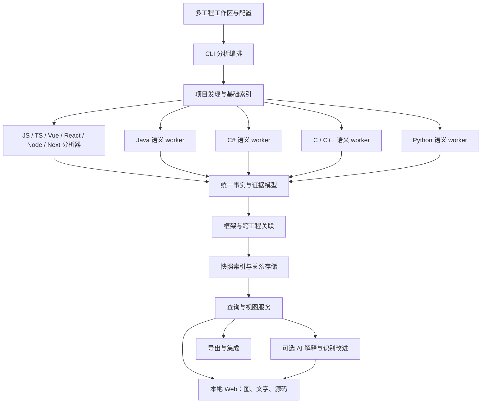
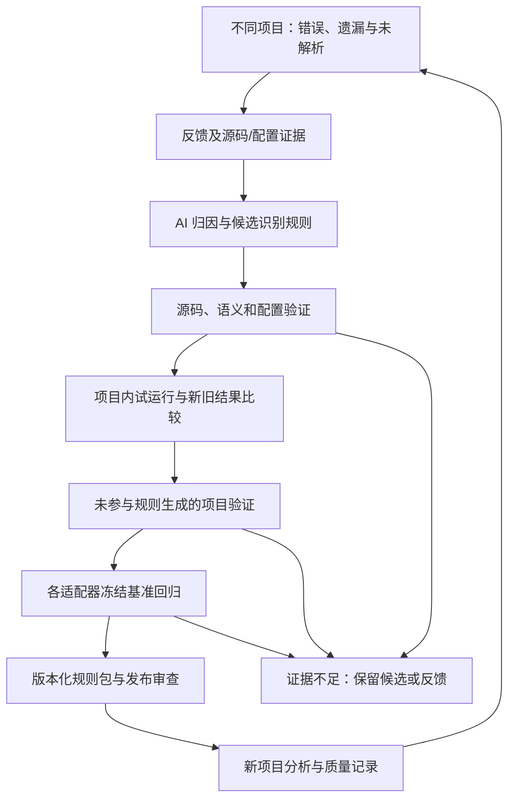

# CodeCartia（源图）设计方案

> 设计版本：0.3｜日期：2026-11-09｜状态：审查问题已补齐设计契约，待原型验证，尚未实施
> 产品描述：面向开发者的本地跨语言代码理解与架构探索工具。
> 标语：看清代码如何相连，每条关系都有依据。

本文件是 v0.3 设计方案，根据对 v0.2 的[审查报告](CodeCartia-设计审查报告.md)复核补齐了调用链路、增量失效、资源身份、质量准入、语义输入和规则组合契约。用户已确认核心验收采用自动静态分析结果，AI 辅助和人工修正另行报告；建议质量数值仍待基准验证。

下文的功能、命令、技术选型、支持矩阵和工程目录均为设计目标；当前仓库处于文档阶段，尚无可运行的 CLI、Web 界面或分析器。已确认需求与待验证的实现建议分别列明，首版支持能力和准确率需通过实施验收后才能对外声明。设计契约补齐不代表实现验收通过，第一里程碑还需冻结传播规则细表、计算上限和分项门槛。

## 1. 已确认需求与项目名称

### 1.1 已确认需求

- 面向其他开发者的通用开源项目。
- 交付形式为 CLI＋本地 Web 界面。
- 前端工程覆盖原生 JavaScript、Vue、React；同时支持这些工程常用的 TypeScript、JSX、TSX、HTML 与配置文件。
- 后端工程覆盖 Java、C#、Node.js、Next.js、C、C++、Python。Next.js 按全栈框架分析。
- 首版所有目标语言同步达到深度分析要求；内部可并行实现，首版发布以各适配器分别通过验收为前提。
- 静态分析提供可追溯的证据；AI 可选用于解释、整理、辅助识别，以及从不同项目的错误和遗漏中归纳改进规则。
- 首版包含跨项目迭代机制：收集反馈、生成候选规则、验证与回归、版本化固化；通过独立项目评估是否真正提高识别准确性。

### 1.2 项目名称

**英文名：CodeCartia。中文名：源图。** 本仓库采用该名称。

Code 表示代码，Cartia 取意于 Cartography（制图）。名称表达将跨文件、跨工程和跨语言的源码关系绘成可探索的地图。建议 CLI 名称与包名使用 `codecartia`，配置目录使用 `.codecartia`。

CLI 名称与包名属于设计约定，发布前需核对实际命名与注册状态。

## 2. 产品目标与分析深度

产品优先帮助开发者回答以下问题：

1. 项目由哪些应用、模块、进程和数据资源组成？
2. 一个页面操作会到达哪些接口、处理函数和数据访问代码？
3. 一个函数、组件或类被哪些位置使用，可能调用哪些目标？
4. HTTP、WebSocket、消息、文件和原生库如何连接不同工程？
5. 修改某项功能，哪些关系可能受影响？依据在哪里？

### 2.1 统一的深度定义

| 分析层 | 首版要求 | 产物 |
|---|---|---|
| 项目与语法 | 识别工程边界、入口、声明、导入及原始源码位置 | 文件、符号与配置索引 |
| 语义 | 解析作用域、模块、类型、引用、重载和调用候选 | 可定位的符号及引用关系 |
| 有限数据流 | 常量与别名传播、函数参数/返回值摘要、常见请求包装器追踪 | 带条件的传播与调用关系 |
| 框架 | 识别组件、路由、注册、依赖注入、请求与约定形成的关系 | 页面、端点、处理器和注册事实 |
| 跨工程 | 根据协议、配置与证据关联不同工程 | 请求—端点及进程/资源关联 |
| 解释与阅读 | 分层视图、源码依据、候选比较、文字链路 | 可探索且可复核的阅读界面 |

“有限数据流”支持第 5.3 节要求逐语言冻结的传播规则，不承诺任意程序的完整运行行为。静态调用目标可能是一组候选；动态注册、反射、条件执行等保留条件和未解析状态。当前矩阵描述能力类别，不代表具体传播模式已经完成定义或实现。

缺少编译环境时可以提供部分结果，但该结果不能计为对应语言的“深度分析完成”。

### 2.2 与图形渲染型工具的设计差异

SeeCode 已提供仓库摘要、证据链接、图形渲染和交互展示。CodeCartia 将源码关系分析作为核心，采用语义分析器和框架规则建立事实，再生成视图。AI 提出的关系和识别规则经证据校验与回归后才能进入确认结果；已经固化的规则可在不调用 AI 时运行。[SeeCode 扫描实现](https://github.com/Aryanutkarsh/SeeCode/blob/main/skills/seecode/scripts/lib/scan/scan.mjs)

质量比较应使用相同输入工程、相同标注关系和相同分析范围，分别测量错误与遗漏；本方案不预先宣称已经优于任何现有产品。

## 3. 用户流程与界面

### 3.1 主要流程

1. 在 CLI 或本地 Web 中建立工作区，添加一个或多个工程。
2. 查看工程识别结果、所需分析器、已取得配置和缺失条件。
3. 选择分析环境，例如开发代理、生产部署或某个编译配置。
4. 从系统总览进入页面、接口、模块、文件、类或函数。
5. 沿关系追踪，查看分支、条件、候选与跨工程连接。
6. 点击节点或关系查看原始源码、双方位置和分析依据。
7. 保存阅读视图与人工注释，导出文档或交互图。
8. 源码变化后查看受影响关系，更新索引与保存视图。

### 3.2 界面布局

- 左侧：工作区、工程、入口和符号搜索。
- 中间：关系图与文字链路，可随时切换。
- 右侧：选中对象的说明、关系、条件和源码依据；关系详情同时展示起点与终点。
- 状态区域：各工程分析进度、缺失条件、未解析数量、结果快照和是否完整。

产品界面用“已确认、存在候选、待核实”等可理解的语言表达可信程度；编译器、解析规则等技术细节放在依据面板中。

### 3.3 四种核心视图

| 视图 | 内容 | 主要用途 |
|---|---|---|
| 系统总览 | 应用、服务、进程、数据库、消息与外部资源 | 建立整体认识 |
| 模块与文件 | 模块依赖、文件引用、边界与循环关系 | 找到阅读和修改位置 |
| 业务流程 | 页面事件、请求、端点、处理逻辑、数据资源 | 理解一个功能如何联动 |
| 符号与调用 | 类、函数、方法、引用和调用候选 | 深入阅读具体实现 |

展开时按关联范围加载，并显示隐藏数量。布局优先保持原有位置，减少用户失去阅读方向。大图使用分组、筛选和层级展开；文字链路、键盘导航、缩放、搜索和历史返回均为首版能力。

动画用于讲解步骤和保持视觉连续性。没有运行时证据时不展示真实耗时，也不把图中路线称为真实执行轨迹。

## 4. 总体架构



### 4.1 推荐实现栈

| 模块 | 建议 | 原因与验证要求 |
|---|---|---|
| CLI 与编排 | TypeScript＋Node.js | 与 JS/TS 分析器集成方便；语言 worker 在独立进程中并行运行 |
| 本地 Web | React＋TypeScript，pnpm＋Vite | 支持复杂阅读状态、组件复用与交互开发 |
| 基础语法层 | Tree-sitter 或等价语法索引器 | 提供增量与容错索引；深度关系由语义分析器确认 |
| JS/TS 语义 | TypeScript Compiler API | 使用工程、符号与类型信息处理模块和引用 |
| Vue | 对应版本的 SFC 编译器及模板适配 | 联合分析模板与脚本，映射回原始源码 |
| Java / C# / C/C++ | JDT / Roslyn / Clang 独立 worker | 使用对应生态的编译上下文与语义能力 |
| Python | AST、作用域与模块解析；类型信息及存根辅助 | 支持常见类型推导和框架关系，保留动态候选 |
| 持久化 | SQLite＋快照文件 | 本地部署简单，支持索引查询、全文搜索与增量失效 |
| 图与布局 | 优先验证 Cytoscape.js＋ELK.js 的布局适配 | 图查询与交互和分层布局分开；用原型验证路由、标签与性能 |

Tree-sitter 提供语法树基础；TypeScript 的 Program 和 TypeChecker 提供符号与类型信息；Vue 官方 SFC 编译器将模板和脚本作为不同部分处理。[Tree-sitter](https://tree-sitter.github.io/tree-sitter/)、[TypeScript Compiler API](https://github.com/microsoft/TypeScript/wiki/Using-the-Compiler-API)、[Vue compiler-sfc](https://github.com/vuejs/core/tree/main/packages/compiler-sfc)

Cytoscape.js 提供图分析与可视化；ELK.js 负责计算布局位置。两者的集成、标签碰撞和大图性能必须通过原型验证后锁定。[Cytoscape.js](https://js.cytoscape.org/)、[ELK.js](https://github.com/kieler/elkjs)

### 4.2 适配器与 worker

分为三类扩展：语言适配器输出符号与语义事实，框架适配器输出组件/路由/注册事实，协议适配器输出请求与跨工程关联。

统一协议包含能力握手、任务 ID、源码快照、配置 ID、分批事实、诊断、取消、超时和完整性状态。日志与协议输出分离。版本不兼容的 worker 明确报错，进程失败不能让整个工作区无提示地丢失结果。

不要求开发者安装全部工具链。CLI 按当前工程检查并启用相关 worker；缺失工具时提供明确诊断与部分结果。

## 5. 首版语言与框架能力矩阵

语言深度分析均为已确认的首版要求。以下框架集合是本设计提出的首版覆盖边界；每个框架及版本需在实施前落实为可测试清单。

| 目标 | 深度分析要求 | 首版框架或关键语义 | 必要输入 |
|---|---|---|---|
| 原生 JS/TS | ESM/CommonJS、作用域、模块别名、符号引用、调用与请求包装器 | HTML 脚本入口、DOM 事件、fetch/XHR/WebSocket | tsconfig/jsconfig、package exports、工作区及构建别名 |
| Vue | SFC 模板与脚本、组件绑定、props/emits、ref 暴露方法、状态与请求 | Vue 2/3 对应解析路径、Options API、script setup、Vue Router、Pinia/Vuex | Vue/编译器版本、别名、路由及全局注册配置 |
| React | JSX/TSX、函数/类组件、props/回调、Hooks、副作用和请求 | 常见 React Router 与请求封装；条件渲染保留条件 | TS/JS 工程配置、构建别名及路由配置 |
| Node.js | ESM/CommonJS、启动入口、模块/符号、异步回调和调用候选 | Express、Fastify、NestJS 的路由、处理器、中间件与注册规则 | 入口、依赖版本、挂载和 DI 配置 |
| Next.js | 全栈文件路由、模块环境、组件渲染、服务端函数和端点 | App/Pages Router、Server/Client Components、Route Handlers、Server Actions | Next 版本、目录约定、指令、配置与 rewrite |
| Java | 类型绑定、继承、重载、符号引用、调用候选和有限数据流 | Spring Boot 的 MVC/WebFlux 路由、常见 DI 和数据访问边界 | JDK、classpath、源码根、profile 和生成源码 |
| C# | 类型/泛型/重载、接口、委托、事件、调用候选和有限数据流 | ASP.NET Core 控制器、Minimal API、路由分组与 DI | solution/project、程序集引用、TargetFramework 和编译选项 |
| C | 类型、头文件、宏、直接调用、函数指针候选、资源读写与进程边界 | 系统调用、FFI 与配置可识别的协议接口 | 编译数据库、include、宏、语言标准及目标平台 |
| C++ | 类型/命名空间/重载/模板、继承、多态候选和有限数据流 | 原生模块、跨语言绑定与已有协议描述 | 每翻译单元编译参数、生成头文件、sysroot 和目标平台 |
| Python | 作用域、导入/再导出、类型辅助、调用候选、装饰器和注册 | FastAPI、Flask、Django 路由；常见进程/文件/FFI 边界 | 工作区根、解释器环境、搜索路径、存根和框架配置 |

Java 绑定需要 classpath 与源码上下文；Roslyn 的语义依赖源码、引用和编译选项；Clang 工具需要翻译单元的编译参数；Python AST 本身不能完成作用域和运行语义检查。[JDT ASTParser](https://help.eclipse.org/latest/topic/org.eclipse.jdt.doc.isv/reference/api/org/eclipse/jdt/core/dom/ASTParser.html)、[Roslyn 语义分析](https://learn.microsoft.com/en-us/dotnet/csharp/roslyn-sdk/get-started/semantic-analysis)、[Clang LibTooling](https://clang.llvm.org/docs/LibTooling.html)、[Python AST](https://docs.python.org/3/library/ast.html)

### 5.1 Next.js 的独立边界

模块依赖关系、组件渲染关系和运行环境分别存储。`use client` 的模块边界与组件父子渲染关系不同；Server Component 可作为内容传入 Client Component。Server Actions/Functions 使用单独的跨边界关系，不伪造普通 HTTP 地址。[React use client](https://react.dev/reference/rsc/use-client)、[Next.js 服务端与客户端组件](https://nextjs.org/docs/app/getting-started/server-and-client-components)

### 5.2 多配置与无法确定的行为

- Java 的构建 profile、C# 的目标框架、C/C++ 的宏与平台、JS 的部署环境均进入分析上下文。
- 同一源文件在不同上下文中可产生不同关系，不合并成无条件执行图。
- Java 反射、C# dynamic/反射、Python 动态导入/猴子补丁、JS 动态求值和 C/C++ 间接调用分别显示候选或未解析原因。
- 二进制库只记录可取得的符号/元数据及调用边界；缺少源码时不生成虚假的实现位置。
- README 与发布说明公开列出各语言、框架、版本和功能的实测支持范围。

### 5.3 有限数据流规则表与交付约束

第一里程碑必须为第 5 节所有目标语言及适用框架分别交付版本化传播规则表。常量与别名传播、函数参数/返回值摘要和常见请求包装器追踪是已有深度要求，须落实为有前提和正反例的具体模式。

| 必须逐项细化的模式 | 规则表需要说明的边界 |
|---|---|
| 常量、别名与字符串/路径模板 | 支持的表达式、赋值与值版本、别名失效、动态值处理 |
| 参数、返回值与多层请求包装器 | 调用点绑定、返回对应、跨函数传播与上下文合并方式 |
| 对象字段读写及配置修改 | 字段区分、对象别名、覆盖赋值、动态字段、逃逸后处理；包含创建配置对象后修改 `url` 再传入包装器的用例 |
| 闭包捕获与回调 | 捕获变量的值版本、回调实参与目标绑定、异步边界和顺序未知的处理 |
| 递归、循环与动态修改 | 摘要迭代方式、收敛条件、截断及未解析原因 |

每条规则记录语言/框架及版本、模式 ID、支持状态与前提、调用上下文、字段与别名处理、跨函数/递归方式、计算上限、超限状态及正反例 ID。对象字段、闭包、回调等具体模式尚需原型确定边界，不能默认为全部支持，也不能通过临时删减已确认能力提高验收分数。

调用上下文深度、摘要迭代次数、候选数和路径展开等计算预算须显式冻结；不支持、缺失输入和超限分别诊断。信息合并或截断导致无法判定时，输出候选、未解析或“链路可行性未知”，不得变为无条件确认。规则表及其指纹进入快照与评估配置，与第 10.2 节真值范围一同版本化；范围变更重新运行相关回归。规则表未完成前不能冻结深度分析实施基线。

## 6. 统一关系与证据模型

### 6.1 实体与关系

实体包括工作区、工程、环境、文件、符号、组件、页面、端点、请求、进程、数据库、消息通道、文件资源和外部库。

关系至少包含导入、引用、静态调用候选、组件渲染、传参、事件绑定、路由注册、依赖注入、发送请求、处理请求、订阅/发布、文件读写、启动进程与 FFI。

实体 ID 由工程身份、文件身份、限定符号和签名等组成。行号用于定位，不单独充当稳定 ID；重命名或移动时保留显式匹配记录。

运行资源的身份另外包含资源所属空间，不能直接套用源码文件 ID：

- 进程记录服务、启动位置、选定环境、可取得的工作目录与主机/容器/文件系统命名空间；空间来自配置或明确元数据，不能仅凭“同一生产环境”推断共享。
- 文件资源在对应文件空间内解析；存在明确共享卷或挂载映射时使用共享资源 ID 与卷内规范化路径。相对路径结合所属进程工作目录解析，已知空间内的绝对路径不依赖工作目录。同空间资源关联不要求跨空间挂载映射；必要空间信息缺失、相对路径所需工作目录未知或跨空间所需共享映射缺失时保留未知状态。
- 消息资源身份包含 broker、命名空间或虚拟主机、通道类型与名称，以及适配器所需的绑定规则。参与者的服务身份记录在发布/订阅关系与来源中，不作为拆分同一 broker 共享资源的依据。
- 工作目录、运行空间、共享挂载及 broker 映射保留配置来源和指纹，作为第 8.2 节资源解析与失效依赖。

### 6.2 每条关系的必要字段

| 字段组 | 内容 |
|---|---|
| 身份 | 关系 ID、起点、终点或候选集合、关系类型 |
| 出处 | 原始源码范围、文件指纹、外部元数据来源 |
| 推导 | 分析器版本、规则 ID/有效规则组合、推导步骤及关联证据；调用点、上下文与参数/返回值绑定摘要 |
| 条件 | 工程、环境、编译配置、分支和注册条件 |
| 来源 | 自动静态、分析时 AI 辅助、人工覆盖、运行时观察及完整依赖来源链 |
| 状态 | 已确认、候选、冲突、未解析；来源不代替解析状态 |
| 完整性 | 缺失输入、截断、过期状态和受影响范围 |

关系类型与解析状态分开：语义确认的调用目标仍可能是多态候选，不等于该目标在运行时已经执行。多候选关系保留原始候选及排除理由。

源码坐标统一规定，并保存原生坐标以便调试。TS/Roslyn 的字符串位置、Clang/Python 的字节位置、Unicode 和换行差异都要测试。Vue 虚拟文件、C++ 宏展开和生成代码保留映射；映射失败时明确说明。

AI 生成的线索单独存储。没有分析器证据或人工确认时，不能升级为已确认关系。人工补边、删边、选定候选等修正保存为独立覆盖层，保留作者、理由、原始自动结果和作用范围，源码改变后重新检查。独立人工标注真值不作为分析器输入。

推导继承其输入事实的完整来源；使用 AI 辅助或人工覆盖的事实再运行规则，也不能重新标为纯自动结果。AI 曾参与生成、但已经验证固化的规则可以在不调用 AI 时参与自动分析，其生成来源仍保留。质量验收按第 10.2 节隔离结果来源。

### 6.3 调用上下文与链路组合

调用点与被调用符号分别标识。函数摘要保存形参与实参、返回值与调用结果的绑定，按调用点和入口上下文实例化；不能汇总共享包装器的所有实参后，再把汇总目标分配给每个调用者。跨函数展开保留调用与返回的对应关系，条件引用绑定后的符号和值版本，不能仅凭变量名匹配。

业务链路沿上下文兼容的关系与参数绑定展开，组合沿途分支、注册、环境及参数约束。对同一绑定值已知互斥的条件排除该路径；不同作用域或不同值版本的同名变量不能被误当作同一条件。

链路结果区分“在所列条件下可静态关联”和“链路可行性未知”。只有所需关系与条件在声明支持规则内可验证时，才可作为确认完整链路；无法判定、摘要不完整、缺失输入或超过第 5.3 节预算的结果必须保留未知原因。静态关联不证明实际执行、事件时序或某次运行的目标。

例如，页面 A 调用 `request('/users')`、页面 B 调用 `request('/orders')` 时，包装器内 `fetch(path)` 的请求按各调用点绑定推导；不能确认 A 到订单端点的链路。多层包装器和互斥分支按同一契约处理。

## 7. 跨工程与业务链路识别

### 7.1 HTTP 关联流程

1. 沿符号和有限数据流追踪 fetch、Axios、XHR 及通用请求工厂，按第 6.3 节保留调用点和参数绑定。
2. 按调用上下文收集方法、URL 模板、baseURL、参数、拦截器修改、调用入口和条件，不能将不同调用者的请求模板混为无条件结果。
3. 按选择的环境应用开发代理、rewrite、网关前缀和服务映射。
4. 提取后端完整路由、方法、参数约束、媒体类型、处理器及注册证据。
5. 根据服务、方法、路径模板和约束匹配；输出精确匹配、模板匹配、歧义候选或未匹配。
6. 展示两侧源码和配置推导，允许人工确认服务对应关系。

不能只比较路径字符串：相同路径可能属于不同服务、方法或环境；Spring 的映射还包含参数、请求头和媒体类型条件。[Axios 请求配置](https://axios-http.com/docs/req_config)、[Vite proxy](https://vite.dev/config/server-options#server-proxy)、[Spring 请求映射](https://docs.spring.io/spring-framework/reference/web/webmvc/mvc-controller/ann-requestmapping.html)

### 7.2 非 HTTP 关系

| 边界 | 首版识别方式 | 不确定性处理 |
|---|---|---|
| WebSocket | 服务身份、地址与挂载、客户端订阅和消息处理注册 | 服务、消息格式或动态地址不明时保留候选 |
| 消息队列 | broker/命名空间、exchange/topic/queue、绑定及发布订阅配置 | 资源空间或运行时名称不明时保留候选并等待配置补充 |
| 文件握手 | 同一已知空间内解析读写资源，跨空间通过明确共享卷/挂载映射关联，保留进程参数和轮询依据 | 必要空间信息、相对路径所需工作目录或跨空间所需映射不明时保留候选；资源一致不证明文件版本、时序或实际握手 |
| 子进程 | 启动调用、程序/参数模板、工作目录、可证明的运行空间继承、管道及文件输出 | 动态程序名、工作目录或空间不明时保留未知信息 |
| FFI | Node 原生桥接、P/Invoke、JNI、Python ctypes/cffi 及已知绑定模式 | 库内实现不可见时停在可证实的调用边界 |

首版必须验证 HTTP、WebSocket、进程、文件和常见 FFI 关系。消息/RPC 适配器的具体客户端与协议列入发布清单；任意自定义协议通过扩展规则补充。

同路径的不同隔离容器文件不能确认相连；共享卷在两个进程中的不同挂载路径应通过映射关联。同名 topic 位于不同 broker 时不能关联，不同服务连接同一 broker 的同一资源则可按发布订阅证据关联。缺少运行配置时只保留候选，配置补齐或变化后重新计算。

视频分析系统可作为跨工程验收场景，重点验证“控制请求、HLS 视频、检测结果 WebSocket、原始帧 WebSocket”和“FFmpeg 写帧—调度器读取—Python 推理”的关联。该场景用于验证 HTTP、WebSocket、进程和文件边界，不限定产品的应用领域；开源测试仓库使用合成工程或具有合适授权的公开工程。

## 8. CLI、数据管理与 AI

### 8.1 CLI 命令设计

| 命令 | 目的 |
|---|---|
| `codecartia init` | 建立工作区配置，添加工程与环境 |
| `codecartia doctor` | 检查分析器、工具链和配置缺失 |
| `codecartia analyze` | 全量或增量分析，输出快照、诊断和质量摘要 |
| `codecartia serve` | 启动本地 Web 阅读界面 |
| `codecartia query` | 查询符号、端点、关系、候选和影响范围 |
| `codecartia export` | 导出阅读视图、关系数据和证据报告 |
| `codecartia explain` | 可选解释已有证据；未配置 AI 时静态功能正常可用 |
| `codecartia feedback` | 记录错连、漏连、目标错误和未解析反馈 |
| `codecartia learn` | 根据允许使用的项目证据提出候选规则，运行比较与回归 |
| `codecartia rules` | 查看项目/公共规则包、版本、验证结果、启用和回退状态 |

以上为接口设计，尚未实现可执行命令。

### 8.2 快照与增量

缓存键包含源码与必要语义输入指纹、依赖、构建/运行配置、分析器版本、有效规则组合及覆盖配置、传播规则表与计算预算。删除和移动文件必须删除或迁移旧实体。

增量依赖不仅记录已解析事实，还记录查询与集合：

- 模块、符号、端点和资源查询，无论成功或失败，均记录查询键、搜索范围、环境/配置、解析优先级和观察到的结果指纹。成功查询仍依赖完整候选集合，不能仅依赖已选中的目标。
- 目录成员、源码根、导出表、路由注册集合、依赖/生成输入和资源映射集合均有版本或指纹。新增文件、符号、端点、第二候选或原先缺失的生成输入时，使相关查询与旧未解析结果失效；删除、配置变化或候选缩小时同样重新计算。
- 失效沿查询、集合、事实、摘要与跨工程关联的依赖传递。无法精确确定范围时扩大到相关工程/配置，必要时全量重建，不能继续使用可能过期的确认结果。

分析使用冻结的输入清单；期间发现输入变化时重试或将变化纳入下一任务，不能发布混合源码/语义输入版本的完整快照。在相同输入、配置、分析器、有效规则组合与预算下，增量和全量的实体、关系、证据、候选及诊断必须等价；比较只忽略快照 ID、时间戳和无语义输出顺序。

用户保存的视图绑定分析快照。源码改变后标明过期关系，保留人工注释；更新完成前不能把旧源码位置显示为当前依据。中断的分析快照不得替换完整结果。

### 8.3 可选 AI

AI 用于解释当前选择、概括已有关系、整理流程、比较快照，以及辅助识别未解析模式、归因错误和生成候选规则。解释与改进建议必须引用事实 ID 和源码依据；模型适配独立于核心分析器。跨项目改进通过第 13 节的验证闭环进入正式规则。

用户可以选择本地或云端模型。发送的证据范围可查看，默认不发送整个仓库。API 凭据不进入索引、导出和开源样例。未配置 AI 时分析、搜索、图、源码查看和导出均可运行。

### 8.4 导出

首版提供关系 JSON、Markdown/Mermaid、SVG、PNG 与可交互 HTML。导出时保留快照和解析状态；分享版本允许移除绝对路径和源码片段。动画视频导出可在核心质量验收后另行扩展。

## 9. 兼容性与执行边界

- 默认读取源码、静态配置和已有构建元数据，不启动目标应用、不控制硬件、不自动运行工程的构建脚本。
- Java/C# 的项目加载及构建工具求值作为单独能力处理；缺少生成产物时显示影响，不悄悄触发构建。
- C/C++ 编译数据库作为数据读取，不把其中的 command 直接传给 shell；分析参数需要处理插件加载和任意程序选项。
- 按 Windows、macOS、Linux 分别验证 CLI、Web、worker、路径大小写、编码、符号链接和工具缺失行为。
- C/C++ 工具链还要分别验证系统头文件、目标平台和 Windows 工程的编译上下文。
- 不同架构的 worker 单独打包；不支持的组合在能力列表中明确显示。
- 索引和工作区配置放在用户选定目录；目标源码目录保持只读。业务索引默认排除依赖目录、构建产物、日志、媒体、上传数据和凭据文件；业务排除规则不直接作为语义 worker 的读取禁令。
- 按选定工程与配置只读加载必要的 package exports、类型定义、程序集/库元数据、系统头文件、存根和已有生成源码/头文件。输入登记来源、规范化路径、指纹、所属配置与依赖结果；变化或原先缺失的输入出现时按第 8.2 节失效。外部或生成输入保留来源标识，不默认展开成业务代码图。
- 业务源码根与只读语义输入根分别登记。工作区外 SDK、依赖缓存或生成目录，只有明确登记且来源可核验时才允许 worker 读取；路径和符号链接解析后仍须落在对应登记范围。缺失、未登记或无法验证的输入给出诊断，不自动构建、生成或下载。
- 本地服务默认绑定回环地址，限制可访问的工作区范围；不提供任意命令执行接口。
- 浏览器访问校验 Host 与 Origin，默认拒绝跨域。源码读取、扫描、配置修改和 AI 调用采用会话鉴权；状态修改及外部模型调用加入跨站请求防护，WebSocket 同样校验 Origin。Web 通用文件接口只访问登记业务根；外部语义证据仅通过已登记证据 ID 提供受限内容，不能开放任意路径浏览。超出对应业务根或语义输入根的路径与符号链接访问必须拒绝。

回环绑定还需配合域名和来源校验；Vite 官方文档说明了放开 allowedHosts 可能产生的 DNS 重绑定与源码访问风险。[Vite allowedHosts](https://vite.dev/config/server-options#server-allowedhosts)

Gradle 配置阶段会求值构建脚本，CMake 配置可启动进程，Clang 参数可加载插件，因此读取编译上下文与执行构建必须分开设计。[Gradle 生命周期](https://docs.gradle.org/current/userguide/build_lifecycle.html)、[CMake execute_process](https://cmake.org/cmake/help/latest/command/execute_process.html)、[Clang 插件](https://clang.llvm.org/docs/ClangPlugins.html)

## 10. 质量验收

### 10.1 基准工程

每种语言和首版框架维护人工标注的正例、反例和完整流程。关系真值与环境条件一起记录，允许多态候选集合。测试数据不包含用户私有源码、凭据或业务数据。

必须覆盖：同名符号、重载、别名、再导出、动态入口、条件注册、未挂载路由、注释代码、生成源码、多编译配置、代理重写、多个后端、Next 跨边界、文件握手、消息与 FFI。

### 10.2 建议发布目标

**核心验收口径已由用户确认：自动静态分析。** 从冻结的原始源码、必要语义输入和配置重建，使用指定版本分析器及已固化规则，分析时关闭 AI 辅助和人工覆盖。人工标注真值独立保存，不参与推导；AI 辅助结果和人工调整结果分别报告其基线、来源、差异与质量，不改变自动分析分数。

已验证固化、运行时不需要调用 AI 的规则属于自动分析输入。输入配置须有独立依据，不能把标注答案或人工补边伪装为必要配置。以下 98%／90% 等数字仍是建议目标，并非已实现结果或已冻结门槛；建立标注基准后验证其可测性，在第一里程碑冻结各必需分项的定义与门槛。

| 指标 | 建议门槛与口径 |
|---|---|
| 自动分析已确认核心关系精确率 | 建议每适配器及适用必需关系类型分别 ≥98%；真值/预测按相同上下文与条件匹配，仅计算自动结果中的已确认核心关系 |
| 自动分析声明支持范围召回率 | 建议每适配器及适用必需关系类型分别 ≥90%；支持范围真值中的遗漏、未解析和超限计入漏报，并单独报告原因 |
| 证据可复核 | 所有已确认关系均有源码或明确元数据依据；本地位置逐项核验 |
| 增量与过期关系管理 | 新增、更新、删除、移动、候选集合和配置变化后旧证据失效或更新；同输入增量与全量语义结果等价 |
| 调用候选集合 | 按调用点、配置和上下文独立评估集合精确率、召回率与完全一致率；门槛在第一里程碑冻结 |
| 跨工程匹配 | 方法、服务、路径、环境、运行资源空间及歧义用独立基准评估，必需协议分别准入；门槛在第一里程碑冻结 |
| 完整业务链路 | 按入口、必经步骤、目标、参数绑定和组合条件独立评估完整链路精确率与召回率；门槛在第一里程碑冻结 |
| 完整性 | 所有截断、失败、缺失输入和未解析状态显式报告 |
| 兼容性 | 发布清单中的系统/架构/语言/框架组合逐项通过 |

**分项准入：** 依据第 5 节能力矩阵与第 6.1 节关系类型，逐适配器冻结必需分项矩阵、样本、输入条件及门槛，覆盖适用的模块/符号、调用与传播、框架关系、跨工程协议和完整链路。所有必需分项分别通过，适配器整体平均值不能抵消任一分项失败。分项不适用须给出与已确认能力一致的理由；缺少样本、分母为零或尚未冻结门槛标记“未完成验收”，不能自动判为通过。不得移除承诺的核心能力以提高汇总分数。

**候选集合：** 真值是支持范围内按调用点、配置和上下文可静态成立的目标集合，不是某次运行调用的目标。设预测为 P、真值为 T，分别计算 `|P∩T|/|P|`、`|P∩T|/|T|` 及集合完全一致率，逐调用点评估后按冻结方式汇总。T 非空而 P 为空时召回率为零；零分母的单项指标标记不适用，不按 100% 处理。负例另行检查无关候选和错误确认；空输出、未解析与超限数量全部报告，不能只衡量预测是否包含正确目标。

**完整链路：** 用有限的人工标注流程冻结入口、必经传播步骤、目标、参数绑定、条件及链路规范化规则。只有完整且满足这些约束的预测链路才计为正确；缺失必经关系、参数串线或已知互斥条件拼接均为失败，不能只比较起点/终点可达性。可行性未知和截断结果单独报告，不计为确认完整链路；对应支持范围真值仍计入召回率分母。静态链路成立不证明实际执行。

报表同时给出语言、框架、关系类型、输入条件、分析模式、有效规则组合、传播范围与基准版本，保留新增错连、遗漏、未解析、候选和链路变化。所有必需分项的定义、样本与门槛未冻结前，不能以本节建议数值宣称发布验收通过。

### 10.3 性能与阅读效果

在固定硬件上记录首次分析、单文件变化、跨模块变化、配置变化、峰值内存、取消响应和图查询耗时。至少覆盖小、中、大三档工程，工程文件数和符号数由脚本记录。

图形验收包含标签碰撞、不同层级下的可读性、布局稳定性、候选表达、文字视图、键盘导航和错误恢复。

使用“从一个页面找到后端处理位置”“解释一条视频识别链路”“找到某符号的调用候选”等任务评估理解效果，与目录阅读和现有工具比较，不仅评价画面外观。

### 10.4 审查反例与回归交付清单

以下用例纳入第一里程碑的基准设计，并在相应模块实现后验证。当前是验收要求，尚无执行结果。

| 来源 | 必须覆盖的正反例 | 判定要求 |
|---|---|---|
| R01 | 双调用者共享请求包装器、多层传参与返回、互斥分支、不同作用域同名变量、超限路径 | 不确认参数串线或条件冲突链路，未知与截断状态明确 |
| R02 | 缺失模块/生成输入出现、新增导出与路由、第二候选增加/删除、目录及解析优先级变化 | 每次变更后与同冻结输入全量结果比较，事实、证据、候选及诊断等价 |
| R03 | 隔离容器同路径、共享卷不同挂载路径、不同工作目录同相对路径、工作目录未知但同一已知空间内绝对路径相同、不同 broker 同名通道、同 broker 跨服务发布订阅 | 排除不同资源的错连，识别有证据的同空间或跨空间共享资源；缺少必要空间信息只保留候选，不将工作目录和挂载映射作为所有访问的前提 |
| R04 | 9,900 条普通引用正确但全部 100 条关键传播遗漏；缺少必需分项样本、候选集额外目标、完整链路缺边 | 即使汇总召回率为 99% 也拒绝通过；空样本不算通过，候选和完整链路独立判定 |
| R05 | 相同输入的自动、AI 辅助和人工调整结果；人工补齐漏边；基于辅助结果的后续推导；新旧规则重建比较 | 自动分数不随覆盖层变化，来源完整继承，相同输入评估可重复 |
| R06 | 构建目录中生成源码/头文件、工作区外类型/程序集/存根、输入变化或缺失后出现、符号链接越界 | 必要且登记的语义输入可读并触发失效，缺失有诊断；未登记读取被拒绝，分析不触发构建或生成 |
| R07 | 重复/兼容命中、条件不同与合法多态、重叠条件的互斥结论、显式覆盖与无效覆盖、停用及回退、打乱 worker 完成顺序 | 保留来源和冲突依据，同有效规则组合与配置输出确定，回退重算受影响结果 |
| S01 | 每项声明支持模式的正反例，包括字段修改后传参、闭包/回调、递归与预算边界 | 支持状态、计算上限与真值范围一致，未定义模式不能宣称支持 |

## 11. 工程组织与实现里程碑

### 11.1 建议目录

以下是实施阶段的目标目录，不代表当前仓库已经创建这些模块。当前实际目录参见[仓库 README](../README.md)。

```text
codecartia/
├─ apps/
│  ├─ cli/                    # 工作区、分析、查询与导出命令
│  └─ web/                    # 本地阅读界面
├─ packages/
│  ├─ core/                   # 编排、配置、快照与增量
│  ├─ graph-model/            # 实体、关系、证据和协议 schema
│  ├─ graph-store/            # 存储、搜索与查询
│  ├─ workspace/              # 多工程发现与环境
│  ├─ adapter-sdk/            # 语言/框架/协议扩展契约
│  ├─ analyzers-js/           # JS/TS、Vue、React、Node、Next
│  ├─ framework-adapters/     # 框架注册、路由、组件和 DI
│  ├─ cross-project/          # HTTP/WS/消息/文件/FFI 关联
│  ├─ viewer/                 # 视图、布局、依据与文字链路
│  ├─ ai/                     # 可选模型、证据解释与改进建议
│  ├─ feedback/               # 错连、漏连、未解析与人工反馈
│  ├─ rule-learning/          # 项目画像、模式与候选规则
│  ├─ rule-validation/        # 语义验证、独立项目与回归
│  ├─ rule-registry/          # 规则包、版本、适用范围与回滚
│  └─ export/                 # 数据、文档和图形导出
├─ workers/
│  ├─ java/
│  ├─ dotnet/
│  ├─ clang/
│  └─ python/
├─ fixtures/                  # 各语言/框架人工标注基准
├─ rules/                     # 经过验证的公共规则与合成复现样例
├─ benchmarks/                # 质量、性能与可复现测量
├─ examples/                  # 可公开的使用示例
├─ docs/                      # 设计、能力矩阵和扩展指南
├─ LICENSE                    # 项目许可证
├─ AGENTS.md                  # 工程功能与目录说明
├─ README.md                  # 实际功能、安装与限制
└─ pnpm-workspace.yaml
```

### 11.2 内部里程碑

1. **契约与验证原型**：冻结实体/关系/证据、调用上下文、资源身份、查询失效和规则组合协议；交付各语言有限数据流规则表与预算、必需分项准入矩阵、候选集合和完整链路真值/评估定义、审查反例基准；验证各语义工具链与图布局集成。
2. **核心工作区闭环**：完成多工程、快照、诊断、查询、本地 Web、取消和增量管理。
3. **所有语言并行适配**：各语言 worker 与 JS/前端/全栈分析线同步推进，分别通过深度基准。
4. **框架与跨工程集成**：完成首版覆盖清单，验证 HTTP、WS、进程、文件和 FFI 联动。
5. **跨项目改进闭环**：完成反馈、AI 候选规则、独立项目验证、回归、版本固化与回退。
6. **产品与发布验收**：完善图/文字阅读、导出、可选 AI、跨系统打包和公开质量报告。

首版发布前，所有目标语言必须通过各自深度验收；以上里程碑用于内部交付管理。某语言仅完成语法索引时，整体首版仍未满足已确认要求。

### 11.3 开源维护

项目自身已采用根目录 [LICENSE](../LICENSE) 中的 MIT 许可证；第三方语法包、worker 组件、布局库等分别记录许可证和分发要求，发布前核对实际依赖。

实施阶段维护贡献指南、适配器模板、能力矩阵、变更记录、可复现基准和问题模板。README 随真实实现更新，避免宣传尚未完成的适配。每次工程改动同步维护根目录 AGENTS.md 中的功能与关键目录说明；提交与推送由用户明确指令触发。

## 12. 实施前需验证的设计点

- 各语义工具链可稳定取得哪些事实、跨系统如何分发、不同版本如何隔离。
- Python 类型辅助的工程化接口与未解析策略。
- 框架的具体版本、逐语言传播规则表、上下文/字段/递归边界、计算预算及生成代码覆盖清单。
- SQLite 驱动与 worker 打包在目标系统/架构上的可用性。
- 图布局引擎与交互层集成后的标签、边路由和大图表现。
- 自动静态核心验收已确认；仍需验证质量建议数值、必需分项门槛与样本量、完整链路规范化和多态/动态行为候选真值，冻结可复现评估配置。
- 项目家族去重、保留测试集隔离、受限规则执行及回退的有效性。

这些项目作为第一里程碑的技术验证任务，不改变已确认的首版语言范围。v0.3 已补齐审查契约，但传播细表、预算、分项门槛与基准仍未完成验证；完成这些交付后才能冻结深度分析实施基线，再进入后续实现里程碑。

## 13. AI 辅助跨项目持续改进

### 13.1 改进目标与两条路径

让开发者使用不同工程时发现的遗漏和误识别，转化成可验证、可复用的识别能力。首版采用规则与模式积累，不以训练或微调模型作为必要条件。

- **当前工程辅助识别**：AI 针对未解析关系读取用户选择的源码证据，提出配置补充、符号目标或关联模式。通过语义/配置校验的结果进入确认图，其余保留为候选。
- **跨工程改进分析器**：AI 从反馈中归纳请求包装器、路由工厂、组件注册、文件握手或 FFI 等模式，产生候选规则和验证样例。通过独立项目及回归验证后，固化为规则包。

后续可以增加模型训练，但首版优先让每项改进可解释、可复现、可回退。项目数增加并不保证准确率必然提高，提升必须由独立评估证明。

### 13.2 迭代流程



1. **发现与记录**：用户可标记错连、漏连、目标错误、环境错误、源码位置错误和未解析项；系统也可通过未匹配请求、缺失符号与规则覆盖情况提供排查线索。保存关系 ID、快照、配置、适配器版本、期望结果和理由。
2. **根因分类**：先区分缺构建上下文、解析错误、符号解析不足、框架规则缺失、跨工程匹配错误与真实动态行为。缺环境时补充环境，避免用规则掩盖必要输入缺失。
3. **AI 归纳**：输入允许使用的证据，输出模式说明、适用语言/框架/版本、必要条件、候选规则、反例与可复现样例。
4. **证据验证**：核对符号绑定、源码位置、参数传播、配置与注册关系；AI 自评或多次回答一致不作为独立正确性证明。
5. **项目内试运行**：新旧规则从相同冻结源码、必要语义输入、配置与基准版本分别重建自动副本快照，只变更待评估规则及明确声明的有效组合；两侧均关闭分析时 AI 辅助和人工覆盖。不以人工修补后的正式图作为质量基线，正式图仅可用于展示差异，候选试运行不直接覆盖正式图。反馈和 AI 生成的期望结果都要经过独立核对后才能成为基准标注。
6. **跨项目验证**：在未参与规则生成的项目上测量是否泛化，同时测试同类模式的反例。
7. **回归与固化**：对相关语言/框架及统一图协议运行冻结基准；通过后，经维护者审查推广为公共规则。依赖特定命名或目录的规则先保留为项目专用规则。
8. **继续观察与回退**：新规则在后续项目中的效果单独记录，出现回归可停用或回退，重新生成受影响快照。

### 13.3 数据、规则与作用范围

| 对象 | 必要内容 | 用途 |
|---|---|---|
| 项目画像 | 语言/框架版本、配置、请求封装、注册模式及证据 | 帮助匹配规则适用条件 |
| 反馈记录 | 问题类型、事实与快照、期望结果、理由及核实状态 | 提供可复查的改进线索 |
| 候选规则 | 输入模式、绑定/传播规则、前提、反例、来源与生成记录 | 提出识别改进 |
| 评估样本 | 真值、环境、项目家族、指纹与数据集分区 | 衡量质量与泛化 |
| 规则包 | 不可变版本、内容指纹、范围、父版本、规则依赖、验证报告和兼容性 | 固化、分发与回退 |
| 有效规则组合 | 包/规则清单、启用状态、优先级、覆盖声明、依赖/阶段、解释器版本与指纹 | 确定执行、组合回归、缓存失效与复现 |

规则检索按语言、框架、版本和模式进行，优先返回适用的已验证规则。项目专用规则、用户工作区规则和公共规则的优先级及适用范围可查看，不能无提示地改变其他工程的分析结果。

首版规则使用受限声明格式表达语法匹配、符号绑定、参数传播和证据条件。AI 生成的任意程序不作为动态规则直接执行；需要修改语义分析器的建议进入普通代码审查、测试和发布流程。

#### 13.3.1 规则组合契约

每次分析冻结有效规则组合，记录规则 ID、包版本/指纹、适用范围、启用状态、优先级、显式覆盖、规则依赖、执行阶段与解释器版本；组合指纹进入快照、事实来源和缓存键。项目、工作区和公共规则的层级或优先级不能自行作为正确性证明。

规则在相同配置与调用上下文中产生独立推导，不就地修改其他规则或分析器原始事实。兼容结论累加，同一结论去重并保留全部证据来源；不同条件下的结论分别保存，合法多态候选不视为规则冲突。相同上下文中，条件可能重叠且按关系约束互斥的结论记录冲突，保留候选，不能仅因某条规则优先级较高而确认其结果。

定向覆盖必须有显式声明，指定被覆盖规则/输出字段、范围和可核验依据，并在当前组合中明确启用；优先级本身不触发覆盖。保存生效与被覆盖结果、原因和来源，不删除底层源码/语义事实。无效、循环或相互矛盾的覆盖及依赖产生配置诊断，不能形成无提示的确认结论。

执行按冻结阶段和依赖进行，同阶段匹配读取同一输入，汇总后统一合并，不以规则输入顺序或 worker 完成顺序决定结果。需要迭代传播时固定迭代方式和第 5.3 节预算；不收敛或超限明确报告，不作为完整确认结果。复现与回归覆盖实际启用组合，包括优先级和覆盖配置。

### 13.4 独立验证与防止过拟合

- 按**项目家族**划分模式发现、开发验证和保留测试集，不随机拆分同一仓库的代码片段。
- 同仓库不同提交、fork、复制模块和生成模板用指纹识别，归入同一组；跨组重复样本不算独立验证。
- 保留测试项目和标注不提供给生成规则的 AI，也不用于调参。测试运行器只执行冻结评估；开发过程使用独立验证集。
- 公共规则的推广要求有独立项目支持，并通过框架反例；单项目规则留在项目画像中。
- 新旧规则按语言、框架、关系类型和环境分别比较。报告新增正确关系、新增错连、遗漏、未解析及候选集合变化。
- 记录项目家族数、关系样本数和基准版本，小样本结果不能作为通用质量结论。

项目家族隔离和保留测试集用于减少重复样本与数据泄漏带来的乐观评估。[数据泄漏与评估](https://scikit-learn.org/stable/common_pitfalls.html#data-leakage)、[分组交叉验证](https://scikit-learn.org/stable/modules/cross_validation.html#cross-validation-iterators-for-grouped-data)

### 13.5 本地与社区协作

反馈、画像和规则学习默认保留在本地。使用云端 AI 时，用户选择输入范围；私有源码、接口名称、派生证据和反馈不自动汇总上传。

社区贡献优先包含模式说明、受限规则、合成复现工程和回归报告。使用私有或第三方样本时需具备相应分享权限；去除敏感字段并不自动授予公开使用权。

### 13.6 迭代验收与回滚

- 独立项目上按第 10.2 节自动重建口径验证识别改进，满足冻结后的全部必需分项；具体数值冻结前仅能报告原型测量，不能宣布发布验收通过。既有核心基准不允许出现未处理回归。
- 所有已确认关系有可复核依据，AI 建议的规则和来源可追踪。
- 有效规则组合及覆盖配置进入事实来源和缓存键，回归针对实际组合运行。切换、停用、回退后，直接与传递依赖的旧推导失效并重新分析；剩余规则独立支持的结论重新合并，不能简单删除全部同目标关系。
- 保留规则来源、模型/提示版本、验证报告、父版本、旧快照和用户注释；规则包不可变发布。
- 首版必须证明至少一条完整闭环：从新项目发现遗漏，经 AI 归纳、独立核对、跨项目验证，到规则固化并在另一独立项目复测。
