# CodeCartia 架构与设计图解

> 图解版本：0.1｜依据：设计 v0.6、推进 v0.4、验收样例 v0.3｜日期：2026-11-09；语言范围同步：2026-11-12

本图解解释 CodeCartia 的产品设计。当前已有设计图解、模拟体验原型与可运行采购示例；
产品分析器、CLI 与 Web 尚未实现，BS/AP 完整分析验收未执行，M1 基线未冻结、G1 未通过。
图中的技术选型仍为候选；采购示例的功能测试不代表 CodeCartia 自动分析能力已经通过验收。

初版只验证 JS/TS（含 Vue、React、Node.js、Next.js 及相关源码输入）和 Python；
Java、C#、C、C++ 及其专属框架与工具链验证延后，保留扩展设计，不阻塞初版，也不计为通过。
范围依据：[D13 初版语言验证范围](../decisions/D13-初版语言验证范围.md)。

[打开离线交互图解](index.html) · [图源与维护方法](README.md) · [完整设计](../CodeCartia-设计方案.md)

按产品全景、系统架构、分析流程、核心模型、业务示例、界面导航、快照变化和规则改进阅读。
各图箭头分别表示阅读关系、信息依赖或合成目标工程的条件路径，不能混作真实运行记录。

## 01 产品阅读全景

从哪里读起，角色与源码放在哪里？

### 一句话看懂

CodeCartia 计划把代码地图和业务说明放在同一个工作区，让你从业务步骤一路追溯到源码。

本图描述 CodeCartia 产品的信息组织设计。2026-11-12 调整后，首版只验证 JS/TS 和 Python；核心自动分析与产品分析验收尚未完成。

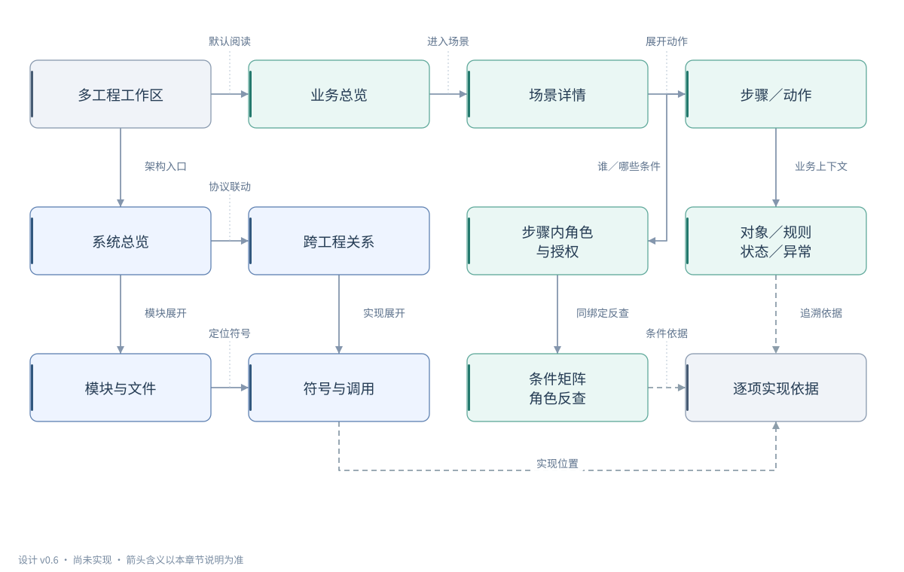

### 怎么读这张图

1. 从“多工程工作区”进入“业务总览”，再选择场景和具体步骤，先理解要做什么。
2. “系统总览”“模块与文件”“符号与调用”帮助你从技术结构找到实现位置。
3. 步骤里的角色、授权和业务规则都要回到“逐项实现依据”核对；箭头表示阅读关联。

### 举个小例子

想知道采购申请如何审批，可以先打开审批场景，再查看审批动作、金额规则、参与角色和对应代码。

### 节点的通俗解释

| 图中名称 | 通俗解释 |
|---|---|
| 多工程工作区 | 把要分析的一个或多个工程集中登记，先确认阅读范围和分析环境。 |
| 业务总览 | 像业务目录一样列出可查看的场景，帮助你先了解系统提供什么能力。 |
| 场景详情 | 围绕一个业务目标说明如何触发、经过哪些步骤，以及输入和输出是什么。 |
| 步骤／动作 | 把一件业务拆成具体动作，分别说明操作对象、业务规则和参与角色。 |
| 系统总览 | 从应用、服务和数据资源看目标工程全貌，再选择要深入的技术部分。 |
| 跨工程关系 | 查看不同工程如何通过请求或资源关联，追踪前后端之间的实现线索。 |
| 步骤内角色 与授权 | 在当前动作里解释谁可以参与、需满足哪些授权条件，以及能操作哪些数据。 |
| 对象／规则 状态／异常 | 说明当前动作处理什么、受哪些业务规则限制，并呈现状态变化和异常出口。 |
| 模块与文件 | 按模块和文件查看代码如何组织、相互引用，帮助缩小阅读或修改范围。 |
| 符号与调用 | 深入函数、类和方法，查看它们可能引用或调用谁，再核对对应源码。 |
| 条件矩阵 角色反查 | 按同一组步骤比较不同角色的动作条件，也能从角色反查相关业务。 |
| 逐项实现依据 | 为每项说明找到对应源码或配置，核对结论依据，并查看还有哪些缺口。 |

### 专业说明与设计边界

表达设计中的阅读入口与信息组织关系，不表示分析器执行顺序，也不表示目标工程的真实执行轨迹。默认从业务总览进入场景，再逐步看动作、对象、规则和授权；架构及符号视图帮助追溯实现。

- 本图为设计阅读材料，CodeCartia 的 CLI、产品 Web 与自动分析器尚未实现；已有体验原型和采购示例不代表产品分析验收通过，技术候选、模式、预算与准入门槛仍待验证和冻结。
- 首版验证 JS/TS（含 Vue、React、Node.js、Next.js 及相关源码输入）和 Python；Java、C#、C、C++ 的验证整体延后，不阻塞首版，也不计为通过。业务、步骤授权、协议及质量要求继续约束首版范围。
- 角色筛选只改变查看范围；不代为登录目标工程，也不授予权限。
- 每个动作分别保留对象、入口、身份域和数据条件；不把跨场景允许结果取并集。
- 没有运行证据时，图中的关联与动画不表示真实执行、耗时或生产使用。

依据：[设计 v0.6](../CodeCartia-设计方案.md)（第 3.1–3.4 节：主要流程、四种关系视图与业务步骤阅读；第 5 节：初版语言范围）；[项目当前状态](../../README.md)（产品目标、当前目录与未实现声明）

[下载 SVG](svgs/overview.svg) · [编辑 Mermaid 图源](sources/overview.mmd)

查看 Mermaid 图源

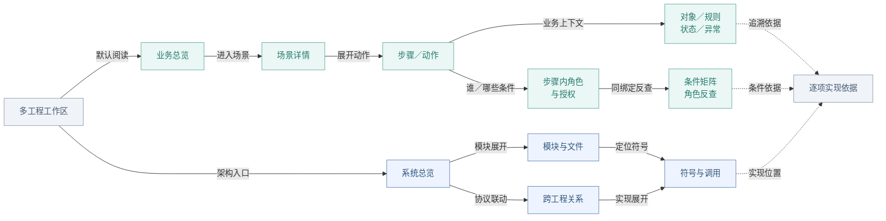

## 02 组件、进程与读取边界

哪些组件协作，谁可以读取哪些输入？

### 一句话看懂

CodeCartia 计划读取指定工程，分工分析代码，保存带依据的结果，再通过本地浏览器展示。

本图描述 CodeCartia 自身的规划架构；首版只验证 JS/TS 和 Python，其他语言 worker 保留为后续扩展。CLI、产品 Web 和自动分析器尚未实现。

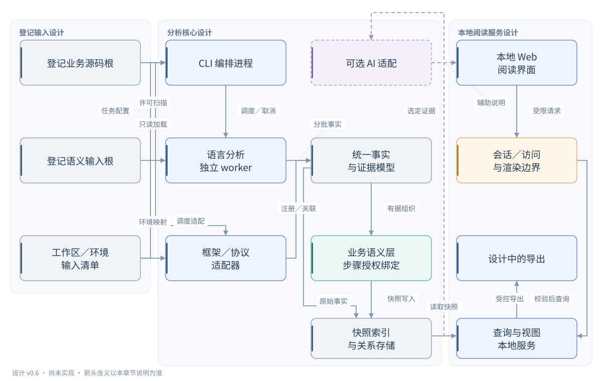

### 怎么读这张图

1. 输入清单限定要读哪些工程和辅助资料；CLI 像任务管理员，安排语言和框架的分析工作。
2. 分析发现先进入统一事实模型；有业务依据时再组织场景和步骤授权，原始事实也能独立保存。
3. 查询服务把保存的结果提供给本地 Web；AI 是可选说明助手，箭头表示信息或接口依赖。

### 举个小例子

分析一个前后端工程时，语言分析组件查出函数关系，框架适配器关联请求和接口，阅读界面把有据结果展示出来。

### 节点的通俗解释

| 图中名称 | 通俗解释 |
|---|---|
| 登记业务源码根 | 明确允许工具扫描的业务源码目录，让分析范围可查看、可控制。 |
| 登记语义输入根 | 登记帮助读懂 JS/TS、Python 的类型、库和存根资料，缺失时保留说明。 |
| 工作区／环境 输入清单 | 记录本次选定的工程、环境和输入，避免把不同配置的分析结果混在一起。 |
| CLI 编排进程 | 像任务管理员一样安排分析工作，检查所需工具，管理进度、取消和结果快照。 |
| JS/TS · Python 独立 worker | 首版分析 JS/TS 和 Python，提取函数、类型和调用关系；其他语言保留后续接入设计。 |
| 框架／协议 适配器 | 理解框架和通信约定，把组件、请求、接口以及实际权限检查关联起来。 |
| 可选 AI 适配 | 可选的说明助手，根据选定证据补充解释或线索；关闭后仍可使用核心静态功能。 |
| 统一事实 与证据模型 | 把不同分析组件的发现整理成统一格式，保留来源、条件和未确认的线索。 |
| 业务语义层 步骤授权绑定 | 依据代码关系组织业务场景，并把参与角色和授权条件绑定到具体动作。 |
| 快照索引 与关系存储 | 保存各次分析的原始发现、关系和业务结果；尚未关联场景的事实也能保留。 |
| 本地 Web 阅读界面 | 在本地浏览器中阅读代码地图、业务步骤和授权条件，并追溯相关依据。 |
| 会话／访问 与渲染边界 | 检查谁在访问本地服务、能读取哪些内容，并让工程文本安全地显示在页面中。 |
| 设计中的导出 | 把选定结果保存为图或文档，保留条件、来源和缺口，便于离线阅读与分享。 |
| 查询与视图 本地服务 | 从同一份结果中查找场景、代码关系和角色条件，供页面和导出使用。 |

### 专业说明与设计边界

表达组件职责、进程关系和读取边界；节点均为设计组件。语言 worker 的工具实现、存储、Web 与布局框架均未锁定。箭头表示数据或接口依赖，不承诺具体部署拓扑、线程数或严格执行顺序。

- 本图为设计阅读材料，CodeCartia 的 CLI、产品 Web 与自动分析器尚未实现；已有体验原型和采购示例不代表产品分析验收通过，技术候选、模式、预算与准入门槛仍待验证和冻结。
- 首版候选：CLI TypeScript/Node.js；Web React/TypeScript/Vite＋pnpm；语义工具 TypeScript Compiler API、Vue SFC 编译器、Python AST 与类型辅助。相关框架版本、模式与依赖仍待验证。
- Java、C#、C、C++ 及 JDT、Roslyn、Clang 的专属验证延后；Spring、ASP.NET 及涉及这些语言的完整实现链路随之延后。独立 worker 与统一事实契约保留扩展能力，延后项不计为已支持或验收通过。
- 候选：SQLite＋快照文件、Cytoscape.js＋ELK.js；全部需要原型、平台与许可证验证，不能视为已采纳。
- 目标源码只读；不启动目标应用、不自动执行构建脚本、编译数据库 command，不自动构建、生成或下载缺失输入。
- 业务索引排除规则不直接充当 worker 读取禁令；外部语义输入与通用 Web 文件访问采用不同边界。
- 原始事实沿独立路径保存；未识别框架、未绑定实际检查或尚未关联业务时，保留事实、证据及诊断，不要求先有场景或步骤授权绑定。

依据：[设计 v0.6](../CodeCartia-设计方案.md)（第 4.1–5 节：实现候选、适配器、worker 与初版语言范围；第 8–9.1 节：服务、输入及渲染边界）；[待决策清单](../decisions/M1-待决策清单.md)（D02、D10、D11：版本、工程选型与云端 AI 未决定）

[下载 SVG](svgs/architecture.svg) · [编辑 Mermaid 图源](sources/architecture.mmd)

查看 Mermaid 图源

```mermaid
flowchart LR
  %% 设计图解；未实现。初版验证 JS/TS、Python，Java/C#/C/C++ 后续验证。箭头含义见本图说明。
  business_roots["登记业务源码根"]:::data
  semantic_roots["登记语义输入根"]:::data
  workspace_config["工作区／环境<br/>输入清单"]:::data
  cli["CLI 编排进程"]:::core
  workers["JS/TS · Python<br/>独立 worker"]:::core
  adapters["框架／协议<br/>适配器"]:::core
  ai["可选 AI 适配"]:::optional
  facts["统一事实<br/>与证据模型"]:::data
  business_layer["业务语义层<br/>步骤授权绑定"]:::business
  store["快照索引<br/>与关系存储"]:::data
  web["本地 Web<br/>阅读界面"]:::core
  session["会话／访问<br/>与渲染边界"]:::warning
  export["设计中的导出"]:::core
  query["查询与视图<br/>本地服务"]:::core
  business_roots -- "许可扫描" --> cli
  semantic_roots -- "只读加载" --> workers
  workspace_config -- "任务配置" --> cli
  workspace_config -- "环境映射" --> adapters
  cli -- "调度／取消" --> workers
  cli -- "调度适配" --> adapters
  workers -- "分批事实" --> facts
  adapters -- "注册／关联" --> facts
  facts -- "原始事实" --> store
  facts -- "有据组织" --> business_layer
  business_layer -- "快照写入" --> store
  store -- "读取快照" --> query
  web -- "受限请求" --> session
  session -- "校验后查询" --> query
  query -- "受控导出" --> export
  query -. "选定证据" .-> ai
  ai -. "辅助说明" .-> web
  classDef core fill:#eef4ff,stroke:#6082b2,color:#31577e
  classDef data fill:#f0f3f8,stroke:#8a9aaf,color:#475b73
  classDef business fill:#eaf7f4,stroke:#60a99b,color:#24796d
  classDef optional fill:#f4effb,stroke:#ac93c5,color:#80619f,stroke-dasharray:6 4
  classDef warning fill:#fff6e8,stroke:#d6ab6a,color:#a87931
```

## 03 分析数据流与部分结果

源码如何成为图，缺输入或分析失败时显示什么？

### 一句话看懂

CodeCartia 计划把指定版本的源码整理成有依据的关系和业务步骤，同时明确哪些地方还没分析清楚。

本图描述首版 JS/TS、Python 的分析信息流设计，共用契约也保留后续语言扩展；箭头不代表目标工程运行轨迹，产品分析验收尚未完成。

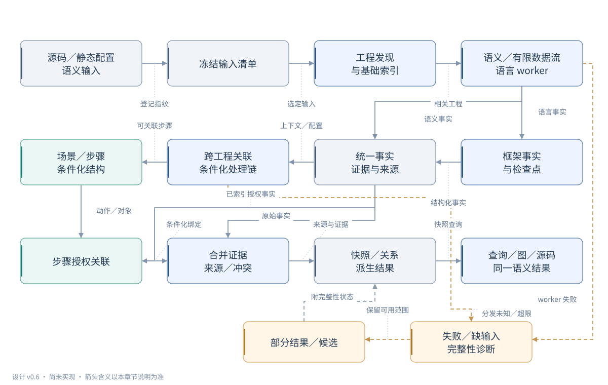

### 怎么读这张图

1. 先看“输入”和“冻结输入清单”：一次分析应使用同一套源码、配置和分析规则。
2. 语言和框架发现进入“统一事实”，原始事实可直接保存；场景与授权有依据后补充，不强制串行到达。
3. 遇到缺输入、失败或超限时，看“诊断”和“部分结果”，保留能确认的部分并标明缺口。

### 举个小例子

找到了页面请求但缺少后端路由配置时，先保留请求和源码依据，并说明后端关联尚未确认。

### 节点的通俗解释

| 图中名称 | 通俗解释 |
|---|---|
| 源码／静态配置 语义输入 | 本次允许分析的源码、配置和辅助资料；独立验收答案不能混入分析输入。 |
| 冻结输入清单 | 固定一次分析使用的文件、配置和规则版本，让结果能够重现和核对。 |
| 工程发现 与基础索引 | 先识别工程结构、文件、声明和入口；找到语法结构还不代表深度分析完成。 |
| 语义／有限数据流 JS/TS · Python | 首版读懂 JS/TS、Python 的变量作用范围、类型和调用关系，在支持模式内追踪值如何传递。 |
| 框架事实 与检查点 | 结合代码和配置识别路由、组件、身份及权限检查，区别声明和实际生效位置。 |
| 统一事实 证据与来源 | 接收语言和框架的原始发现，保存条件与依据，不等业务场景齐全才记录。 |
| 跨工程关联 条件化处理链 | 核对不同工程之间的请求和处理路径，地址相似只能先作为待确认线索。 |
| 场景／步骤 条件化结构 | 依据入口、动作和对象组织业务步骤，缺少下游实现时明确保留边界。 |
| 步骤授权关联 | 把具体步骤和主体、角色、策略及数据范围关联；没关联成功的声明仍保留。 |
| 合并证据 来源／冲突 | 汇集各组件的发现及独立依据，保留不同条件、冲突和未关联事实的诊断。 |
| 快照／关系 派生结果 | 保存同一输入版本上的事实、场景和条件，记录结果完整性供后续查询。 |
| 查询／图／源码 同一语义结果 | 让图、文字、角色反查和源码阅读使用同一份结果，减少各页面说明脱节。 |
| 部分结果／候选 | 展示仍有依据的局部发现，同时标明未确认范围，避免把部分结果当完整分析。 |
| 失败／缺输入 完整性诊断 | 说明缺少什么输入、哪里失败或超限，让用户知道哪些结果需要继续核对。 |

### 专业说明与设计边界

表达静态分析的信息依赖与结果组织。图中的场景组织和授权绑定不是 worker 必须遵守的串行完成顺序；相同冻结输入下，场景与授权事实的到达次序不得改变最终语义。图不启动目标工程，也不表示其运行流程。

- 本图为设计阅读材料，CodeCartia 的 CLI、产品 Web 与自动分析器尚未实现；已有体验原型和采购示例不代表产品分析验收通过，技术候选、模式、预算与准入门槛仍待验证和冻结。
- HTTP 地址匹配仅生成候选；依据框架版本、注册顺序/优先级及条件控制转移推导可达处理链。
- 授权、角色声明可先于场景识别；先保留事实，业务依据补齐后建立步骤绑定，不丢弃先到事实。
- 首版 JS/TS、Python 的语义、框架、传播和授权模式及预算待 M1 冻结；缺必要上下文的部分结果不能计为深度分析完成。Java、C#、C、C++ 延后验证，不以缺失实验阻塞初版，也不记为通过。
- 来源继承完整依赖链；AI 或人工输入参与的推导不得洗成纯自动结果。
- 语言事实可直接进入统一模型并合并索引；框架识别、场景组织与步骤授权绑定分别补充结果。未关联或框架未识别不导致原始事实被丢弃，也不被计为对应深度能力已完成。

依据：[设计 v0.6](../CodeCartia-设计方案.md)（第 4.2、5、6.2–6.3、7.1–7.4、8.2 节）；[合成验收 v0.3](../CodeCartia-业务场景与权限验收样例.md)（BS05 与 AP07-P4：无 AI 运行、事实到达顺序等价）

[下载 SVG](svgs/analysis.svg) · [编辑 Mermaid 图源](sources/analysis.mmd)

查看 Mermaid 图源

```mermaid
flowchart LR
  %% 设计图解；未实现。初版验证 JS/TS、Python，Java/C#/C/C++ 后续验证。箭头含义见本图说明。
  input["源码／静态配置<br/>语义输入"]:::data
  freeze["冻结输入清单"]:::data
  discover["工程发现<br/>与基础索引"]:::core
  semantic["语义／有限数据流<br/>JS/TS · Python"]:::core
  framework["框架事实<br/>与检查点"]:::core
  facts["统一事实<br/>证据与来源"]:::data
  links["跨工程关联<br/>条件化处理链"]:::core
  scenario["场景／步骤<br/>条件化结构"]:::business
  binding["步骤授权关联"]:::business
  merge["合并证据<br/>来源／冲突"]:::core
  snapshot["快照／关系<br/>派生结果"]:::data
  read["查询／图／源码<br/>同一语义结果"]:::core
  partial["部分结果／候选"]:::warning
  diagnosis["失败／缺输入<br/>完整性诊断"]:::warning
  input -- "登记指纹" --> freeze
  freeze -- "选定输入" --> discover
  discover -- "相关工程" --> semantic
  semantic -- "语义事实" --> facts
  semantic -- "语言事实" --> framework
  framework -- "结构化事实" --> facts
  facts -- "上下文／配置" --> links
  links -- "可关联步骤" --> scenario
  scenario -- "动作／对象" --> binding
  facts -- "原始事实" --> merge
  facts -- "已索引授权事实" --> binding
  binding -- "条件化绑定" --> merge
  merge -- "来源与证据" --> snapshot
  snapshot -- "快照查询" --> read
  semantic -. "worker 失败" .-> diagnosis
  links -. "分发未知／超限" .-> diagnosis
  diagnosis -. "保留可用范围" .-> partial
  partial -. "附完整性状态" .-> snapshot
  classDef core fill:#eef4ff,stroke:#6082b2,color:#31577e
  classDef data fill:#f0f3f8,stroke:#8a9aaf,color:#475b73
  classDef business fill:#eaf7f4,stroke:#60a99b,color:#24796d
  classDef optional fill:#f4effb,stroke:#ac93c5,color:#80619f,stroke-dasharray:6 4
  classDef warning fill:#fff6e8,stroke:#d6ab6a,color:#a87931
```

## 04 场景、步骤与授权实体关系

角色和权限如何跨场景复用，又不丢失动作条件？

### 一句话看懂

CodeCartia 计划用一套共享关系，把业务动作、操作对象、参与角色和授权条件连在一起。

本图描述 CodeCartia 的信息模型设计，概念关系尚未通过产品分析验收。

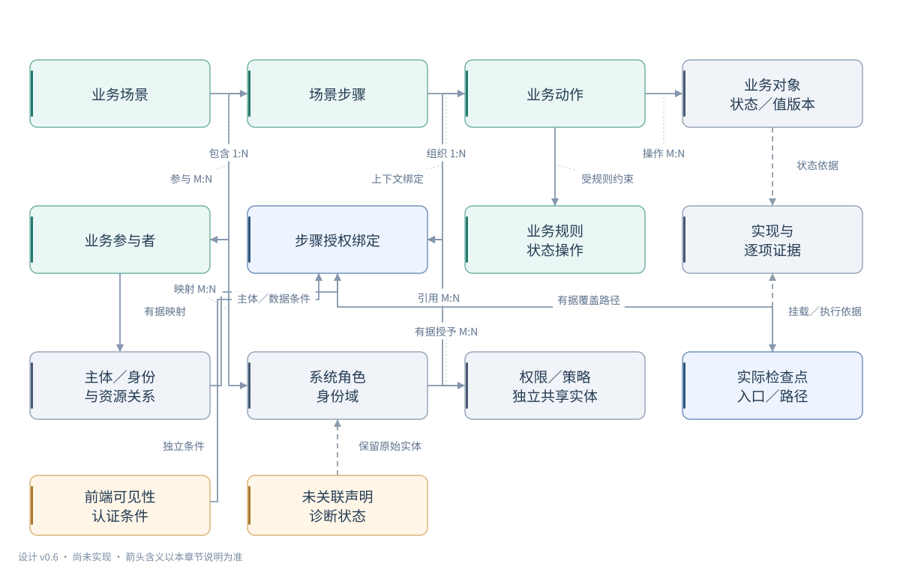

### 怎么读这张图

1. 从“业务场景”找到步骤和动作，再看动作处理哪个对象、遵守什么业务规则。
2. “步骤授权绑定”同时保存入口／调用／配置、动作、对象／数据范围和当前有效主体；不同动作的条件不能互相套用。
3. 区分参与者映射、有效主体取得角色、角色或主体获授权限、绑定引用策略，以及检查点按路径条件执行策略。
4. 1:N 表示一个可关联多个，M:N 表示两边都可复用；角色和独立权限只在有据时适用，未关联声明仍保留证据和诊断。

### 举个小例子

在采购 B0 示例中，manager 可读取同租户自己的申请，但审批禁止自审；同一角色在两个动作里的条件不同。

### 节点的通俗解释

| 图中名称 | 通俗解释 |
|---|---|
| 业务场景 | 表示一个有依据的业务目标，关联它的入口、步骤、输入和输出。 |
| 场景步骤 入口／调用上下文 | 表示场景中的一个环节，并保留该入口、调用和配置；这些上下文直接进入授权绑定。 |
| 业务动作 | 表示读取、修改或审批等具体操作；使用同一权限的不同动作仍分别记录。 |
| 业务对象 状态／值版本 | 表示动作处理的业务数据，并区分读取和写入的状态、对象及值版本。 |
| 业务规则 状态操作 | 说明业务本身的校验、计算和状态操作，例如审批金额限制及失败出口。 |
| 业务参与者 | 申请人、审批人等业务称谓；有据映射说明职责或候选人，不能替代实际角色取得和权限授予。 |
| 当前入口有效主体 身份上下文 | 表示当前路径实际用于授权的身份，角色取得和直接授予需有依据；服务身份不能自动继承上游用户角色。 |
| 步骤授权绑定 上下文关联记录 | 关联当前步骤、入口、动作、对象、有效身份与检查路径，并有据引用权限和策略；它本身不是被授予的权限。 |
| 实际检查点 入口／路径 | 表示代码中真正挂载并适用的检查位置；只有策略声明还不能证明检查生效。 |
| 实现与 逐项证据 | 把每个结论连到直接支持或反对它的代码、配置和来源，方便逐项核对。 |
| 系统角色 身份域 | 表示某个身份范围内的系统角色，可被多个场景引用，同名角色不自动合并。 |
| 独立权限标识 | 表示目标工程实际使用的权限标识，可由角色或主体有据取得；多个动作可引用同一权限。 |
| 实际授权策略 | 表示目标工程实际怎样判定允许或拒绝；它与权限标识分别记录，也可以直接使用主体属性或资源关系。 |
| 前端可见性 认证条件 | 分别说明按钮是否可见和是否需要认证，前端显示状态不能替代后端授权。 |
| 未关联声明 诊断状态 | 已发现角色或策略但还没连到业务时，保留原始证据并说明缺口，不虚构场景。 |

### 专业说明与设计边界

表达概念关系与查询结构，箭头不表示解析先后或目标工程运行顺序。场景、步骤、动作、对象、主体、角色、权限、策略及检查点有独立身份；步骤授权绑定是上下文关联记录，引用权限与策略，并连接当前入口、动作、对象、有效主体和实际覆盖路径。角色反查与条件矩阵复用同一绑定。

- 本图为设计阅读材料，CodeCartia 的 CLI、产品 Web 与自动分析器尚未实现；已有体验原型和采购示例不代表产品分析验收通过，技术候选、模式、预算与准入门槛仍待验证和冻结。
- 图中 1:N、M:N 表示设计允许的结构复用，不要求每个对象必须有全部关联；每条实际关系保留条件和来源，检查点执行策略只表示有据的条件路径，不证明某次运行已执行。
- 同名不同身份域的角色不合并；参与者映射只说明业务职责或候选人选择，不替代当前有效主体的实际角色取得或权限授予；同一主体可有多个有据角色。
- 入口、调用与配置、对象与数据范围、有效主体及检查覆盖路径分别进入绑定；跨服务或消息入口按身份取得／转换证据绑定下游主体，不继承未经证明的上游角色。
- 角色与独立权限标识分支仅在目标工程存在对应依据时适用；无角色的属性／资源关系策略直接经主体、对象和动作绑定策略，不编造角色或权限。
- 权限标识与授权策略是独立共享实体；授予关系指向权限，绑定引用权限／策略，检查点按路径条件执行策略；不把目标工程策略组合与 CodeCartia 识别规则组合混用。
- 适用上游检查可按有据覆盖路径复用，不要求每个内部函数新建权限；前端可见性与认证分别作为独立说明，不能替代后端授权。
- 未关联声明保留实体与原始证据；图中诊断到角色的连线仅为保留关系示意，同样适用于权限和策略，不创建虚构场景、不删除仍有独立支持的实体。

依据：[设计 v0.6](../CodeCartia-设计方案.md)（第 6.4–6.5 节：场景模型、实体复用及步骤授权绑定）；[合成验收 v0.3](../CodeCartia-业务场景与权限验收样例.md)（B0 §2.1、BS01、AP01/AP03/AP04、AP07-P2/P3/N3：参与者映射、有效主体、无角色策略、共享实体与未关联诊断）

[下载 SVG](svgs/model.svg) · [编辑 Mermaid 图源](sources/model.mmd)

查看 Mermaid 图源

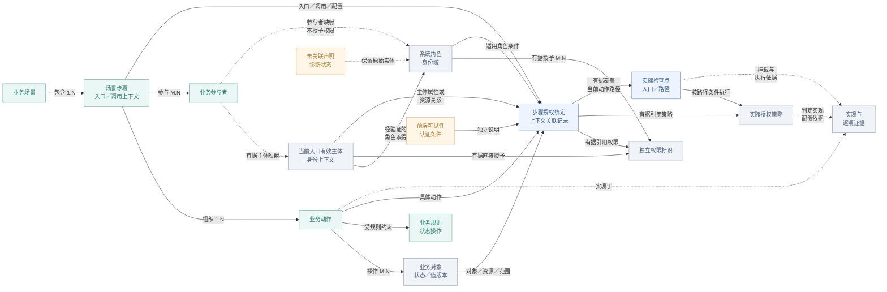

## 05 合成采购审批：授权、业务与提交

manager 能审批什么，金额超限或回执失败意味着什么？

### 一句话看懂

采购审批示例说明：身份和授权、业务校验、事务提交、回执发送是不同环节，要分别判断结果。

本图解释合成采购示例的业务，经理权限属于示例工程；已有示例源码，自动分析与 BS/AP 验收尚未完成。

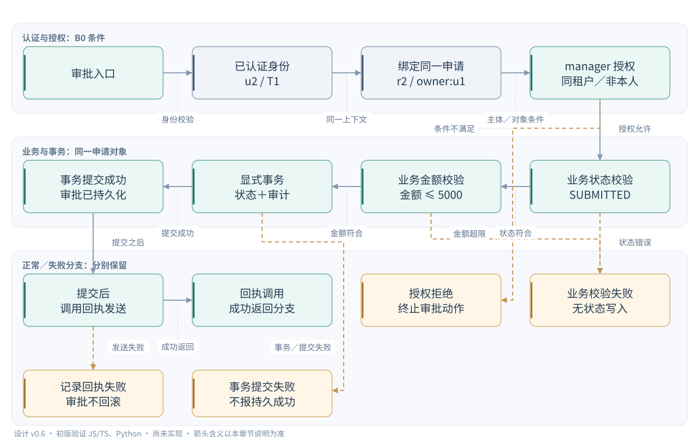

### 怎么读这张图

1. 先确认当前身份和同一张申请，再检查审批角色、租户和是否自审；不满足授权条件会走拒绝分支。
2. 获得授权后，还要检查申请状态和金额；只有事务提交成功的路径才能支持审批已保存。
3. 回执在提交后发送；图中成功和失败是规格里的代码分支，回执失败不会撤销已提交的审批。

### 举个小例子

示例中经理 u2 审批同租户、属于 u1 的 1000 元已提交申请；条件满足且事务提交成功的路径才表示批准已保存。

### 节点的通俗解释

| 图中名称 | 通俗解释 |
|---|---|
| 审批入口 | 示例里的审批接口，进入此动作时应用已绑定的认证和审批授权检查。 |
| 已认证身份 u2 / T1 | 示例当前主体为经理 u2，属于租户 T1；身份取自认证上下文而非请求自报。 |
| 绑定同一申请 r2 / owner:u1 | 本次处理同一张 r2 申请，所有者是 u1；后续条件和状态操作都围绕它核对。 |
| manager 授权 同租户／非本人 | 示例允许同租户的经理审批别人的申请；角色名称不能绕过租户和非本人条件。 |
| 业务状态校验 SUBMITTED | 获得授权后仍要检查申请已处于提交状态，否则返回业务错误且不写入批准状态。 |
| 业务金额校验 金额 ≤ 5000 | 示例审批金额不能超过 5000 元；超限属于业务校验失败，不等于没有审批权限。 |
| 显式事务 状态＋审计 | 把批准状态更新和审计写入放进同一事务，写入动作本身还不能证明提交成功。 |
| 事务提交成功 审批已持久化 | 规格中事务提交成功的分支才支持批准状态和审计已保存，图示不代表线上发生。 |
| 提交后 调用回执发送 | 在审批提交成功后调用回执发送；调用发送接口不等于用户已经收到消息。 |
| 回执调用 成功返回分支 | 表示示例回执调用成功返回的代码分支，需要运行证据才能确认实际送达。 |
| 授权拒绝 终止审批动作 | 角色、租户或非本人条件不满足时终止审批；缺少检查依据时仍应标为未知。 |
| 业务校验失败 无状态写入 | 申请状态不符或金额超限时不进行审批写入，即使此前已经获得授权。 |
| 记录回执失败 审批不回滚 | 示例会记录回执失败，但保留此前已提交的审批，不额外推断重试或通知成功。 |
| 事务提交失败 不报持久成功 | 事务提交失败的分支不能报告批准已保存，也不能从异常捕获推断补偿完成。 |

### 专业说明与设计边界

表达验收样例 B0 中源码/配置应支持的条件路径。示例指定已认证 u2=manager/T1 处理同一对象 r2=(owner:u1, tenant:T1, state:SUBMITTED, amount:1000)，并展开拒绝、业务失败、提交失败与回执失败。本图按合成规格解释条件路径，不代表自动分析结果、实际账号或线上执行记录；对象绑定节点表示后续检查使用同一已取得对象，不承诺未规定的数据库读取时机。

- 全部节点按合成规格解读；仓库已有采购示例源码，但本图的 F.* 仍作为逻辑证据标签，不代表自动分析结果或 BS/AP 产品分析验收已完成。
- 仅采用 B0；不加入 AP02 的有序策略变体或 AP04 的消息身份变体。manager 没有默认角色继承。
- 认证与前端可见性、后端授权分别表达：审批按钮仅检查 manager，不能证明同租户、非所有者或业务校验通过。
- B0 的已绑定授权检查对适用允许规则取任一满足，无允许匹配则拒绝；此默认不适用于所有工程或未覆盖入口。
- r3 金额 6000 的对照可以授权通过但业务金额校验失败；授权允许不等于审批已提交。
- 状态更新和审计必须在同一显式事务中，只有提交成功路径支持持久结果。回执失败被记录，已提交审批不回滚；不额外推断补偿、重试或外部实际送达。

依据：[合成验收 v0.3](../CodeCartia-业务场景与权限验收样例.md)（第 2.1–2.2 节 B0；BS02-P1/P2/N1、AP01 与 AP03）；[设计 v0.6](../CodeCartia-设计方案.md)（第 6.4–6.5、7.4 节：对象/提交证据、授权与业务成功分离）

[下载 SVG](svgs/scenario.svg) · [编辑 Mermaid 图源](sources/scenario.mmd)

查看 Mermaid 图源

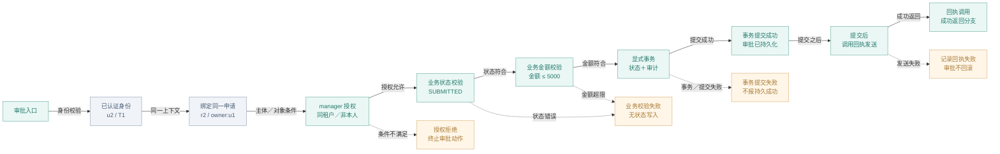

## 06 业务阅读、角色反查与证据导航

怎样从业务问题查到依据，再从角色或源码返回原步骤？

### 一句话看懂

CodeCartia 计划让你从业务步骤看角色和代码，也能从角色或代码返回同一业务上下文。

本图描述 CodeCartia 阅读界面的导航设计，查看顺序不代表业务执行顺序，产品分析验收尚未完成。

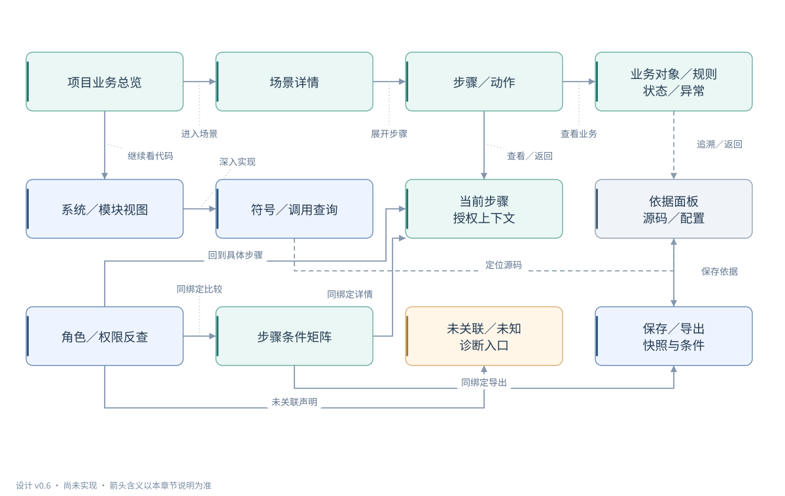

### 怎么读这张图

1. 沿“业务总览 → 场景详情 → 步骤”阅读，逐步查看操作对象、业务规则和授权条件。
2. “角色反查”和“条件矩阵”复用同一组步骤关系；角色筛选只改变阅读范围，不切换身份或授予权限。
3. 通过“依据面板”核对源码与配置，再返回原步骤；保存和导出也要带上条件、来源与缺口。

### 举个小例子

查询 manager 关联的动作后，可以分别打开读取和审批步骤，核对各自的数据范围，再定位支持这些条件的代码。

### 节点的通俗解释

| 图中名称 | 通俗解释 |
|---|---|
| 项目业务总览 | 先浏览工程有哪些可查看的业务场景，同时了解已知范围和未解析数量。 |
| 场景详情 | 查看所选业务的目标和步骤，从角色或代码返回时仍保留原入口条件。 |
| 步骤／动作 | 选中具体动作后，围绕同一对象阅读业务规则、参与角色和授权条件。 |
| 业务对象／规则 状态／异常 | 在当前动作里查看处理对象、业务校验、状态变化和异常，不把授权等同成功。 |
| 系统／模块视图 | 从应用和服务进入模块、文件，与业务关系相互跳转，继续追踪实现位置。 |
| 符号／调用查询 | 查找函数及调用关系，也能反查相关场景；共享函数不意味着业务场景相同。 |
| 当前步骤 授权上下文 | 保留当前步骤的入口、主体、对象和授权条件，让详情与角色反查指向同一关系。 |
| 依据面板 源码／配置 | 展开每项说明的源码、配置和推导依据，核对后可带着原上下文返回步骤。 |
| 角色／权限反查 | 从角色或权限找出关联的场景和动作，再分别查看各动作的条件与数据范围。 |
| 步骤条件矩阵 | 像对照表一样比较各步骤的认证、授权和业务条件，不把角色能力简化成无条件勾选。 |
| 未关联／未知 诊断入口 | 集中查看未关联声明、未知检查和其他缺口，避免把没发现检查当作允许访问。 |
| 保存／导出 快照与条件 | 保存或分享当前视图时带上快照、条件和来源，移除源码后也要说明缺失内容。 |

### 专业说明与设计边界

表达用户阅读导航设计，箭头表示查看入口和返回关联，不表示目标业务执行。场景详情、授权上下文、角色反查、矩阵与导出必须引用同一组场景/步骤/动作/对象/入口绑定；不会生成与业务脱节的角色功能表。

- 本图为设计阅读材料，CodeCartia 的 CLI、产品 Web 与自动分析器尚未实现；已有体验原型和采购示例不代表产品分析验收通过，技术候选、模式、预算与准入门槛仍待验证和冻结。
- 按 manager 反查读取与审批时分别保留动作条件：同租户自己的申请可读取，但 B0 审批禁止自审。
- 同一权限绑定列表与详情时，保留列表集合范围与详情指定对象检查，不把两者合并。
- 搜索和历史返回、文字链路、键盘导航属于设计目标；隐藏节点数量、候选和未解析范围须可见。
- 导出允许移除绝对路径或源码，但保留证据 ID、配置、条件、来源、缺口与过期状态。

依据：[设计 v0.6](../CodeCartia-设计方案.md)（第 3.1–3.4、8.4 节：阅读导航、四种关系视图、导出）；[合成验收 v0.3](../CodeCartia-业务场景与权限验收样例.md)（BS04、AP07-P1/P2/P3/N2/N3：双向导航、同条件矩阵与未关联诊断）

[下载 SVG](svgs/navigation.svg) · [编辑 Mermaid 图源](sources/navigation.mmd)

查看 Mermaid 图源

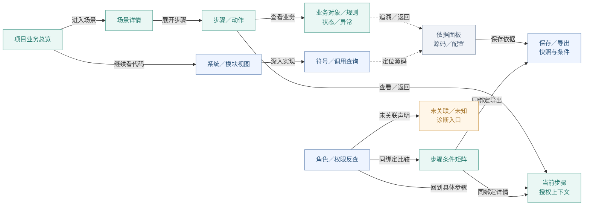

## 07 快照失效、增量更新与历史保留

只改配置、新增候选或回退规则时，哪些结果必须更新？

### 一句话看懂

代码或配置变化后，CodeCartia 计划更新受影响的分析结果，标记过期内容，并保留历史快照。

本图描述 CodeCartia 的快照更新设计，增量与全量等价尚未通过产品分析验收。

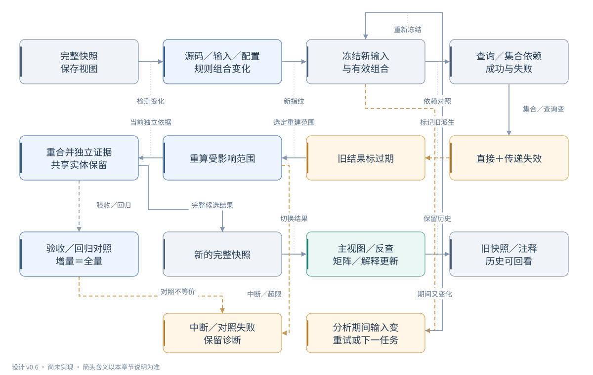

### 怎么读这张图

1. 从“变化”找到依赖它的查询和关系，沿依赖标记失效；新增候选和曾经失败的查询也要检查。
2. 旧结果先标过期，再按新输入重算受影响范围；完成后发布同一版本的完整结果，历史仍可回看。
3. “增量＝全量”是验收和回归对照，不要求每次更新都全量分析；影响范围不明时才按需要扩大重建。

### 举个小例子

例如审批金额门槛从 5000 改为 4000，相关业务规则与说明需重算，旧快照仍能回看当时的依据。

### 节点的通俗解释

| 图中名称 | 通俗解释 |
|---|---|
| 完整快照 保存视图 | 记录当前完整结果及其输入版本，保存的阅读视图仍指向这份快照。 |
| 源码／输入／配置 规则组合变化 | 代码、辅助输入、路由、身份配置或识别规则变化，都可能影响旧分析结论。 |
| 冻结新输入 与有效组合 | 为下一次分析固定新的文件和规则组合，防止结果混用不同版本的输入。 |
| 查询／集合依赖 成功与失败 | 记录查询查过什么范围、有哪些候选；查找失败也可能因后续新增内容而改变。 |
| 直接＋传递失效 | 沿依赖找出直接和间接受影响的结果，让相关场景、反查和说明一起过期。 |
| 旧结果标过期 | 提醒读者旧说明尚未按新代码核对，更新完成前不能当作当前工程依据。 |
| 重算受影响范围 | 按新版本重算受影响部分；范围无法确定时扩大到相关工程或全量重建。 |
| 重合并独立证据 共享实体保留 | 重新汇集仍有效的独立依据；其他场景仍支持的角色和策略不会随一条关系一起删除。 |
| 验收／回归对照 增量＝全量 | 在验收和回归中比较同输入的增量与全量结果，不是每次更新都必须执行的任务。 |
| 新的完整快照 | 相关重算和合并完成后发布同一输入版本的完整快照，中断结果不能替换它。 |
| 主视图／反查 矩阵／解释更新 | 根据更新后的同一组步骤关系同步刷新场景、角色反查、条件矩阵和解释。 |
| 旧快照／注释 历史可回看 | 保留旧快照和注释，方便回看当时依据，同时明确它们属于历史版本。 |
| 中断／对照失败 保留诊断 | 分析中断时保留完整旧结果；验收对照失败时保存差异和诊断，等待修正复测。 |
| 分析期间输入变 重试或下一任务 | 分析期间文件变化时重试或安排下一任务，避免发布混合新旧输入的完整结果。 |

### 专业说明与设计边界

表达设计中的分析快照更新过程。变化来自源码、语义输入、路由顺序、身份/策略配置或有效识别规则组合；原始事实、步骤绑定、角色反查、矩阵和解释沿依赖失效。正常增量重建受影响范围并发布同一冻结输入版本的完整快照；同输入增量／全量等价对照通过验收和回归旁路验证契约，不作为每次增量发布必须执行的全量任务。当前完整结果与历史快照分别维护。

- 本图为设计阅读材料，CodeCartia 的 CLI、产品 Web 与自动分析器尚未实现；已有体验原型和采购示例不代表产品分析验收通过，技术候选、模式、预算与准入门槛仍待验证和冻结。
- 成功查询依赖完整候选集合，失败查询也登记依赖；新增第二候选或补齐原缺输入都要重算，不能只追踪已经选中目标。
- 路由注册集合包含有语义的顺序、挂载、分发优先级和转交条件；策略顺序与下游有效身份变化不能按无序集合比较。
- 范围无法精确确定时扩大到相关工程/配置，必要时全量重建；不能继续复用可能过期的确认结果。
- 删除场景或一条绑定不删除其他场景独立支持的共享角色/策略；仍存在但无场景绑定的声明进入未关联诊断。
- 增量与全量比较只忽略快照 ID、时间戳与无语义输出顺序；条件、证据、来源、候选、诊断和上下文必须等价。
- 正常增量沿受影响范围重建并发布完整快照；同输入全量重建在验收／回归旁路中验证等价，保留对照来源和差异报告，不要求每次增量更新都执行全量分析。范围无法安全缩小时所需的全量重建，另由失效范围决定。

依据：[设计 v0.6](../CodeCartia-设计方案.md)（第 8.2 节：缓存键、查询/集合依赖、快照发布与增量等价；第 13.6 节：规则回退）；[合成验收 v0.3](../CodeCartia-业务场景与权限验收样例.md)（BS04、AP06、AP07：入口/阈值、顺序/身份、共享绑定与回退对照）

[下载 SVG](svgs/incremental.svg) · [编辑 Mermaid 图源](sources/incremental.mmd)

查看 Mermaid 图源

```mermaid
flowchart LR
  %% 设计图解；未实现。初版验证 JS/TS、Python，Java/C#/C/C++ 后续验证。箭头含义见本图说明。
  current["完整快照<br/>保存视图"]:::data
  change["源码／输入／配置<br/>规则组合变化"]:::core
  freeze["冻结新输入<br/>与有效组合"]:::data
  queries["查询／集合依赖<br/>成功与失败"]:::data
  invalidate["直接＋传递失效"]:::warning
  stale["旧结果标过期"]:::warning
  recompute["重算受影响范围"]:::core
  merge["重合并独立证据<br/>共享实体保留"]:::core
  compare["验收／回归对照<br/>增量＝全量"]:::core
  publish["新的完整快照"]:::data
  views["主视图／反查<br/>矩阵／解释更新"]:::business
  history["旧快照／注释<br/>历史可回看"]:::data
  incomplete["中断／对照失败<br/>保留诊断"]:::warning
  input_moved["分析期间输入变<br/>重试或下一任务"]:::warning
  current -- "检测变化" --> change
  change -- "新指纹" --> freeze
  freeze -- "依赖对照" --> queries
  queries -- "集合／查询变" --> invalidate
  invalidate -. "标记旧派生" .-> stale
  stale -- "选定重建范围" --> recompute
  recompute -- "当前独立依据" --> merge
  merge -- "完整候选结果" --> publish
  merge -. "验收／回归" .-> compare
  publish -- "切换结果" --> views
  views -- "保留历史" --> history
  recompute -. "中断／超限" .-> incomplete
  compare -. "对照不等价" .-> incomplete
  freeze -. "期间又变化" .-> input_moved
  input_moved -- "重新冻结" --> freeze
  classDef core fill:#eef4ff,stroke:#6082b2,color:#31577e
  classDef data fill:#f0f3f8,stroke:#8a9aaf,color:#475b73
  classDef business fill:#eaf7f4,stroke:#60a99b,color:#24796d
  classDef optional fill:#f4effb,stroke:#ac93c5,color:#80619f,stroke-dasharray:6 4
  classDef warning fill:#fff6e8,stroke:#d6ab6a,color:#a87931
```

## 08 跨项目规则改进、固化与回退

一次漏连如何成为可复用规则，回归后如何退回？

### 一句话看懂

CodeCartia 计划把错连和漏连转成候选识别规则，经过独立核对和测试后再推广，出现问题时可以回退。

本图描述 CodeCartia 识别规则的改进设计，不改变目标工程的授权策略，闭环尚未通过产品分析验收。

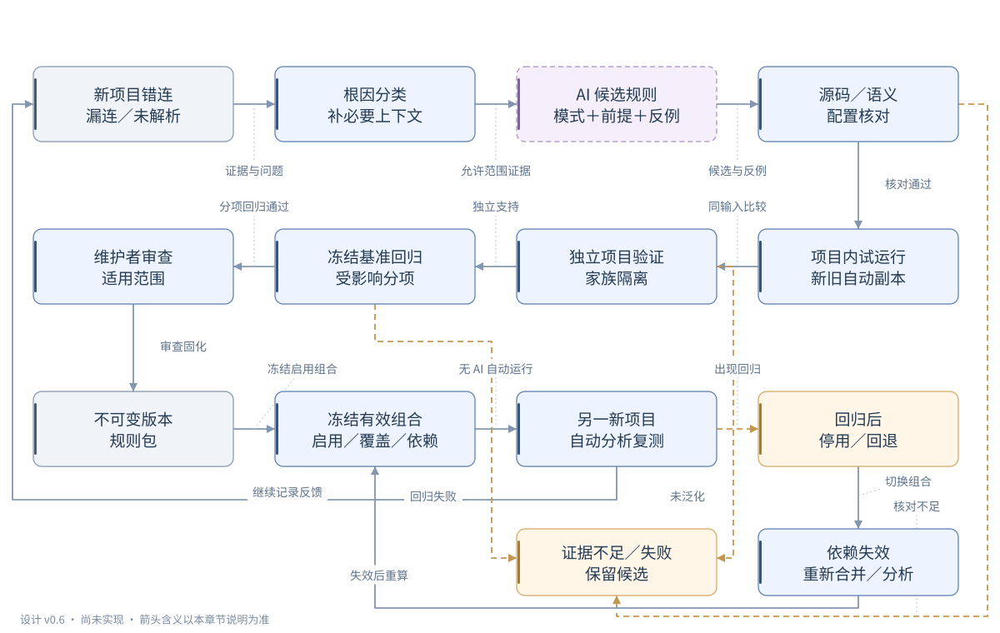

### 怎么读这张图

1. 先查清问题原因并补齐必要输入；AI 可辅助提出候选，但建议和反馈本身不能证明规则正确。
2. 候选先在副本试运行，再用未参与生成的独立项目和冻结基准验证；失败时保留候选及诊断。
3. 经过维护者审查的规则才进入版本包；启用、停用或回退后重算受影响结果，固化规则可无 AI 运行。

### 举个小例子

某工程的请求封装导致接口漏连时，可提出识别封装的候选规则，再用其他独立工程验证，确认后才推广。

### 节点的通俗解释

| 图中名称 | 通俗解释 |
|---|---|
| 新项目错连 漏连／未解析 | 记录发现的错连、漏连或未解析线索，附上源码依据，反馈本身仍需核对。 |
| 根因分类 补必要上下文 | 先判断问题来自缺输入、分析错误还是动态行为，避免用新规则掩盖环境缺口。 |
| AI 候选规则 模式＋前提＋反例 | AI 可提出识别模式、前提和反例；这些只是候选建议，不能直接当作正确规则。 |
| 源码／语义 配置核对 | 独立核对源码、符号和配置是否支持候选，确认反馈预期有足够依据。 |
| 项目内试运行 新旧自动副本 | 在相同输入上比较新旧自动分析副本，候选结果不会直接覆盖正式代码地图。 |
| 独立项目验证 家族隔离 | 用未参与规则生成和调参的独立项目验证，复制仓库或相同模板不算独立样本。 |
| 冻结基准回归 受影响分项 | 用冻结基准复查受影响能力，确认候选没有带来新的错连、遗漏或条件错误。 |
| 维护者审查 适用范围 | 由维护者核对适用范围和验证报告，再决定作为项目专用规则还是推广使用。 |
| 不可变版本 规则包 | 把已审查规则保存为有固定版本和指纹的规则包，连同依赖与验证报告留档。 |
| 冻结有效组合 启用／覆盖／依赖 | 记录本次真正启用的规则、依赖和显式覆盖，确保分析结果可重现并保留冲突。 |
| 另一新项目 自动分析复测 | 在另一个独立工程自动复测固化规则，验证推广效果；运行规则不必再调用 AI。 |
| 回归后 停用／回退 | 后续发现回归时可停用或退回旧规则版本，并重新计算受影响的结果。 |
| 证据不足／失败 保留候选 | 证据不足或验证失败的规则先保留为候选，记录问题，不能进入正式确认结果。 |
| 依赖失效 重新合并／分析 | 规则组合变化后让相关旧推导失效，用仍有效的独立依据重新合并和分析。 |

### 专业说明与设计边界

表达 CodeCartia 识别规则的设计闭环，与目标工程的授权策略执行语义无关。候选试运行重建自动副本快照，不覆盖正式图；经证据核对、独立项目验证、冻结基准回归和维护者审查后，才进入版本化规则包。规则应用、停用与回退都改变有效组合并触发重算。

- 本图为设计阅读材料，CodeCartia 的 CLI、产品 Web 与自动分析器尚未实现；已有体验原型和采购示例不代表产品分析验收通过，技术候选、模式、预算与准入门槛仍待验证和冻结。
- 新旧试运行采用相同冻结输入与基准，关闭分析时 AI 与人工覆盖，仅改变待评估规则及明确声明的有效组合。
- 按项目家族隔离发现、开发验证与保留测试；同提交、fork、复制模块及生成模板不算独立项目。保留项目源码/标注不提供给规则生成 AI，也不用于调参。
- 受限声明规则可以匹配、绑定、传播和校验证据；AI 生成的任意程序不直接执行，需修改分析器的建议进入普通代码审查。
- 兼容结论累加并保留独立证据；冲突不因优先级高而自动确认；覆盖要显式声明、可核验且在当前组合中启用。
- 候选业务/授权规则改进的是识别，不替代目标工程授权策略；固化规则可无 AI 自动运行，但保留 AI 生成来源与验证记录。
- 反馈与画像默认本地；云端证据范围由用户选定，实际服务、调用范围及成本仍待 D11，不自动上传私有代码。

依据：[设计 v0.6](../CodeCartia-设计方案.md)（第 13.1–13.6 节：跨项目闭环、有效组合、家族隔离、独立验证与回退）；[待决策清单](../decisions/M1-待决策清单.md)（D04、D05、D06、D07、D08、D11：模式/预算/准入与云端调用待证据）

[下载 SVG](svgs/rules.svg) · [编辑 Mermaid 图源](sources/rules.mmd)

查看 Mermaid 图源

```mermaid
flowchart LR
  %% 设计图解；未实现。初版验证 JS/TS、Python，Java/C#/C/C++ 后续验证。箭头含义见本图说明。
  feedback["新项目错连<br/>漏连／未解析"]:::data
  triage["根因分类<br/>补必要上下文"]:::core
  candidate["AI 候选规则<br/>模式＋前提＋反例"]:::optional
  verify["源码／语义<br/>配置核对"]:::core
  trial["项目内试运行<br/>新旧自动副本"]:::core
  independent["独立项目验证<br/>家族隔离"]:::core
  regression["冻结基准回归<br/>受影响分项"]:::core
  review["维护者审查<br/>适用范围"]:::core
  package["不可变版本<br/>规则包"]:::data
  effective["冻结有效组合<br/>启用／覆盖／依赖"]:::core
  new_project["另一新项目<br/>自动分析复测"]:::core
  rollback["回归后<br/>停用／回退"]:::warning
  quarantine["证据不足／失败<br/>保留候选"]:::warning
  rebuild["依赖失效<br/>重新合并／分析"]:::core
  feedback -- "证据与问题" --> triage
  triage -- "允许范围证据" --> candidate
  candidate -- "候选与反例" --> verify
  verify -- "核对通过" --> trial
  trial -- "同输入比较" --> independent
  independent -- "独立支持" --> regression
  regression -- "分项回归通过" --> review
  review -- "审查固化" --> package
  package -- "冻结启用组合" --> effective
  effective -- "无 AI 自动运行" --> new_project
  new_project -. "出现回归" .-> rollback
  new_project -- "继续记录反馈" --> feedback
  verify -. "核对不足" .-> quarantine
  independent -. "未泛化" .-> quarantine
  regression -. "回归失败" .-> quarantine
  rollback -- "切换组合" --> rebuild
  rebuild -- "失效后重算" --> effective
  classDef core fill:#eef4ff,stroke:#6082b2,color:#31577e
  classDef data fill:#f0f3f8,stroke:#8a9aaf,color:#475b73
  classDef business fill:#eaf7f4,stroke:#60a99b,color:#24796d
  classDef optional fill:#f4effb,stroke:#ac93c5,color:#80619f,stroke-dasharray:6 4
  classDef warning fill:#fff6e8,stroke:#d6ab6a,color:#a87931
```

