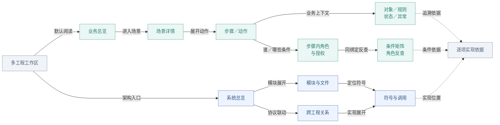
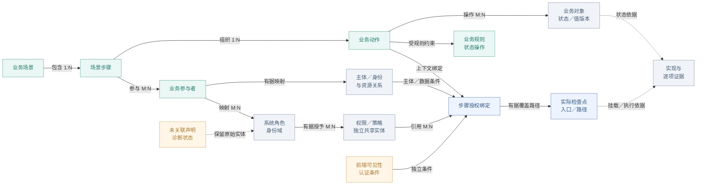
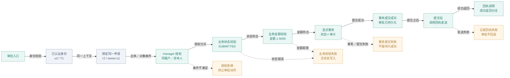
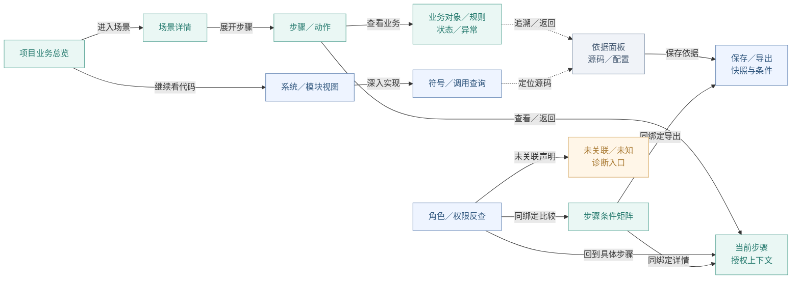

# CodeCartia 架构与设计图解

> 图解版本：0.1｜依据：设计 v0.6、推进 v0.4、验收样例 v0.3｜日期：2026-11-09

本图解解释已确认的产品设计。当前 M1-01 文档已交付，M1 基线未冻结、G1 未通过；
应用、分析 worker、可执行原型及 BS/AP 验收均未实现或执行。图中的技术选型仍为候选。

[打开离线交互图解](index.html) · [图源与维护方法](README.md) · [完整设计](../CodeCartia-设计方案.md)

按产品全景、系统架构、分析流程、核心模型、业务示例、界面导航、快照变化和规则改进阅读。
各图箭头分别表示阅读关系、信息依赖或合成目标工程的条件路径，不能混作真实运行记录。

## 01 产品阅读全景

从哪里读起，角色与源码放在哪里？

表达设计中的阅读入口与信息组织关系，不表示分析器执行顺序，也不表示目标工程的真实执行轨迹。默认从业务总览进入场景，再逐步看动作、对象、规则和授权；架构及符号视图帮助追溯实现。

- 本图为设计阅读材料，CodeCartia 应用与验证原型尚未实现；技术候选、模式、预算与准入门槛仍待验证和冻结。
- 角色筛选只改变查看范围；不代为登录目标工程，也不授予权限。
- 每个动作分别保留对象、入口、身份域和数据条件；不把跨场景允许结果取并集。
- 没有运行证据时，图中的关联与动画不表示真实执行、耗时或生产使用。

依据：[设计 v0.6](../CodeCartia-设计方案.md)（第 3.1–3.4 节：主要流程、四种关系视图与业务步骤阅读）；[项目当前状态](../../README.md)（产品目标、当前目录与未实现声明）

[下载 SVG](svgs/overview.svg) · [编辑 Mermaid 图源](sources/overview.mmd)

查看 Mermaid 图源

## 02 组件、进程与读取边界

哪些组件协作，谁可以读取哪些输入？

表达组件职责、进程关系和读取边界；节点均为设计组件。语言 worker 的工具实现、存储、Web 与布局框架均未锁定。箭头表示数据或接口依赖，不承诺具体部署拓扑、线程数或严格执行顺序。

- 本图为设计阅读材料，CodeCartia 应用与验证原型尚未实现；技术候选、模式、预算与准入门槛仍待验证和冻结。
- 候选：CLI TypeScript/Node.js；Web React/TypeScript/Vite＋pnpm；语义工具 TypeScript Compiler API、Vue SFC 编译器、JDT、Roslyn、Clang，Python AST 与类型辅助。
- 候选：SQLite＋快照文件、Cytoscape.js＋ELK.js；全部需要原型、平台与许可证验证，不能视为已采纳。
- 目标源码只读；不启动目标应用、不自动执行构建脚本、编译数据库 command，不自动构建、生成或下载缺失输入。
- 业务索引排除规则不直接充当 worker 读取禁令；外部语义输入与通用 Web 文件访问采用不同边界。
- 原始事实沿独立路径保存；未识别框架、未绑定实际检查或尚未关联业务时，保留事实、证据及诊断，不要求先有场景或步骤授权绑定。

依据：[设计 v0.6](../CodeCartia-设计方案.md)（第 4.1–4.2 节：实现候选、适配器与 worker；第 8–9.1 节：服务、输入及渲染边界）；[待决策清单](../decisions/M1-待决策清单.md)（D02、D10、D11：版本、工程选型与云端 AI 未决定）

[下载 SVG](svgs/architecture.svg) · [编辑 Mermaid 图源](sources/architecture.mmd)

```mermaid
flowchart LR
  %% 设计图解；未实现。箭头含义见本图说明。
  business_roots["登记业务源码根"]:::data
  semantic_roots["登记语义输入根"]:::data
  workspace_config["工作区／环境<br/>输入清单"]:::data
  cli["CLI 编排进程"]:::core
  workers["语言分析<br/>独立 worker"]:::core
  adapters["框架／协议<br/>适配器"]:::core
  ai["可选 AI 适配"]:::optional
  facts["统一事实<br/>与证据模型"]:::data
  business_layer["业务语义层<br/>步骤授权绑定"]:::business
  store["快照索引<br/>与关系存储"]:::data
  web["本地 Web<br/>阅读界面"]:::core
  session["会话／访问<br/>与渲染边界"]:::warning
  export["设计中的导出"]:::core
  query["查询与视图<br/>本地服务"]:::core
  business_roots -- "许可扫描" --> cli
  semantic_roots -- "只读加载" --> workers
  workspace_config -- "任务配置" --> cli
  workspace_config -- "环境映射" --> adapters
  cli -- "调度／取消" --> workers
  cli -- "调度适配" --> adapters
  workers -- "分批事实" --> facts
  adapters -- "注册／关联" --> facts
  facts -- "原始事实" --> store
  facts -- "有据组织" --> business_layer
  business_layer -- "快照写入" --> store
  store -- "读取快照" --> query
  web -- "受限请求" --> session
  session -- "校验后查询" --> query
  query -- "受控导出" --> export
  query -. "选定证据" .-> ai
  ai -. "辅助说明" .-> web
  classDef core fill:#eef4ff,stroke:#6082b2,color:#31577e
  classDef data fill:#f0f3f8,stroke:#8a9aaf,color:#475b73
  classDef business fill:#eaf7f4,stroke:#60a99b,color:#24796d
  classDef optional fill:#f4effb,stroke:#ac93c5,color:#80619f,stroke-dasharray:6 4
  classDef warning fill:#fff6e8,stroke:#d6ab6a,color:#a87931
```

查看 Mermaid 图源

## 03 分析数据流与部分结果

源码如何成为图，缺输入或分析失败时显示什么？

表达静态分析的信息依赖与结果组织。图中的场景组织和授权绑定不是 worker 必须遵守的串行完成顺序；相同冻结输入下，场景与授权事实的到达次序不得改变最终语义。图不启动目标工程，也不表示其运行流程。

- 本图为设计阅读材料，CodeCartia 应用与验证原型尚未实现；技术候选、模式、预算与准入门槛仍待验证和冻结。
- HTTP 地址匹配仅生成候选；依据框架版本、注册顺序/优先级及条件控制转移推导可达处理链。
- 授权、角色声明可先于场景识别；先保留事实，业务依据补齐后建立步骤绑定，不丢弃先到事实。
- 语义、框架、传播和授权模式及预算待 M1 冻结；缺编译上下文的部分结果不能计为该语言深度分析完成。
- 来源继承完整依赖链；AI 或人工输入参与的推导不得洗成纯自动结果。
- 语言事实可直接进入统一模型并合并索引；框架识别、场景组织与步骤授权绑定分别补充结果。未关联或框架未识别不导致原始事实被丢弃，也不被计为对应深度能力已完成。

依据：[设计 v0.6](../CodeCartia-设计方案.md)（第 4.2、5.2–5.4、6.2–6.3、7.1–7.4、8.2 节）；[合成验收 v0.3](../CodeCartia-业务场景与权限验收样例.md)（BS05 与 AP07-P4：无 AI 运行、事实到达顺序等价）

[下载 SVG](svgs/analysis.svg) · [编辑 Mermaid 图源](sources/analysis.mmd)

```mermaid
flowchart LR
  %% 设计图解；未实现。箭头含义见本图说明。
  input["源码／静态配置<br/>语义输入"]:::data
  freeze["冻结输入清单"]:::data
  discover["工程发现<br/>与基础索引"]:::core
  semantic["语义／有限数据流<br/>语言 worker"]:::core
  framework["框架事实<br/>与检查点"]:::core
  facts["统一事实<br/>证据与来源"]:::data
  links["跨工程关联<br/>条件化处理链"]:::core
  scenario["场景／步骤<br/>条件化结构"]:::business
  binding["步骤授权关联"]:::business
  merge["合并证据<br/>来源／冲突"]:::core
  snapshot["快照／关系<br/>派生结果"]:::data
  read["查询／图／源码<br/>同一语义结果"]:::core
  partial["部分结果／候选"]:::warning
  diagnosis["失败／缺输入<br/>完整性诊断"]:::warning
  input -- "登记指纹" --> freeze
  freeze -- "选定输入" --> discover
  discover -- "相关工程" --> semantic
  semantic -- "语义事实" --> facts
  semantic -- "语言事实" --> framework
  framework -- "结构化事实" --> facts
  facts -- "上下文／配置" --> links
  links -- "可关联步骤" --> scenario
  scenario -- "动作／对象" --> binding
  facts -- "原始事实" --> merge
  facts -- "已索引授权事实" --> binding
  binding -- "条件化绑定" --> merge
  merge -- "来源与证据" --> snapshot
  snapshot -- "快照查询" --> read
  semantic -. "worker 失败" .-> diagnosis
  links -. "分发未知／超限" .-> diagnosis
  diagnosis -. "保留可用范围" .-> partial
  partial -. "附完整性状态" .-> snapshot
  classDef core fill:#eef4ff,stroke:#6082b2,color:#31577e
  classDef data fill:#f0f3f8,stroke:#8a9aaf,color:#475b73
  classDef business fill:#eaf7f4,stroke:#60a99b,color:#24796d
  classDef optional fill:#f4effb,stroke:#ac93c5,color:#80619f,stroke-dasharray:6 4
  classDef warning fill:#fff6e8,stroke:#d6ab6a,color:#a87931
```

查看 Mermaid 图源

## 04 场景、步骤与授权实体关系

角色和权限如何跨场景复用，又不丢失动作条件？

表达概念关系与查询结构，箭头不表示解析先后或目标工程运行顺序。场景、步骤、动作、对象、主体、角色、权限、策略及检查点有独立身份；步骤授权绑定连接它们，角色反查与条件矩阵复用同一绑定。

- 本图为设计阅读材料，CodeCartia 应用与验证原型尚未实现；技术候选、模式、预算与准入门槛仍待验证和冻结。
- 图中 1:N、M:N 表示设计允许的结构复用；不是要求每个对象必须有全部关联。每条实际关系仍需证据。
- 同名不同身份域的角色不合并；业务参与者名称与系统角色不自动等价，候选人映射不额外授予权限。
- 适用上游检查可按有据覆盖路径复用，不要求每个内部函数新建权限。无角色的属性策略可直接连接主体与动作绑定。
- 权限与策略仍是独立实体类别，图中合并成一个展示节点只为控制图规模；不把目标工程策略组合与 CodeCartia 识别规则组合混用。
- 未关联声明保持实体与原始证据；不创建虚构场景、不删除仍有独立支持的角色或策略。

依据：[设计 v0.6](../CodeCartia-设计方案.md)（第 6.4–6.5 节：场景模型、实体复用及步骤授权绑定）；[合成验收 v0.3](../CodeCartia-业务场景与权限验收样例.md)（B0 §2.1、BS01、AP07-P2/P3/N3：参与者映射、跨场景/多动作复用与未关联诊断）

[下载 SVG](svgs/model.svg) · [编辑 Mermaid 图源](sources/model.mmd)

查看 Mermaid 图源

## 05 合成采购审批：授权、业务与提交

manager 能审批什么，金额超限或回执失败意味着什么？

表达验收样例 B0 中源码/配置应支持的条件路径。示例指定已认证 u2=manager/T1 处理同一对象 r2=(owner:u1, tenant:T1, state:SUBMITTED, amount:1000)，并展开拒绝、业务失败、提交失败与回执失败。它不是已存在源码、实际账号或线上执行记录；对象绑定节点表示后续检查使用同一已取得对象，不承诺未规定的数据库读取时机。

- 全部节点为合成示例，规格尚未制作成可执行样例或运行验收；F.* 是待映射到样例源码/配置的逻辑证据标签。
- 仅采用 B0；不加入 AP02 的有序策略变体或 AP04 的消息身份变体。manager 没有默认角色继承。
- 认证与前端可见性、后端授权分别表达：审批按钮仅检查 manager，不能证明同租户、非所有者或业务校验通过。
- B0 的已绑定授权检查对适用允许规则取任一满足，无允许匹配则拒绝；此默认不适用于所有工程或未覆盖入口。
- r3 金额 6000 的对照可以授权通过但业务金额校验失败；授权允许不等于审批已提交。
- 状态更新和审计必须在同一显式事务中，只有提交成功路径支持持久结果。回执失败被记录，已提交审批不回滚；不额外推断补偿、重试或外部实际送达。

依据：[合成验收 v0.3](../CodeCartia-业务场景与权限验收样例.md)（第 2.1–2.2 节 B0；BS02-P1/P2/N1、AP01 与 AP03）；[设计 v0.6](../CodeCartia-设计方案.md)（第 6.4–6.5、7.4 节：对象/提交证据、授权与业务成功分离）

[下载 SVG](svgs/scenario.svg) · [编辑 Mermaid 图源](sources/scenario.mmd)

查看 Mermaid 图源

## 06 业务阅读、角色反查与证据导航

怎样从业务问题查到依据，再从角色或源码返回原步骤？

表达用户阅读导航设计，箭头表示查看入口和返回关联，不表示目标业务执行。场景详情、授权上下文、角色反查、矩阵与导出必须引用同一组场景/步骤/动作/对象/入口绑定；不会生成与业务脱节的角色功能表。

- 本图为设计阅读材料，CodeCartia 应用与验证原型尚未实现；技术候选、模式、预算与准入门槛仍待验证和冻结。
- 按 manager 反查读取与审批时分别保留动作条件：同租户自己的申请可读取，但 B0 审批禁止自审。
- 同一权限绑定列表与详情时，保留列表集合范围与详情指定对象检查，不把两者合并。
- 搜索和历史返回、文字链路、键盘导航属于设计目标；隐藏节点数量、候选和未解析范围须可见。
- 导出允许移除绝对路径或源码，但保留证据 ID、配置、条件、来源、缺口与过期状态。

依据：[设计 v0.6](../CodeCartia-设计方案.md)（第 3.1–3.4、8.4 节：阅读导航、四种关系视图、导出）；[合成验收 v0.3](../CodeCartia-业务场景与权限验收样例.md)（BS04、AP07-P1/P2/P3/N2/N3：双向导航、同条件矩阵与未关联诊断）

[下载 SVG](svgs/navigation.svg) · [编辑 Mermaid 图源](sources/navigation.mmd)

查看 Mermaid 图源

## 07 快照失效、增量更新与历史保留

只改配置、新增候选或回退规则时，哪些结果必须更新？

表达设计中的分析快照更新过程。变化来自源码、语义输入、路由顺序、身份/策略配置或有效识别规则组合；原始事实、步骤绑定、角色反查、矩阵和解释沿依赖失效。正常增量重建受影响范围并发布同一冻结输入版本的完整快照；同输入增量／全量等价对照通过验收和回归旁路验证契约，不作为每次增量发布必须执行的全量任务。当前完整结果与历史快照分别维护。

- 本图为设计阅读材料，CodeCartia 应用与验证原型尚未实现；技术候选、模式、预算与准入门槛仍待验证和冻结。
- 成功查询依赖完整候选集合，失败查询也登记依赖；新增第二候选或补齐原缺输入都要重算，不能只追踪已经选中目标。
- 路由注册集合包含有语义的顺序、挂载、分发优先级和转交条件；策略顺序与下游有效身份变化不能按无序集合比较。
- 范围无法精确确定时扩大到相关工程/配置，必要时全量重建；不能继续复用可能过期的确认结果。
- 删除场景或一条绑定不删除其他场景独立支持的共享角色/策略；仍存在但无场景绑定的声明进入未关联诊断。
- 增量与全量比较只忽略快照 ID、时间戳与无语义输出顺序；条件、证据、来源、候选、诊断和上下文必须等价。
- 正常增量沿受影响范围重建并发布完整快照；同输入全量重建在验收／回归旁路中验证等价，保留对照来源和差异报告，不要求每次增量更新都执行全量分析。范围无法安全缩小时所需的全量重建，另由失效范围决定。

依据：[设计 v0.6](../CodeCartia-设计方案.md)（第 8.2 节：缓存键、查询/集合依赖、快照发布与增量等价；第 13.6 节：规则回退）；[合成验收 v0.3](../CodeCartia-业务场景与权限验收样例.md)（BS04、AP06、AP07：入口/阈值、顺序/身份、共享绑定与回退对照）

[下载 SVG](svgs/incremental.svg) · [编辑 Mermaid 图源](sources/incremental.mmd)

```mermaid
flowchart LR
  %% 设计图解；未实现。初版验证 JS/TS、Python，Java/C#/C/C++ 后续验证。箭头含义见本图说明。
  current["完整快照<br/>保存视图"]:::data
  change["源码／输入／配置<br/>规则组合变化"]:::core
  freeze["冻结新输入<br/>与有效组合"]:::data
  queries["查询／集合依赖<br/>成功与失败"]:::data
  invalidate["直接＋传递失效"]:::warning
  stale["旧结果标过期"]:::warning
  recompute["重算受影响范围"]:::core
  merge["重合并独立证据<br/>共享实体保留"]:::core
  compare["验收／回归对照<br/>增量＝全量"]:::core
  publish["新的完整快照"]:::data
  views["主视图／反查<br/>矩阵／解释更新"]:::business
  history["旧快照／注释<br/>历史可回看"]:::data
  incomplete["中断／对照失败<br/>保留诊断"]:::warning
  input_moved["分析期间输入变<br/>重试或下一任务"]:::warning
  current -- "检测变化" --> change
  change -- "新指纹" --> freeze
  freeze -- "依赖对照" --> queries
  queries -- "集合／查询变" --> invalidate
  invalidate -. "标记旧派生" .-> stale
  stale -- "选定重建范围" --> recompute
  recompute -- "当前独立依据" --> merge
  merge -- "完整候选结果" --> publish
  merge -. "验收／回归" .-> compare
  publish -- "切换结果" --> views
  views -- "保留历史" --> history
  recompute -. "中断／超限" .-> incomplete
  compare -. "对照不等价" .-> incomplete
  freeze -. "期间又变化" .-> input_moved
  input_moved -- "重新冻结" --> freeze
  classDef core fill:#eef4ff,stroke:#6082b2,color:#31577e
  classDef data fill:#f0f3f8,stroke:#8a9aaf,color:#475b73
  classDef business fill:#eaf7f4,stroke:#60a99b,color:#24796d
  classDef optional fill:#f4effb,stroke:#ac93c5,color:#80619f,stroke-dasharray:6 4
  classDef warning fill:#fff6e8,stroke:#d6ab6a,color:#a87931
```

查看 Mermaid 图源

## 08 跨项目规则改进、固化与回退

一次漏连如何成为可复用规则，回归后如何退回？

表达 CodeCartia 识别规则的设计闭环，与目标工程的授权策略执行语义无关。候选试运行重建自动副本快照，不覆盖正式图；经证据核对、独立项目验证、冻结基准回归和维护者审查后，才进入版本化规则包。规则应用、停用与回退都改变有效组合并触发重算。

- 本图为设计阅读材料，CodeCartia 应用与验证原型尚未实现；技术候选、模式、预算与准入门槛仍待验证和冻结。
- 新旧试运行采用相同冻结输入与基准，关闭分析时 AI 与人工覆盖，仅改变待评估规则及明确声明的有效组合。
- 按项目家族隔离发现、开发验证与保留测试；同提交、fork、复制模块及生成模板不算独立项目。保留项目源码/标注不提供给规则生成 AI，也不用于调参。
- 受限声明规则可以匹配、绑定、传播和校验证据；AI 生成的任意程序不直接执行，需修改分析器的建议进入普通代码审查。
- 兼容结论累加并保留独立证据；冲突不因优先级高而自动确认；覆盖要显式声明、可核验且在当前组合中启用。
- 候选业务/授权规则改进的是识别，不替代目标工程授权策略；固化规则可无 AI 自动运行，但保留 AI 生成来源与验证记录。
- 反馈与画像默认本地；云端证据范围由用户选定，实际服务、调用范围及成本仍待 D11，不自动上传私有代码。

依据：[设计 v0.6](../CodeCartia-设计方案.md)（第 13.1–13.6 节：跨项目闭环、有效组合、家族隔离、独立验证与回退）；[待决策清单](../decisions/M1-待决策清单.md)（D04、D05、D06、D07、D08、D11：模式/预算/准入与云端调用待证据）

[下载 SVG](svgs/rules.svg) · [编辑 Mermaid 图源](sources/rules.mmd)

```mermaid
flowchart LR
  %% 设计图解；未实现。初版验证 JS/TS、Python，Java/C#/C/C++ 后续验证。箭头含义见本图说明。
  feedback["新项目错连<br/>漏连／未解析"]:::data
  triage["根因分类<br/>补必要上下文"]:::core
  candidate["AI 候选规则<br/>模式＋前提＋反例"]:::optional
  verify["源码／语义<br/>配置核对"]:::core
  trial["项目内试运行<br/>新旧自动副本"]:::core
  independent["独立项目验证<br/>家族隔离"]:::core
  regression["冻结基准回归<br/>受影响分项"]:::core
  review["维护者审查<br/>适用范围"]:::core
  package["不可变版本<br/>规则包"]:::data
  effective["冻结有效组合<br/>启用／覆盖／依赖"]:::core
  new_project["另一新项目<br/>自动分析复测"]:::core
  rollback["回归后<br/>停用／回退"]:::warning
  quarantine["证据不足／失败<br/>保留候选"]:::warning
  rebuild["依赖失效<br/>重新合并／分析"]:::core
  feedback -- "证据与问题" --> triage
  triage -- "允许范围证据" --> candidate
  candidate -- "候选与反例" --> verify
  verify -- "核对通过" --> trial
  trial -- "同输入比较" --> independent
  independent -- "独立支持" --> regression
  regression -- "分项回归通过" --> review
  review -- "审查固化" --> package
  package -- "冻结启用组合" --> effective
  effective -- "无 AI 自动运行" --> new_project
  new_project -. "出现回归" .-> rollback
  new_project -- "继续记录反馈" --> feedback
  verify -. "核对不足" .-> quarantine
  independent -. "未泛化" .-> quarantine
  regression -. "回归失败" .-> quarantine
  rollback -- "切换组合" --> rebuild
  rebuild -- "失效后重算" --> effective
  classDef core fill:#eef4ff,stroke:#6082b2,color:#31577e
  classDef data fill:#f0f3f8,stroke:#8a9aaf,color:#475b73
  classDef business fill:#eaf7f4,stroke:#60a99b,color:#24796d
  classDef optional fill:#f4effb,stroke:#ac93c5,color:#80619f,stroke-dasharray:6 4
  classDef warning fill:#fff6e8,stroke:#d6ab6a,color:#a87931
```

查看 Mermaid 图源

